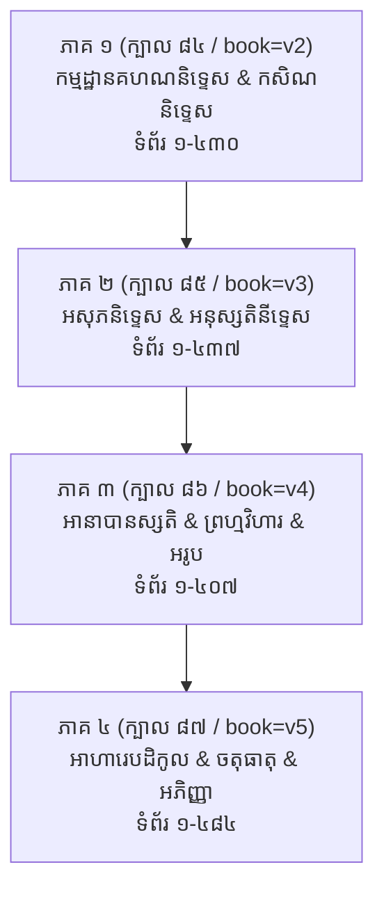
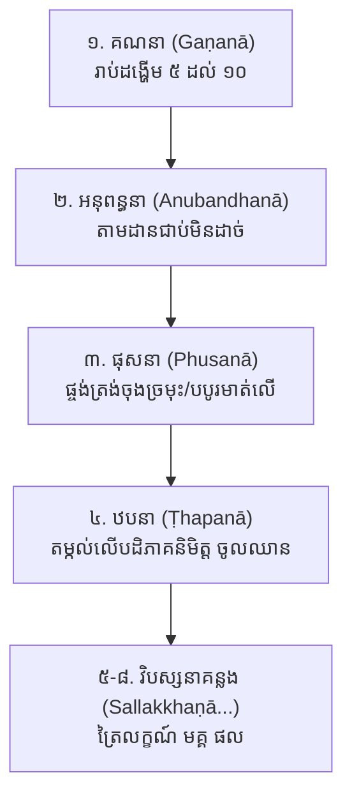
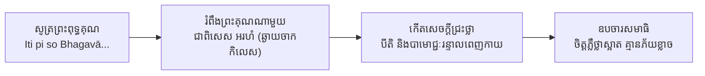
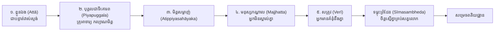

# សិក្សាស្រាវជ្រាវស៊ីជម្រៅ៖ វិធីសមាធិទាំង ៤០ ក្នុងវិសុទ្ធិមគ្គ សមាធិនិទ្ទេស
## Deep Study: The 40 Samādhi Methods of Buddhaghosa's Visuddhimagga (Books 84–87 / Volumes v2–v5)
### សៀវភៅណែនាំទ្រឹស្តី និងការបដិបត្តិសម្រាប់គេហទំព័រ «Samādhi Daily Guide»

---

> [!NOTE]
> ឯកសារនេះជាការសិក្សាស្រាវជ្រាវកម្រិតជាន់ខ្ពស់លើ **វិសុទ្ធិមគ្គ សមាធិនិទ្ទេស** (គម្ពីរពុទ្ធសាសនាថេរវាទក្បាល ៨៤ ដល់ ៨៧ ក្នុងគម្រោងព្រះត្រៃបិដក និងអដ្ឋកថាខ្មែរ ១១០ ក្បាល លើគេហទំព័រ [tripitaka82.com](https://www.tripitaka82.com/))។ ឯកសារនេះចងក្រងនូវវចនានុក្រមកម្មដ្ឋានទាំង ៤០ និងវិធីសាស្ត្រប្រតិបត្តិជាក់ស្តែងលម្អិតនៃកម្មដ្ឋានកំពូលទាំង ៨ សម្រាប់យកទៅប្រើប្រាស់ក្នុងកម្មវិធីគេហទំព័រ សំដៅឱ្យអ្នកបដិបត្តិអាចជ្រើសរើសកម្មដ្ឋានដែលត្រូវនឹងចរិតរបស់ខ្លួនបានយ៉ាងងាយស្រួល និងត្រឹមត្រូវតាមក្បួនខ្នាតព្រះបរិយត្តិ។

---

## មាតិកាស្រាវជ្រាវ (Table of Contents)

1. **សេចក្តីផ្តើម និងរចនាសម្ព័ន្ធគម្ពីរវិសុទ្ធិមគ្គ សមាធិនិទ្ទេស ៤ ភាគ**
2. **តារាងមហាសន្និបាតកម្មដ្ឋានទាំង ៤០ (Master Taxonomy of the 40 Kammaṭṭhāna)**
   - ចំណាត់ថ្នាក់តាមក្រុមធំទាំង ៧
   - និស្ស័យចរិតសមស្រប (Carita Suitability)
   - កម្រិតឈានខ្ពស់បំផុត (Maximum Jhāna Attainment)
   - អាសយដ្ឋានបិដកយោង និង Deep Links ទៅកាន់ tripitaka82.com
3. **ការវិភាគលម្អិតនៃកម្មដ្ឋានកំពូលទាំង ៨ (Deep Dives into the 8 Premier Methods)**
   - ១. **អានាបានស្សតិ (Ānāpānasati)** — វត្ថុ ១៦ និងវិធី ៨ ដំណាក់
   - ២. **ពុទ្ធានុស្សតិ (Buddhānussati)** — ព្រះពុទ្ធគុណ ៩ ព្រះអង្គ
   - ៣. **មេត្តាព្រហ្មវិហារ (Mettā Brahmavihāra)** — បុគ្គល ៤ ពួក, អានិសង្ស ១១, និងការផ្សាយ ១០ ទិស
   - ៤. **មរណស្សតិ (Maraṇassati)** — វិធីរលឹក ៨ យ៉ាង និងការបង្កើតសង្វេគ
   - ៥. **កាយគតាសតិ / កោដ្ឋាស ៣២ (Kāyagatāsati / 32 Koṭṭhāsa)** — ឆកៈ ៦ និងវចីវសី ៧
   - ៦. **ចតុធាតុវវដ្ឋាន (Catudhātuvavatthāna)** — វិនិច្ឆ័យធាតុ ៤ និងលក្ខណៈ ១២
   - ៧. **បឋវីកសិណ (Pathavī Kasiṇa)** — មណ្ឌលដី និងការរីកធំនៃបដិភាគនិមិត្ត
   - ៨. **អសុភភាវនា (Asubha Bhāvanā)** — សាកសព ១០ ដំណាក់កាលកាត់ផ្តាច់រាគៈ
4. **រូបមន្តបាលី និងប្រែសម្រួលជាភាសាខ្មែរ (Pāḷi Chants & Khmer Translations)**
5. **សង្ខេបស្ថាបត្យកម្មទិន្នន័យសម្រាប់ Web App (`data/samadhi_methods.json`)**

---

## ១. សេចក្តីផ្តើម និងរចនាសម្ព័ន្ធគម្ពីរវិសុទ្ធិមគ្គ សមាធិនិទ្ទេស ៤ ភាគ

នៅក្នុងគម្ពីរវិសុទ្ធិមគ្គដែលតាក់តែងឡើងដោយ **ព្រះភទន្តាចារ្យពុទ្ធឃោសៈ** ក្នុងសតវត្សរ៍ទី ៥ នៃគ្រិស្តសករាជ ផ្នែក **សមាធិនិទ្ទេស** ត្រូវបានចាត់ទុកជាក្បួនខ្នាតវិទ្យាសាស្ត្រចិត្តដ៏ល្អឯក និងគ្រប់ជ្រុងជ្រោយបំផុតក្នុងពិភពលោក។ នៅក្នុងគម្រោង [tripitaka82.com](https://www.tripitaka82.com/) សមាធិនិទ្ទេសគ្របដណ្តប់លើ ៤ ក្បាលធំ (ក្បាល ៨៤ ដល់ ៨៧ ឬ `book=v2` ដល់ `book=v5`)៖



- **[វិសុទ្ធិមគ្គ សមាធិនិទ្ទេស ភាគ ១](https://www.tripitaka82.com/read.html?book=v2)** (`book=v2` / ក្បាល ៨៤)៖ បកស្រាយអំពីនិយមន័យសមាធិ, បលិពោធ ១០, កល្យាណមិត្ត, ចរិត ៦, ឈ្មោះកម្មដ្ឋានទាំង ៤០, បឋវីកសិណ, និមិត្ត ៣, សមាធិ ២, សប្បាយ ៧, អប្បនាកោសល្យ ១០, បឋមជ្ឈាន ដល់ ចតុត្ថជ្ឈាន, វសី ៥, និងកសិណ ៩ ទៀត។
- **[វិសុទ្ធិមគ្គ សមាធិនិទ្ទេស ភាគ ២](https://www.tripitaka82.com/read.html?book=v3)** (`book=v3` / ក្បាល ៨៥)៖ អសុភ ១០ យ៉ាង, អនុស្សតិ ៦ (ពុទ្ធ ធម៌ សង្ឃ សីល ចាគ ទេវតា), មរណស្សតិ (វិធីរលឹក ៨ ប្រការ), និងកាយគតាសតិ (កោដ្ឋាស ៣២)។
- **[វិសុទ្ធិមគ្គ សមាធិនិទ្ទេស ភាគ ៣](https://www.tripitaka82.com/read.html?book=v4)** (`book=v4` / ក្បាល ៨៦)៖ អានាបានស្សតិ (វត្ថុ ១៦ ដំណាក់ ៨ វិធី ឧបមា ៣), ឧបសមានុស្សតិ, ព្រហ្មវិហារ ៤ (មេត្តា ករុណា មុទិតា ឧបេក្ខា), និងអរូបជ្ឈាន ៤។
- **[វិសុទ្ធិមគ្គ សមាធិនិទ្ទេស ភាគ ៤](https://www.tripitaka82.com/read.html?book=v5)** (`book=v5` / ក្បាល ៨៧)៖ អាហារេបដិកូលសញ្ញា (ពិចារណាអាហារបដិកូល ១០ យ៉ាង), ចតុធាតុវវដ្ឋាន (វិនិច្ឆ័យធាតុ ៤ សង្ខេប និងពិស្តារ), អានិសង្សនៃសមាធិ, និងលោកិយអភិញ្ញា ៥។

---

## ២. តារាងមហាសន្និបាតកម្មដ្ឋានទាំង ៤០ (Master Taxonomy of the 40 Kammaṭṭhāna)

ព្រះពុទ្ធឃោសាចារ្យបានបែងចែកអារម្មណ៍កម្មដ្ឋានជា ៧ ពួកធំៗ ដោយកំណត់នូវ **កម្រិតឈានអតិបរមា** និង **ភាពត្រូវគ្នានឹងចរិតទាំង ៦** (រាគៈ, ទោសៈ, មោហៈ, សទ្ធា, ពុទ្ធិ, វិតក្ក) ដូចមានក្នុងតារាងពិស្តារខាងក្រោម៖

| ល.រ | ឈ្មោះកម្មដ្ឋាន (ខ្មែរ) | ឈ្មោះបាលី (Pāḷi) | ពួក (Category) | ចរិតសមស្រប (Carita) | កម្រិតឈានខ្ពស់បំផុត | គម្ពីរ និងទំព័រយោង (Tripitaka82 Link) |
|:---:|------------------------|------------------|----------------|----------------------|-----------------------|---------------------------------------|
| 1 | **បឋវីកសិណ** | Pathavī-kasiṇa | កសិណ ១០ | ទូទៅ (Universal) | ចតុត្ថជ្ឈាន (4th Jhāna) | [ក្បាល ៨៤ ទំព័រ ១៥៣](https://www.tripitaka82.com/read.html?book=v2&id=100305&page=153) |
| 2 | **អាបោកសិណ** | Āpo-kasiṇa | កសិណ ១០ | ទូទៅ (Universal) | ចតុត្ថជ្ឈាន (4th Jhāna) | [ក្បាល ៨៤ ទំព័រ ៤០១](https://www.tripitaka82.com/read.html?book=v2&page=401) |
| 3 | **តេជោកសិណ** | Tejo-kasiṇa | កសិណ ១០ | ទូទៅ (Universal) | ចតុត្ថជ្ឈាន (4th Jhāna) | [ក្បាល ៨៤ ទំព័រ ៤០៥](https://www.tripitaka82.com/read.html?book=v2&page=405) |
| 4 | **វាយោកសិណ** | Vāyo-kasiṇa | កសិណ ១០ | ទូទៅ (Universal) | ចតុត្ថជ្ឈាន (4th Jhāna) | [ក្បាល ៨៤ ទំព័រ ៤០៨](https://www.tripitaka82.com/read.html?book=v2&page=408) |
| 5 | **នីលកសិណ** | Nīla-kasiṇa | កសិណ ១០ | ទោសចរិត (Dosa) | ចតុត្ថជ្ឈាន (4th Jhāna) | [ក្បាល ៨៤ ទំព័រ ៤១០](https://www.tripitaka82.com/read.html?book=v2&page=410) |
| 6 | **បីតកសិណ** | Pīta-kasiṇa | កសិណ ១០ | ទោសចរិត (Dosa) | ចតុត្ថជ្ឈាន (4th Jhāna) | [ក្បាល ៨៤ ទំព័រ ៤១២](https://www.tripitaka82.com/read.html?book=v2&page=412) |
| 7 | **លោហិតកសិណ** | Lohita-kasiṇa | កសិណ ១០ | ទោសចរិត (Dosa) | ចតុត្ថជ្ឈាន (4th Jhāna) | [ក្បាល ៨៤ ទំព័រ ៤១៣](https://www.tripitaka82.com/read.html?book=v2&page=413) |
| 8 | **ឱទាតកសិណ** | Odāta-kasiṇa | កសិណ ១០ | ទោសចរិត (Dosa) | ចតុត្ថជ្ឈាន (4th Jhāna) | [ក្បាល ៨៤ ទំព័រ ៤១៤](https://www.tripitaka82.com/read.html?book=v2&page=414) |
| 9 | **អាលោកកសិណ** | Āloka-kasiṇa | កសិណ ១០ | មោហចរិត (Moha) | ចតុត្ថជ្ឈាន (4th Jhāna) | [ក្បាល ៨៤ ទំព័រ ៤១៦](https://www.tripitaka82.com/read.html?book=v2&page=416) |
| 10 | **បរិច្ឆិន្នាកាសកសិណ** | Paricchinnākāsa-kasiṇa | កសិណ ១០ | ទូទៅ (Universal) | ចតុត្ថជ្ឈាន (4th Jhāna) | [ក្បាល ៨៤ ទំព័រ ៤២១](https://www.tripitaka82.com/read.html?book=v2&page=421) |
| 11 | **ឧទ្ធុមាតកអសុភ** | Uddhumātaka | អសុភ ១០ | រាគចរិត (Rāga) | បឋមជ្ឈាន (1st Jhāna) | [ក្បាល ៨៥ ទំព័រ ៧](https://www.tripitaka82.com/read.html?book=v3&id=100348&page=7) |
| 12 | **វិនីលកអសុភ** | Vinīlaka | អសុភ ១០ | រាគចរិត (Rāga) | បឋមជ្ឈាន (1st Jhāna) | [ក្បាល ៨៥ ទំព័រ ៤៩](https://www.tripitaka82.com/read.html?book=v3&id=100354&page=49) |
| 13 | **វិបុព្វកអសុភ** | Vipubbaka | អសុភ ១០ | រាគចរិត (Rāga) | បឋមជ្ឈាន (1st Jhāna) | [ក្បាល ៨៥ ទំព័រ ៥០](https://www.tripitaka82.com/read.html?book=v3&page=50) |
| 14 | **វិច្ឆិទ្ទកអសុភ** | Vicchiddaka | អសុភ ១០ | រាគចរិត (Rāga) | បឋមជ្ឈាន (1st Jhāna) | [ក្បាល ៨៥ ទំព័រ ៥២](https://www.tripitaka82.com/read.html?book=v3&page=52) |
| 15 | **វិក្ខាយិតកអសុភ** | Vikkhāyitaka | អសុភ ១០ | រាគចរិត (Rāga) | បឋមជ្ឈាន (1st Jhāna) | [ក្បាល ៨៥ ទំព័រ ៥៣](https://www.tripitaka82.com/read.html?book=v3&page=53) |
| 16 | **វិក្ខិត្តកអសុភ** | Vikkhittaka | អសុភ ១០ | រាគចរិត (Rāga) | បឋមជ្ឈាន (1st Jhāna) | [ក្បាល ៨៥ ទំព័រ ៥៤](https://www.tripitaka82.com/read.html?book=v3&page=54) |
| 17 | **ហតវិក្ខិត្តកអសុភ** | Hatavikkhittaka | អសុភ ១០ | រាគចរិត (Rāga) | បឋមជ្ឈាន (1st Jhāna) | [ក្បាល ៨៥ ទំព័រ ៥៥](https://www.tripitaka82.com/read.html?book=v3&page=55) |
| 18 | **លោហិតកអសុភ** | Lohitaka | អសុភ ១០ | រាគចរិត (Rāga) | បឋមជ្ឈាន (1st Jhāna) | [ក្បាល ៨៥ ទំព័រ ៥៦](https://www.tripitaka82.com/read.html?book=v3&page=56) |
| 19 | **បុឡុវកអសុភ** | Puḷuvaka | អសុភ ១០ | រាគចរិត (Rāga) | បឋមជ្ឈាន (1st Jhāna) | [ក្បាល ៨៥ ទំព័រ ៥៧](https://www.tripitaka82.com/read.html?book=v3&page=57) |
| 20 | **អដ្ឋិកអសុភ** | Aṭṭhika | អសុភ ១០ | រាគចរិត (Rāga) | បឋមជ្ឈាន (1st Jhāna) | [ក្បាល ៨៥ ទំព័រ ៥៨](https://www.tripitaka82.com/read.html?book=v3&page=58) |
| 21 | **ពុទ្ធានុស្សតិ** | Buddhānussati | អនុស្សតិ ១០ | សទ្ធាចរិត (Saddhā) | ត្រឹមឧបចារសមាធិ (Upacāra) | [ក្បាល ៨៥ ទំព័រ ៧៧](https://www.tripitaka82.com/read.html?book=v3&id=100357&page=77) |
| 22 | **ធម្មានុស្សតិ** | Dhammānussati | អនុស្សតិ ១០ | សទ្ធាចរិត (Saddhā) | ត្រឹមឧបចារសមាធិ (Upacāra) | [ក្បាល ៨៥ ទំព័រ ២៣២](https://www.tripitaka82.com/read.html?book=v3&page=232) |
| 23 | **សង្ឃានុស្សតិ** | Saṅghānussati | អនុស្សតិ ១០ | សទ្ធាចរិត (Saddhā) | ត្រឹមឧបចារសមាធិ (Upacāra) | [ក្បាល ៨៥ ទំព័រ ២៧៣](https://www.tripitaka82.com/read.html?book=v3&page=273) |
| 24 | **សីលានុស្សតិ** | Sīlānussati | អនុស្សតិ ១០ | សទ្ធាចរិត (Saddhā) | ត្រឹមឧបចារសមាធិ (Upacāra) | [ក្បាល ៨៥ ទំព័រ ២៩០](https://www.tripitaka82.com/read.html?book=v3&page=290) |
| 25 | **ចាគានុស្សតិ** | Cāgānussati | អនុស្សតិ ១០ | សទ្ធាចរិត (Saddhā) | ត្រឹមឧបចារសមាធិ (Upacāra) | [ក្បាល ៨៥ ទំព័រ ២៩៦](https://www.tripitaka82.com/read.html?book=v3&page=296) |
| 26 | **ទេវតានុស្សតិ** | Devatānussati | អនុស្សតិ ១០ | សទ្ធាចរិត (Saddhā) | ត្រឹមឧបចារសមាធិ (Upacāra) | [ក្បាល ៨៥ ទំព័រ ៣០៤](https://www.tripitaka82.com/read.html?book=v3&page=304) |
| 27 | **មរណស្សតិ** | Maraṇassati | អនុស្សតិ ១០ | ពុទ្ធិចរិត (Buddhi) | ត្រឹមឧបចារសមាធិ (Upacāra) | [ក្បាល ៨៥ ទំព័រ ៣១៧](https://www.tripitaka82.com/read.html?book=v3&page=317) |
| 28 | **កាយគតាសតិ** | Kāyagatāsati | អនុស្សតិ ១០ | រាគចរិត (Rāga) | បឋមជ្ឈាន (1st Jhāna) | [ក្បាល ៨៥ ទំព័រ ៣៦០](https://www.tripitaka82.com/read.html?book=v3&page=360) |
| 29 | **អានាបានស្សតិ** | Ānāpānasati | អនុស្សតិ ១០ | វិតក្ក & មោហៈ | ចតុត្ថជ្ឈាន (4th Jhāna) | [ក្បាល ៨៦ ទំព័រ ១](https://www.tripitaka82.com/read.html?book=v4&id=100413&page=4) |
| 30 | **ឧបសមានុស្សតិ** | Upasamānussati | អនុស្សតិ ១០ | ពុទ្ធិចរិត (Buddhi) | ត្រឹមឧបចារសមាធិ (Upacāra) | [ក្បាល ៨៦ ទំព័រ ១៤២](https://www.tripitaka82.com/read.html?book=v4&page=142) |
| 31 | **មេត្តាព្រហ្មវិហារ** | Mettā | ព្រហ្មវិហារ ៤ | ទោសចរិត (Dosa) | តតិយជ្ឈាន (3rd Jhāna) | [ក្បាល ៨៦ ទំព័រ ១៥២](https://www.tripitaka82.com/read.html?book=v4&page=152) |
| 32 | **ករុណាព្រហ្មវិហារ** | Karuṇā | ព្រហ្មវិហារ ៤ | ទោសចរិត (Dosa) | តតិយជ្ឈាន (3rd Jhāna) | [ក្បាល ៨៦ ទំព័រ ២៤៤](https://www.tripitaka82.com/read.html?book=v4&page=244) |
| 33 | **មុទិតាព្រហ្មវិហារ** | Muditā | ព្រហ្មវិហារ ៤ | ទោសចរិត (Dosa) | តតិយជ្ឈាន (3rd Jhāna) | [ក្បាល ៨៦ ទំព័រ ២៥៤](https://www.tripitaka82.com/read.html?book=v4&page=254) |
| 34 | **ឧបេក្ខាព្រហ្មវិហារ** | Upekkhā | ព្រហ្មវិហារ ៤ | ទោសចរិត (Dosa) | ចតុត្ថជ្ឈាន (4th Jhāna) | [ក្បាល ៨៦ ទំព័រ ២៦០](https://www.tripitaka82.com/read.html?book=v4&page=260) |
| 35 | **អាកាសានញ្ចាយតនៈ** | Ākāsānañcāyatana | អរូបជ្ឈាន ៤ | ទូទៅ (Universal) | អរូបជ្ឈាន ទី ១ | [ក្បាល ៨៦ ទំព័រ ៣២៥](https://www.tripitaka82.com/read.html?book=v4&page=325) |
| 36 | **វិញ្ញាណញ្ចាយតនៈ** | Viññāṇañcāyatana | អរូបជ្ឈាន ៤ | ទូទៅ (Universal) | អរូបជ្ឈាន ទី ២ | [ក្បាល ៨៦ ទំព័រ ៣៥៥](https://www.tripitaka82.com/read.html?book=v4&page=355) |
| 37 | **អាកិញ្ចញ្ញាយតនៈ** | Ākiñcaññāyatana | អរូបជ្ឈាន ៤ | ទូទៅ (Universal) | អរូបជ្ឈាន ទី ៣ | [ក្បាល ៨៦ ទំព័រ ៣៦៤](https://www.tripitaka82.com/read.html?book=v4&page=364) |
| 38 | **នេវសញ្ញានាសញ្ញាយតនៈ** | Nevasaññānāsaññāyatana | អរូបជ្ឈាន ៤ | ទូទៅ (Universal) | អរូបជ្ឈាន ទី ៤ | [ក្បាល ៨៦ ទំព័រ ៣៩៨](https://www.tripitaka82.com/read.html?book=v4&page=398) |
| 39 | **អាហារេបដិកូលសញ្ញា** | Āhārepaṭikūlasaññā | សញ្ញា ១ | ពុទ្ធិចរិត (Buddhi) | ត្រឹមឧបចារសមាធិ (Upacāra) | [ក្បាល ៨៧ ទំព័រ ៧](https://www.tripitaka82.com/read.html?book=v5&id=100471&page=7) |
| 40 | **ចតុធាតុវវដ្ឋាន** | Catudhātuvavatthāna | វវដ្ឋាន ១ | ពុទ្ធិចរិត (Buddhi) | ត្រឹមឧបចារសមាធិ (Upacāra) | [ក្បាល ៨៧ ទំព័រ ៤៧](https://www.tripitaka82.com/read.html?book=v5&id=100477&page=47) |

---

## ៣. ការវិភាគលម្អិតនៃកម្មដ្ឋានកំពូលទាំង ៨ (Deep Dives into the 8 Premier Methods)

---

### ១. អានាបានស្សតិ (Ānāpānasati — Mindfulness of Breathing)
- **គម្ពីរយោង**៖ [វិសុទ្ធិមគ្គ សមាធិនិទ្ទេស ភាគ ៣](https://www.tripitaka82.com/read.html?book=v4&id=100413&page=4) (ក្បាល ៨៦, ទំព័រ ១ ដល់ ១៤០)
- **ចរិតសមស្រប**៖ វិតក្កចរិត (អ្នកចូលចិត្តគិតច្រើន រវើរវាយ) និង មោហចរិត (អ្នកស្រពោនស្រពន់ ងងឹតងងុយ)
- **កម្រិតឈានខ្ពស់បំផុត**៖ ចតុត្ថជ្ឈាន (សម្រេចរូបជ្ឈានទាំង ៤ ថ្នាក់ និងជាបាទគ្រឹះនៃវិបស្សនាឈានដល់ព្រះអរហត្ត)



#### ក. មូលដ្ឋាន ១៦ ដំណាក់កាល (សោឡសវត្ថុកា អានាបានស្សតិ)
ចែកចេញជា ៤ ចតុក្កៈ (ស្របនឹងមហាសតិប្បដ្ឋានទាំង ៤)៖
1. **កាយានុបស្សនាចតុក្កៈ**៖ 
   - ដកដង្ហើមចេញចូលវែង ដឹងច្បាស់ (*Dīghaṃ assasanto...*)
   - ដកដង្ហើមចេញចូលខ្លី ដឹងច្បាស់ (*Rassaṃ assasanto...*)
   - កំណត់ដឹងកាយដង្ហើមទាំងមូល ដើម កណ្តាល ចុង (*Sabbakāyapaṭisaṃvedī...*)
   - រម្ងាប់កាយសង្ខារឱ្យដង្ហើមប្រណីតល្អិតស្មើ (*Passambhayaṃ kāyasaṅkhāraṃ...*)
2. **វេទនានុបស្សនាចតុក្កៈ**៖ កំណត់ដឹងបីតិ (*Pīti*), សេចក្តីសុខ (*Sukha*), ចិត្តសង្ខារ (*Cittasaṅkhāra*), និងរម្ងាប់ចិត្តសង្ខារ។
3. **ចិត្តានុបស្សនាចតុក្កៈ**៖ កំណត់ដឹងសភាពចិត្ត (*Citta*), ញ៉ាំងចិត្តឱ្យរីករាយ (*Abhippamodayaṃ*), តម្កល់ចិត្តឱ្យមាំ (*Samādahaṃ*), និងដោះលែងចិត្តចាកនីវរណៈ (*Vimocayaṃ*).
4. **ធម្មានុបស្សនាចតុក្កៈ**៖ ពិចារណាឃើញថាមិនទៀង (*Aniccānupassī*), ពិចារណាការរសាយតម្រេក (*Virāgānupassī*), ពិចារណាការរលត់ទុក្ខ (*Nirodhānupassī*), និងពិចារណាការលះបង់ (*Paṭinissaggānupassī*).

#### ខ. ឧបមាគន្លឹះ ៣ ប្រការក្នុងវិសុទ្ធិមគ្គ
1. **ឧបមាដោយអ្នកយាមទ្វារនគរ (ទោវារិកោ វិយ)**៖ អ្នកយាមទ្វារអង្គុយនៅមាត់ទ្វារកំផែង មិនដើរដេញតាមមនុស្សដែលដើរចូលទៅផ្សារខាងក្នុង ហើយក៏មិនរត់តាមមនុស្សដែលដើរចេញទៅស្រុកខាងក្រៅដែរ។ គាត់សង្កេតឃើញតែមនុស្សកាលណាគេដើរកាត់ទ្វារនោះតែប៉ុណ្ណោះ។ អ្នកចម្រើនអានាបានស្សតិក៏ដូច្នោះដែរ មិនត្រូវរត់តាមដង្ហើមចូលទៅដល់បំពង់ក ទ្រូង ឬពោះ ហើយក៏មិនត្រូវដេញតាមដង្ហើមចេញទៅក្នុងលំហអាកាសក្រៅឡើយ គឺដឹងតែត្រង់ **កន្លែងប៉ះ (ផុសនស្ថាន)** មួយគត់។
2. **ឧបមាដោយជាងកាត់ឈើ (កកចោ វិយ)**៖ ជាងអារឈើក្រឡេកមើលតែធ្មេញរណារដែលកាត់លើដើមឈើមួយកន្លែង មិនរវល់ងាកក្បាលតាមផ្លែរណារដែលរំកិលទៅមុខទៅក្រោយឡើយ។ យ៉ាងណាមិញ សតិត្រូវតាំងនៅត្រង់ចុងច្រមុះ ឬបបូរមាត់លើ មិនរវល់តាមដង្ហើមចូលជ្រៅ ឬចេញឆ្ងាយឡើយ។
3. **ឧបាយនាំខ្យល់ត្រឡប់មកវិញ (Lost Breath Recovery)**៖ កាលណាដង្ហើមរម្ងាប់ល្អិតស្មើនឹងចិត្ត រហូតដល់ហាក់ដូចជាបាត់ខ្យល់ដង្ហើម យោគាវចរមិនត្រូវភ័យស្លន់ស្លោឡើយ។ គប្បីពិចារណាថា មានតែមនុស្ស ៧ ពួកប៉ុណ្ណោះដែលគ្មានដង្ហើម (កូនក្នុងផ្ទៃ, មនុស្សលង់ទឹក, មនុស្សស្លាប់, អសញ្ញីសត្វ, មនុស្សចូលចតុត្ថជ្ឈាន, មនុស្សក្នុងអរូបភព, និងមនុស្សចូលនិរោធសមាបត្តិ)។ ខ្លួនយើងមិនមែនក្នុងចំណោម ៧ ពួកនេះទេ ដង្ហើមនៅតែមាន គឺមានត្រង់កន្លែងប៉ះដដែល គ្រាន់តែល្អិតពេក។ ចូរតម្កល់ចិត្តស្ងប់នៅត្រង់ចុងច្រមុះដដែល នោះដង្ហើម និងបដិភាគនិមិត្តនឹងភ្លឺឡើងវិញជាក់ជាមិនខាន។

---

### ២. ពុទ្ធានុស្សតិ (Buddhānussati — Recollection of the Buddha)
- **គម្ពីរយោង**៖ [វិសុទ្ធិមគ្គ សមាធិនិទ្ទេស ភាគ ២](https://www.tripitaka82.com/read.html?book=v3&id=100357&page=77) (ក្បាល ៨៥, ទំព័រ ៧៧ ដល់ ២៣២)
- **ចរិតសមស្រប**៖ សទ្ធាចរិត (អ្នកមានសេចក្តីជ្រះថ្លាខ្លាំង) និងជា **សព្វត្ថកកម្មដ្ឋាន** សម្រាប់មនុស្សគ្រប់រូប
- **កម្រិតឈានខ្ពស់បំផុត**៖ ត្រឹម **ឧបចារសមាធិ (Access Concentration)**



#### ក. ខ្លឹមសារព្រះពុទ្ធគុណទាំង ៩ (នវគុណ)
1. **អរហំ (Arahaṃ)**៖ ព្រះអង្គឆ្ងាយចាកសេចក្តីសៅហ្មង, ជាអ្នកកម្ចាត់កាំរទេះនៃសង្សារវដ្ត, មិនធ្វើបាបសូម្បីក្នុងទីកំបាំង, សក្តិសមទទួលគ្រឿងបូជាពិសេសពីទេវតានិងមនុស្ស។
2. **សម្មាសម្ពុទ្ធោ (Sammāsambuddho)**៖ ត្រាស់ដឹងនូវញេយ្យធម៌ទាំងពួងដោយព្រះអង្គឯងដោយប្រពៃ គ្មានគ្រូអាចារ្យណាដឹកនាំ។
3. **វិជ្ជាចរណសម្បន្នោ (Vijjācaraṇasampanno)**៖ បរិបូរណ៍ដោយវិជ្ជា ៣ (ឬវិជ្ជា ៨) និងចរណធម៌ ១៥ ប្រការ (ដូចជា សីលសំវរៈ ឥន្ទ្រិយសំវរៈ ភោជនេមត្តញ្ញុតា ជោគ្គរិយានុយោគ...)។
4. **សុគតោ (Sugato)**៖ យាងដំណើរទៅកាន់ទីដ៏ល្អ (ព្រះនិព្វាន), មានដំណើរល្អបរិសុទ្ធ, ពោលតែវាចាពិត ត្រឹមត្រូវ មានប្រយោជន៍ និងត្រូវកាល។
5. **លោកវិទូ (Lokavidū)**៖ ជ្រាបច្បាស់នូវលោកទាំង ៣ (សង្ខារលោក, សត្តលោក, ឱកាសលោក) ដល់ទីបំផុត។
6. **អនុត្តរោ បុរិសទម្មសារថិ (Anuttaro purisadammasārathi)**៖ អ្នកទូន្មានមនុស្សដែលគួរទូន្មានបាន គ្មានអ្នកដទៃក្រៃលែងជាង (ដូចជាទូន្មានអាឡវកយក្ស, អង្គុលិមាល, នាលាគិរី...)។
7. **សត្ថា ទេវមនុស្សានំ (Satthā devamanussānaṃ)**៖ ជាគ្រូនៃទេវតានិងមនុស្សទាំងឡាយ ដឹកនាំសត្វឆ្លងកាត់វាលកន្តារនៃសង្សារវដ្ត។
8. **ពុទ្ធោ (Buddho)**៖ ព្រះអង្គភ្ញាក់រឭកចាកមោហៈផង ត្រាស់ដឹងចតុរារិយសច្ចផង ញ៉ាំងសត្វដទៃឱ្យភ្ញាក់រឭកដឹងតាមផង។
9. **ភគវា (Bhagavā)**៖ មានភ័ព្វសំណាងពិសេស, បានបំបែកបំបាក់អវិជ្ជាតណ្ហា, គាស់រំលើងភព, និងជាអ្នកបែងចែកព្រះធម៌ទេសនាប្រោសសត្វ។

#### ខ. ហេតុអ្វីពុទ្ធានុស្សតិសម្រេចត្រឹមឧបចារសមាធិ មិនដល់អប្បនាសមាធិ?
ព្រះពុទ្ធឃោសាចារ្យបានបកស្រាយថា (ក្បាល ៨៥, ទំព័រ ២៣១)៖ ព្រះពុទ្ធគុណមានសភាព **គម្ភីរភាព ជ្រាលជ្រៅ និងទូលំទូលាយរកទីបំផុតគ្មាន**។ ចិត្តរបស់អ្នកចម្រើនត្រូវតែបញ្ជូនសតិទៅត្រិះរិះ ពិចារណា និងរំពឹងរលឹក (វិតក្ក និង វិចារ) លើព្រះគុណដ៏វិសេសទាំងនោះជាបន្តបន្ទាប់។ ការត្រិះរិះលើគុណដ៏ជ្រាលជ្រៅនេះ មិនអនុញ្ញាតឱ្យចិត្តឈប់រំពឹងដើម្បីដេកផ្អឹបលើអារម្មណ៍តែមួយ (Ekaggatā នៃឈាន) បានឡើយ ប៉ុន្តែវាបង្កើតបាននូវ **ឧបចារសមាធិដ៏បរិសុទ្ធ** ដែលកម្ចាត់នីវរណៈ ៥ បានស្អាតស្អំ មានរស្មីភ្លឺថ្លា មានបីតិញាប់ញ័ររោម (លោមហំស) និងធ្វើឱ្យកាយស្រាលហាក់ដូចជាអណ្តែតលើអាកាស។

---

### ៣. មេត្តាព្រហ្មវិហារ (Mettā Brahmavihāra — Loving-Kindness Meditation)
- **គម្ពីរយោង**៖ [វិសុទ្ធិមគ្គ សមាធិនិទ្ទេស ភាគ ៣](https://www.tripitaka82.com/read.html?book=v4&page=152) (ក្បាល ៨៦, ទំព័រ ១៥២ ដល់ ២៤៣)
- **ចរិតសមស្រប**៖ ទោសចរិត (អ្នកឆាប់ខឹង មួរម៉ៅ គុំកួន ចិត្តក្តៅក្រហាយ)
- **កម្រិតឈានខ្ពស់បំផុត**៖ តតិយជ្ឈាន (សម្រេចឈានទី ១, ទី ២, ទី ៣ ក្នុងចតុក្កន័យ។ បើចង់ឡើងឈានទី ៤ ត្រូវប្តូរទៅចម្រើន **ឧបេក្ខាព្រហ្មវិហារ**)



#### ក. លំដាប់បុគ្គលក្នុងការផ្សាយមេត្តា
1. **ខ្លួនឯង (Attā)**៖ សូត្រផ្សាយដល់ខ្លួនឯងជាមុនសិន ដើម្បីយកចិត្តខ្លួនឯងជាបន្ទាត់វាស់ស្ទង់ថា «យើងស្រឡាញ់សុខ ស្អប់ទុក្ខយ៉ាងណា សត្វដទៃក៏ស្រឡាញ់សុខ ស្អប់ទុក្ខយ៉ាងនោះដែរ» (*Attūpamāya*)។ ចំណាំ៖ ការផ្សាយដល់ខ្លួនឯងមិនអាចកើតឈានបានទេ តែជាការបន្ទន់ចិត្ត។
2. **បុគ្គលជាទីស្រឡាញ់ និងគួរគោរព (បិយបុគ្គល / អាចារិយ)**៖ ផ្សាយដល់គ្រូ ឪពុកម្តាយ ឬបុគ្គលដែលធ្លាប់មានគុណធម៌ចំពោះខ្លួន ដើម្បីឱ្យចិត្តរីករាយ និងបង្កើតថាមពលមេត្តាបានងាយ។
3. **មិត្តសម្លាញ់ដ៏ជាទីស្រឡាញ់ (អតិប្បិយសហាយក)**។
4. **មនុស្សកណ្តាល (មជ្ឈត្តបុគ្គល)**៖ មនុស្សដែលមិនស្អប់ មិនស្រឡាញ់ (អ្នកជិតខាង មនុស្សទូទៅ)។
5. **សត្រូវ ឬមនុស្សដែលខ្លួនធ្លាប់ខឹង (វេរីបុគ្គល)**៖ កម្ចាត់កំហឹងដោយពិចារណាទោសនៃកំហឹង និងគុណនៃមេត្តា។

> [!WARNING]
> **បុគ្គលដែលហាមមិនឱ្យផ្សាយមេត្តាជាដំបូង**៖
> 1. បុគ្គលដែលខ្លួនស្អប់តាំងពីដើម (នាំឱ្យកើតទោសៈភ្លាម)។
> 2. មិត្តសម្លាញ់ខ្លាំងពេក (កាលណាគេមានទុក្ខ យើងនឹងយំសោកកើតទុក្ខតាមគេ)។
> 3. មនុស្សកណ្តាល (អារម្មណ៍ស្ងួត មិនទាន់បង្កើតកម្លាំងមេត្តាបាន)។
> 4. សត្រូវ (នាំឱ្យខឹងក្តៅក្រហាយ)។
> 5. **បុគ្គលភេទផ្ទុយគ្នាចំពោះឈ្មោះជាក់លាក់** (នាំឱ្យរអិលធ្លាក់ទៅជារាគៈ និងតម្រេកកាមគុណ)។
> 6. **មនុស្សដែលស្លាប់ទៅហើយ (មតបុគ្គល)** — មិនអាចសម្រេចឈានដាច់ខាត ប្រៀបដូចជារទេះបាក់កង់បុកគល់ឈើ។

#### ខ. ការទម្លុះព្រំដែន (សីមាសម្ភេទ)
កាលណាផ្សាយមេត្តាដល់បុគ្គលទាំង ៤ ពួក (ខ្លួនឯង, បិយបុគ្គល, មជ្ឈត្តបុគ្គល, វេរីបុគ្គល) រហូតដល់ចិត្តមានសភាព **ស្មើគ្នាបេះបិទ** គ្មានលម្អៀង គ្មានការបែងចែកថានរណាជាមិត្ត នរណាជាសត្រូវឡើយ នោះហៅថា «សម្រេចសីមាសម្ភេទ»។ កាលបើទម្លុះព្រំដែនបានហើយ ចិត្តនឹងស្ទុះចូលកាន់ **បឋមជ្ឈាន, ទុតិយជ្ឈាន, និងតតិយជ្ឈាន** ដោយងាយ។

#### គ. អានិសង្ស ១១ ប្រការនៃមេត្តា (Ekādasa Ānisaṃsā)
1. ដេកលក់ជាសុខ (*Sukhaṃ supati*)
2. ភ្ញាក់ឡើងជាសុខ (*Sukhaṃ paṭibujjhati*)
3. មិនយល់សប្តិអាក្រក់ (*Na pāpakaṃ supinaṃ passati*)
4. ជាទីស្រឡាញ់នៃមនុស្សទាំងឡាយ (*Manussānaṃ piyo hoti*)
5. ជាទីស្រឡាញ់នៃអមនុស្សទាំងឡាយ (*Amanussānaṃ piyo hoti*)
6. ទេវតាតែងតាមបីបាច់ថែរក្សា (*Devatā rakkhanti*)
7. ភ្លើង ថ្នាំពិស និងគ្រឿងសស្ត្រាវុធ មិនអាចប៉ះពាល់បាន (*Nāssa aggi vā visaṃ vā satthaṃ vā kamati*)
8. ចិត្តតម្កល់ជាសមាធិបានលឿន (*Tuvaṭaṃ cittaṃ samādhiyati*)
9. ទឹកមុខស្រស់បំព្រង ភ្លឺថ្លា (*Mukhavaṇṇo vippasīdati*)
10. មិនវង្វេងស្មារតីពេលស្លាប់ (*Asammūḷho kālaṃ karoti*)
11. បើមិនទាន់សម្រេចព្រះអរហត្ត នឹងទៅកើតក្នុងព្រហ្មលោក (*Brahmalokūpago hoti*)។

---

### ៤. មរណស្សតិ (Maraṇassati — Mindfulness of Death)
- **គម្ពីរយោង**៖ [វិសុទ្ធិមគ្គ សមាធិនិទ្ទេស ភាគ ២](https://www.tripitaka82.com/read.html?book=v3&page=317) (ក្បាល ៨៥, ទំព័រ ៣១៧ ដល់ ៣៦០)
- **ចរិតសមស្រប**៖ ពុទ្ធិចរិត (អ្នកមានប្រាជ្ញា ចូលចិត្តពិចារណាវិភាគហេតុផល)
- **កម្រិតឈានខ្ពស់បំផុត**៖ ត្រឹម **ឧបចារសមាធិ (Access Concentration)**

#### វិធីរលឹកដល់សេចក្តីស្លាប់ ៨ យ៉ាង (អដ្ឋាការេហិ មរណស្សតិ)
1. **វធកត្តុបដ្ឋិតតោ (ដូចពេជ្ឈឃាតយារដាវតាមពីក្រោយ)**៖ ពិចារណាថាសេចក្តីស្លាប់ដើរតាមយើងជាប់រាល់ជំហាន តាំងពីវិនាទីដែលចាប់កំណើតក្នុងផ្ទៃម្តាយ ប្រៀបដូចពេជ្ឈឃាតដែលយារដាវស្រួចស្រាវតាមប្រកិតពីក្រោយ រង់ចាំតែពេលកាត់ក្បាល។
2. **សម្បត្តិវិបត្តិបដិពាហនតោ (ដោយសេចក្តីវិនាសនៃសម្បត្តិ)**៖ ទ្រព្យសម្បត្តិ រូបសម្បត្តិ យសសក្តិ សុខភាព សុទ្ធតែត្រូវបញ្ចប់ដោយភាពវិនាស គ្មានសម្បត្តិលោកិយណាមួយដែលគេចផុតពីមាត់មច្ចុរាជឡើយ។
3. **ឧបសំហរណតោ (ដោយការប្រៀបធៀបខ្លួនឯងនឹងអ្នកដទៃ)**៖ រលឹកប្រៀបធៀបទៅនឹងមហាក្សត្រ អ្នកមានទ្រព្យស្តុកស្តម្ភ វីរបុរស អ្នកចម្បាំង និងព្រះអរហន្តកាលពីអតីតកាល សុទ្ធតែត្រូវសេចក្តីស្លាប់លេបត្របាក់អស់ គ្មានសល់ម្នាក់ ចុះទម្រាំរូបយើងជាមនុស្សសាមញ្ញ តើគេចផុតដូចម្តេចបាន?
4. **កាយពហុសាធារណតោ (ដោយកាយនេះជាផ្ទះរួមនៃសត្វល្អិត និងរោគរាប់រយ)**៖ រូបកាយនេះជាទីជួបជុំនៃដង្កូវ សត្វល្អិត មេរោគរាប់រយប្រភេទ និងគ្រោះថ្នាក់ក្រៅខ្លួន (ពស់ចឹក គ្រោះថ្នាក់ចរាចរណ៍ ខ្យល់គរ...) ងាយនឹងបែកធ្លាយគ្រប់វិនាទី។
5. **អាយុទុព្វលតោ (ដោយភាពទន់ខ្សោយនៃជីវិត)**៖ ជីវិតនេះផុយស្រួយណាស់ ពឹងផ្អែកលើដង្ហើមចេញចូលតែបន្តិចបន្តួច បើដកដង្ហើមចេញហើយ មិនដកចូលវិញ គឺស្លាប់ភ្លាម។
6. **អនិមិត្តតោ (ដោយគ្មានសញ្ញាប្រាប់មុន ៥ ប្រការ)**៖ 
   - មិនដឹងអាយុ (ថានឹងរស់បានប៉ុន្មានឆ្នាំ)
   - មិនដឹងរោគ (ថានឹងស្លាប់ដោយរោគអ្វី)
   - មិនដឹងកាល (ថានឹងស្លាប់ពេលថ្ងៃ ពេលយប់ ក្មេង ឬចាស់)
   - មិនដឹងទីកន្លែងបោះបង់សាកសព (ថានឹងស្លាប់លើគ្រែ លើផ្លូវ ឬក្នុងទឹក)
   - មិនដឹងគតិ (ថាស្លាប់ទៅនឹងទៅចាប់កំណើតនៅទីណា)។
7. **អទ្ធានបរិច្ឆេទតោ (ដោយការកំណត់នៃកាលដ៏ខ្លី)**៖ មនុស្សក្នុងសម័យនេះរស់នៅយ៉ាងច្រើនត្រឹម ១០០ ឆ្នាំ ពេលវេលាកន្លងផុតទៅដូចខ្សែទឹកហូរ មិនត្រឡប់មកវិញឡើយ។
8. **ខណបរិត្តតោ (ដោយភាពខ្លីនៃខណៈចិត្ត)**៖ តាមបរមត្ថធម៌ ជីវិតពិតប្រាកដរស់នៅត្រឹមតែ **មួយខណៈចិត្ត** (ឧប្បាទ-ឋិតិ-ភង្គ) ប៉ុណ្ណោះ។ កាលណាភង្គខណៈរលត់ទៅ ចិត្តមុនស្លាប់បាត់ហើយ ជីវិតថ្មីទើបកើតបន្ត។

> [!TIP]
> **ផលប្រយោជន៍ផ្លូវចិត្ត**៖ កាត់ផ្តាច់សេចក្តីខ្ជិលច្រអូស (*កោសជ្ជៈ*), កម្ចាត់មោហៈដែលគិតថានឹងរស់នៅរាប់រយឆ្នាំ, បង្កើតសេចក្តីសង្វេគ (*Saṃvega*), បង្កើនភាពរួសរាន់ក្នុងការធ្វើអំពើល្អ និងមិនជាប់ជំពាក់នឹងទ្រព្យសម្បត្តិក្រៅខ្លួន។

---

### ៥. កាយគតាសតិ / កោដ្ឋាស ៣២ (Kāyagatāsati / 32 Anatomical Parts)
- **គម្ពីរយោង**៖ [វិសុទ្ធិមគ្គ សមាធិនិទ្ទេស ភាគ ២](https://www.tripitaka82.com/read.html?book=v3&page=360) (ក្បាល ៨៥, ទំព័រ ៣៦០ ដល់ ៤៣៧)
- **ចរិតសមស្រប**៖ រាគចរិត (អ្នកជាប់ជំពាក់នឹងរូបកាយ សម្រស់ និងកាមគុណ)
- **កម្រិតឈានខ្ពស់បំផុត**៖ បឋមជ្ឈាន (បើពិចារណាដោយភាពជាបដិកូល) ឬ ចតុត្ថជ្ឈាន (បើលើកយកចំណែកពណ៌ ដូចជាឆ្អឹងស មកធ្វើជាឱទាតកសិណ)

#### ក. ការបែងចែកកោដ្ឋាសទាំង ៣២ ជា ៦ ពួក
1. **តចបញ្ចកៈ (កោដ្ឋាស ៥ មានស្បែកជាទីបំផុត)**៖ កេសា (សក់), លោមា (រោម), នខា (ក្រចក), ទន្តា (ធ្មេញ), តចោ (ស្បែក)។
2. **វក្កបញ្ចកៈ (កោដ្ឋាស ៥ មានវ៉ាក់ជាទីបំផុត)**៖ មំសំ (សាច់), នហារូ (សរសៃ), អដ្ឋិ (ឆ្អឹង), អដ្ឋិមិញ្ជំ (ខួរក្នុងឆ្អឹង), វក្កំ (តម្រងនោម/វ៉ាក់)។
3. **បប្ផាសបញ្ចកៈ (កោដ្ឋាស ៥ មានសួតជាទីបំផុត)**៖ ហទយំ (បេះដូង), យកនំ (ថ្លើម), កិលោមpackage (វាវ/ស្រោមសាច់), បិហកំ (អណ្តែត), បប្ផាសំ (សួត)។
4. **មត្ថលុង្គបញ្ចកៈ (កោដ្ឋាស ៥ មានខួរក្បាលជាទីបំផុត)**៖ អន្តំ (ពោះវៀនធំ), អន្តគុណំ (ពោះវៀនតូច), ឧទរិយំ (អាហារថ្មី), ករីសំ (អាហារចាស់/លាមក), មត្ថលុង្គំ (ខួរក្នុងក្បាល)។
5. **មេទឆដ្ឋកៈ (កោដ្ឋាស ៦ មានខ្លាញ់ខាប់ជាទីបំផុត)**៖ បិត្តំ (ទឹកប្រមាត់), សេម្ហំ (ទឹកស្លេស្ម), បុព្វោ (ទឹកខ្ទុះ), លោហិតំ (ឈាម), សេទោ (ញើស), មេទោ (ខ្លាញ់ខាប់)។
6. **មុត្តឆដ្ឋកៈ (កោដ្ឋាស ៦ មានទឹកនោមជាទីបំផុត)**៖ អស្សុ (ទឹកភ្នែក), វសា (ខ្លាញ់រាវ), ខេឡោ (ទឹកមាត់), សិង្ឃាណិកា (ទឹកសម្បោរ), លសិកា (ទឹកសន្លាក់/ទឹករំអិល), មុត្តំ (ទឹកនោម)។

#### ខ. វចីវសី ៧ យ៉ាងក្នុងការហ្វឹកហាត់ (Skill in Recitation & Reflection)
1. **វចសា (សូត្រដោយពាក្យសម្តី)**៖ សូត្របាលីបញ្ច្រាសត្រឡប់ចុះឡើង ឱ្យចាំរអិលមាត់។
2. **មនសា (សូត្រដោយចិត្ត)**៖ នឹកកំណត់ក្នុងចិត្តម្តងមួយៗ មិនឱ្យភ្លាត់។
3. **វណ្ណតោ (ពិចារណាដោយពណ៌)**៖ សក់ពណ៌ខ្មៅ, ធ្មេញពណ៌ស, ថ្លើមពណ៌ក្រហមចាស់...
4. **សណ្ឋានតោ (ពិចារណាដោយរូបរាង)**៖ ឆ្អឹងក្បាលដូចត្រឡោកដូង, បេះដូងដូចផ្កាឈូកក្រពុំ...
5. **ទិសាតោ (ពិចារណាដោយទិស)**៖ លើផ្ចិត (ឧទ្ធំ) ឬ ក្រោមផ្ចិត (អធោ)។
6. **ឱកាសតោ (ពិចារណាដោយទីតាំង)**៖ កោដ្ឋាសនីមួយៗតាំងនៅត្រង់ណាពិតប្រាកដក្នុងកាយ។
7. **បរិច្ឆេទតោ (ពិចារណាដោយព្រំដែនកំណត់)**៖ ចំណែកនីមួយៗមិនច្រឡូកច្រឡំគ្នា ត្រូវបែងចែកដាច់ពីគ្នា។

> [!NOTE]
> **ឧបមាថង់ដាក់គ្រាប់ធញ្ញជាតិ**៖ ដូចបុរសម្នាក់មានថង់ស្បោងច្រកគ្រាប់សណ្តែក អង្ករ គ្រាប់ស្ពៃ ល្ង ចម្រុះគ្នា កាលបើស្រាយមាត់ថង់ចាក់មើល គេរមែងដឹងច្បាស់ថា «នេះជាគ្រាប់សណ្តែកបាយ នេះជាគ្រាប់អង្ករ នេះជាគ្រាប់ល្ង...»។ យោគាវចរពិនិត្យកាយនេះឃើញកោដ្ឋាស ៣២ យ៉ាងដូច្នោះ មិនឃើញមានសត្វ បុគ្គល ប្រុស ស្រី ឬព្រលឹងអ្វីឡើយ។

---

### ៦. ចតុធាតុវវដ្ឋាន (Catudhātuvavatthāna — Analysis of the 4 Physical Elements)
- **គម្ពីរយោង**៖ [វិសុទ្ធិមគ្គ សមាធិនិទ្ទេស ភាគ ៤](https://www.tripitaka82.com/read.html?book=v5&id=100477&page=47) (ក្បាល ៨៧, ទំព័រ ៤៧ ដល់ ១០០)
- **ចរិតសមស្រប**៖ ពុទ្ធិចរិត (អ្នកមានបញ្ញាចូលចិត្តញែកធម៌)
- **កម្រិតឈានខ្ពស់បំផុត**៖ ត្រឹម **ឧបចារសមាធិ (Access Concentration)** — ប៉ុន្តែជា **ស្ពានមាសឆ្លងទៅកាន់វិបស្សនា** (នាមរូបបរិច្ឆេទញាណ)

#### លក្ខណៈ ១២ ប្រការនៃមហាភូតរូប ៤
1. **បឋវីធាតុ (ធាតុដី — Earth Element)**៖
   - *កក្ខឡត្តំ* (ភាពរឹង — Hardness)
   - *មុទុតំ* (ភាពទន់ — Softness)
   - *ផរុសត្តំ* (ភាពគ្រើម — Roughness)
   - *សណ្ហត្តំ* (ភាពរលោង — Smoothness)
2. **អាបោធាតុ (ធាតុទឹក — Water Element)**៖
   - *បគ្ឃរណំ* (ភាពហូរ/រអិល — Flowing / Trickling)
   - *អាពន្ធនំ* (ភាពស្អិតផ្សារភ្ជាប់រូប — Cohesion / Binding)
3. **តេជោធាតុ (ធាតុភ្លើង — Fire Element)**៖
   - *ឧណ្ហត្តំ* (ភាពក្តៅ — Heat / Warmth)
   - *សីតត្តំ* (ភាពត្រជាក់ — Coldness)
   - *បាចនំ* (ភាពចម្អិនរំលាយអាហារ — Maturing / Digestion)
4. **វាយោធាតុ (ធាតុខ្យល់ — Air / Wind Element)**៖
   - *វិត្ថម្ភនំ* (ភាពតានតឹង/ទ្រទ្រង់ — Supporting / Tension)
   - *សមុទីរណំ* (ភាពរំកិល/កម្រើក — Moving / Pressure)

#### វិធីចម្រើន ២ បែបក្នុងវិសុទ្ធិមគ្គ
- **សង្ខេបន័យ (Concise Method)**៖ សម្រាប់អ្នកមានបញ្ញារហ័ស (*តិក្ខបញ្ញា*) — កំណត់ដឹងសភាពរឹង ស្អិត ក្តៅ តឹង ក្នុងទូទាំងរូបកាយទាំងមូលក្នុងពេលតែមួយ ដោយឃើញថាកាយនេះគ្រាន់តែជាកំហាប់នៃធាតុដី ធាតុទឹក ធាតុភ្លើង ធាតុខ្យល់ ប្រជុំគ្នា គ្មានខ្លឹមសារជាខ្លួនយើងឡើយ។
- **ពិស្តារន័យ (Detailed Method)**៖ សម្រាប់អ្នកមានបញ្ញាមធ្យម — កំណត់ធាតុទាំង ៤ តាមចំណែកកាយទាំង ៤២ (បឋវី ២០, អាបោ ១២, តេជោ ៤, វាយោ ៦)។

---

### ៧. បឋវីកសិណ (Pathavī Kasiṇa — Earth Disk Meditation)
- **គម្ពីរយោង**៖ [វិសុទ្ធិមគ្គ សមាធិនិទ្ទេស ភាគ ១](https://www.tripitaka82.com/read.html?book=v2&id=100305&page=153) (ក្បាល ៨៤, ទំព័រ ១៥៣ ដល់ ៤០០)
- **ចរិតសមស្រប**៖ ទូទៅ (ស័ក្តិសមសម្រាប់អ្នកចង់កសាងឈានជ្រៅ និងមូលដ្ឋានអភិញ្ញា)
- **កម្រិតឈានខ្ពស់បំផុត**៖ ចតុត្ថជ្ឈាន (រូបជ្ឈានទី ៤ និងជាគ្រឹះនៃអរូបជ្ឈាន ៤)

#### ក. ការរៀបចំមណ្ឌលកសិណដី
- យកដីស្អាតពណ៌ដូចអរុណរះ (ពណ៌ដីឥដ្ឋក្រហមស្រាល) គ្មានលាយកម្ទេចថ្ម ស្មៅ ឬឫសឈើ មកលុញធ្វើជាបន្ទះមូលរលោងស្មើ មានទំហំមុខកាត់ ១ ចំអាម ៤ ធ្នាប់ (ប្រហែល ៣០ សង់ទីម៉ែត្រ)។
- ដាក់តម្កល់លើជើងទម្រចម្ងាយ ២ ហត្ថកន្លះ (ប្រហែល ១.២ ម៉ែត្រ) ពីកន្លែងអង្គុយ។

#### ខ. ដំណាក់កាលនិមិត្ត ៣ ប្រការ
1. **បរិកម្មនិមិត្ត (Parikamma Nimitta)**៖ ការបើកភ្នែកសម្លឹងមើលផ្ទាំងដីនោះដោយភ្នែកស្មើៗ (ដូចឆ្លុះកញ្ចក់) ហើយភាវនាក្នុងចិត្តថា «បឋវី, បឋវី...» (ដី, ដី...)។
2. **ឧគ្គហនិមិត្ត (Uggaha Nimitta)**៖ ពេលបិទភ្នែក រូបមណ្ឌលដីនោះលេចឡើងក្នុងចិត្តយ៉ាងច្បាស់ ប៉ុន្តែនៅជាប់ស្នាមស្នឹម ក្រឡោត ឬជាំតិចតួចដូចវត្ថុដើម។
3. **បដិភាគនិមិត្ត (Paṭibhāga Nimitta)**៖ ពេលសមាធិកាន់តែស្ងប់ជ្រៅ រូបមណ្ឌលដីផ្លាស់ប្តូរទៅជា **ផ្ទាំងពន្លឺរលោងស្អាត ភ្លឺថ្លាដូចកញ្ចក់ឆ្លុះ ឬដូចព្រះចន្ទពេញបូណ៌មីរះផុតពីពពក** គ្មានស្នាមប្រឡាក់ឡើយ។ ពេលនេះនីវរណៈ ៥ ត្រូវបានកម្ចាត់ទាំងស្រុង ហើយយោគាវចរឈានចូល **ឧបចារសមាធិ** និង **បឋមជ្ឈាន**។

#### គ. ការពង្រីកនិមិត្ត (វឌ្ឍនា)
ក្រោយពីស្ទាត់ជំនាញក្នុងឈាន យោគាវចរអាចពង្រីកបដិភាគនិមិត្តឱ្យធំឡើងម្តងមួយចំអាម, ពេញបន្ទប់, ពេញអារាម, ពេញភូមិ, ពេញប្រទេស, និងពេញចក្រវាលទាំងមូល។

---

### ៨. អសុភភាវនា (Asubha Bhāvanā — 10 Stages of Foulness)
- **គម្ពីរយោង**៖ [វិសុទ្ធិមគ្គ សមាធិនិទ្ទេស ភាគ ២](https://www.tripitaka82.com/read.html?book=v3&id=100347&page=1) (ក្បាល ៨៥, ទំព័រ ១ ដល់ ៧៥)
- **ចរិតសមស្រប**៖ រាគចរិត (អ្នកជាប់ជំពាក់នឹងរូបសម្រស់ កាមគុណ និងភេទផ្ទុយ)
- **កម្រិតឈានខ្ពស់បំផុត**៖ បឋមជ្ឈាន (សម្រេចត្រឹមឈានទី ១ ប៉ុណ្ណោះ ព្រោះអារម្មណ៍អសុភជាអារម្មណ៍គ្រោតគ្រាត ត្រូវការពឹងផ្អែកលើ **វិតក្កៈ** ដើម្បីទប់ចិត្តកុំឱ្យរអិលចេញ)

#### ក. សាកសព ១០ ដំណាក់កាល និងឱសថព្យាបាលរាគៈ
1. **ឧទ្ធុមាតកៈ (សាកសពហើមប៉ោង)**៖ កម្ចាត់ការជាប់ចិត្តនឹងទ្រង់ទ្រាយកាយស្អាត (*សណ្ឋានរាគៈ*)។
2. **វិនីលកៈ (សាកសពមានពណ៌ខៀវជាំ)**៖ កម្ចាត់ការជាប់ចិត្តនឹងសម្បុរស្បែកសស្អាត (*វណ្ណរាគៈ*)។
3. **វិបុព្វកៈ (សាកសពមានទឹកខ្ទុះហូររលួយ)**៖ កម្ចាត់ការជាប់ចិត្តនឹងក្លិនក្រអូប ទឹកអប់ (*គន្ធរាគៈ*)។
4. **វិច្ឆិទ្ទកៈ (សាកសពដាច់ជាពីរកំណាត់)**៖ កម្ចាត់ការយល់ថាកាយជារបស់រឹងមាំតែមួយ (*ឃនរាគៈ*)។
5. **វិក្ខាយិតកៈ (សាកសពត្រូវសត្វឆ្កែត្មាតចឹកស៊ីរយះ)**៖ កម្ចាត់ការជាប់ចិត្តនឹងសាច់ដុំទ្រលុកទ្រលន់ (*មំសរាគៈ*)។
6. **វិក្ខិត្តកៈ (សាកសពរាយប៉ាយដាច់ដៃជើង)**៖ កម្ចាត់ការជាប់ចិត្តនឹងកាយវិការ ដំណើរទន់ភ្លន់ (*អង្គបច្ចង្គរាគៈ*)។
7. **ហតវិក្ខិត្តកៈ (សាកសពត្រូវគេកាប់ចិញ្ច្រាំ)**៖ កម្ចាត់ការជាប់ចិត្តនឹងភាពពេញលេញនៃកាយ (*បរិបុណ្ណរាគៈ*)។
8. **លោហិតកៈ (សាកសពស្រោចស្រពដោយឈាមហូរ)**៖ កម្ចាត់ការជាប់ចិត្តនឹងការតុបតែងគ្រឿងអលង្ការ (*អលង្ការរាគៈ*)។
9. **បុឡុវកៈ (សាកសពមានដង្កូវជញ្ជក់ស៊ី)**៖ កម្ចាត់ការប្រកាន់ថាកាយជារបស់អញ (*មមាយនរាគៈ*)។
10. **អដ្ឋិកៈ (រាងឆ្អឹងសកណ្តក)**៖ កម្ចាត់ការជាប់ចិត្តនឹងធ្មេញ និងស្នាមញញឹម (*ទន្តរាគៈ*)។

#### ខ. និមិត្តនៃអសុភ
- **ឧគ្គហនិមិត្ត**៖ លេចចេញជារូបសាកសពគួរឱ្យខ្លាច គួរខ្ពើម ពណ៌សម្បុររញ៉េរញ៉ៃ។
- **បដិភាគនិមិត្ត**៖ ផ្លាស់ប្តូរទៅជា **រូបរាងកាយស្ងប់ស្ងៀម បរិសុទ្ធ ដូចជារូបចម្លាក់កែវ ឬដូចដុំម្សៅដ៏ស្អាត** ចិត្តលែងមានការភ័យខ្លាច ឬខ្ពើមរអើមឡើយ មានតែសេចក្តីស្ងប់រម្ងាប់ និងការមិនជាប់ជំពាក់។

---

## ៤. រូបមន្តបាលី និងប្រែសម្រួលជាភាសាខ្មែរ (Pāḷi Chants & Khmer Translations)

ដើម្បីឱ្យអ្នកបដិបត្តិអាចទន្ទេញចាំមាត់ និងយកទៅសូត្រក្នុងពេលអង្គុយសមាធិ ខាងក្រោមនេះជារូបមន្តបាលី និងពាក្យប្រែខ្មែរត្រឹមត្រូវតាមក្បួនខ្នាត៖

### ១. អានាបានស្សតិ (Ānāpānasati)
```pali
Dīghaṃ vā assasanto "Dīghaṃ assasāmī"ti pajānāti,
Dīghaṃ vā passasanto "Dīghaṃ passasāmī"ti pajānāti.
Rassaṃ vā assasanto "Rassaṃ assasāmī"ti pajānāti,
Rassaṃ vā passasanto "Rassaṃ passasāmī"ti pajānāti.
Sabbakāyapaṭisaṃvedī assasissāmīti sikkhati,
Sabbakāyapaṭisaṃvedī passasissāmīti sikkhati.
Passambhayaṃ kāyasaṅkhāraṃ assasissāmīti sikkhati,
Passambhayaṃ kāyasaṅkhāraṃ passasissāmīti sikkhati.
```
**សម្រាយខ្មែរ**៖
> កាលដកដង្ហើមចេញវែង ក៏ដឹងច្បាស់ថា «អាត្មាអញដកដង្ហើមចេញវែង»  
> កាលដកដង្ហើមចូលវែង ក៏ដឹងច្បាស់ថា «អាត្មាអញដកដង្ហើមចូលវែង»  
> កាលដកដង្ហើមចេញខ្លី ក៏ដឹងច្បាស់ថា «អាត្មាអញដកដង្ហើមចេញខ្លី»  
> កាលដកដង្ហើមចូលខ្លី ក៏ដឹងច្បាស់ថា «អាត្មាអញដកដង្ហើមចូលខ្លី»  
> យោគាវចររមែងសិក្សាថា «អាត្មាអញជាអ្នកដឹងច្បាស់នូវកាយដង្ហើមទាំងពួង នឹងដកដង្ហើមចេញ-ចូល»  
> យោគាវចររមែងសិក្សាថា «អាត្មាអញរម្ងាប់កាយសង្ខារ (ធ្វើដង្ហើមឱ្យល្អិតស្មើ) នឹងដកដង្ហើមចេញ-ចូល»។

---

### ២. ពុទ្ធានុស្សតិ (Buddhānussati)
```pali
Iti pi so Bhagavā Arahaṃ Sammāsambuddho Vijjācaraṇasampanno
Sugato Lokavidū Anuttaro purisadammasārathi
Satthā devamanussānaṃ Buddho Bhagavāti.
```
**សម្រាយខ្មែរ**៖
> ព្រះដ៏មានព្រះភាគអង្គនោះ ទ្រង់ព្រះនាមថា **អរហំ** ព្រោះព្រះអង្គឆ្ងាយចាកសេចក្តីសៅហ្មងទាំងពួង គួរទទួលនូវគ្រឿងបូជាពិសេស,  
> ទ្រង់ព្រះនាមថា **សម្មាសម្ពុទ្ធោ** ព្រោះទ្រង់ត្រាស់ដឹងនូវញេយ្យធម៌ទាំងពួងដោយប្រពៃចំពោះព្រះអង្គឯង,  
> ទ្រង់ព្រះនាមថា **វិជ្ជាចរណសម្បន្នោ** ព្រោះទ្រង់បរិបូរណ៍ដោយវិជ្ជា ៣ និងចរណៈ ១៥ ប្រការ,  
> ទ្រង់ព្រះនាមថា **សុគតោ** ព្រោះព្រះអង្គយាងដំណើរទៅកាន់ទីដ៏ល្អ (ព្រះនិព្វាន) ពោលតែពាក្យពិតមានប្រយោជន៍,  
> ទ្រង់ព្រះនាមថា **លោកវិទូ** ព្រោះទ្រង់ជ្រាបច្បាស់នូវត្រៃលោក,  
> ទ្រង់ព្រះនាមថា **អនុត្តរោ បុរិសទម្មសារថិ** ព្រោះទ្រង់ជាសារថីទូន្មាននូវបុរសដែលគួរទូន្មានបាន រកអ្នកដទៃស្មើគ្មាន,  
> ទ្រង់ព្រះនាមថា **សត្ថា ទេវមនុស្សានំ** ព្រោះទ្រង់ជាគ្រូនៃទេវតានិងមនុស្សទាំងឡាយ,  
> ទ្រង់ព្រះនាមថា **ពុទ្ធោ** ព្រោះទ្រង់ត្រាស់ដឹងនូវអរិយសច្ច ៤ និងញ៉ាំងអ្នកដទៃឱ្យត្រាស់ដឹងផង,  
> ទ្រង់ព្រះនាមថា **ភគវា** ព្រោះទ្រង់ជាអ្នកមានភ័ព្វ បានបំបែកបំបាក់អវិជ្ជាតណ្ហា និងបែងចែកព្រះធម៌ទេសនាប្រោសសត្វ។

---

### ៣. មេត្តាព្រហ្មវិហារ (Mettā Brahmavihāra)
```pali
Ahaṃ sukhito homi, niddukkho homi, avero homi,
abyāpajjho homi, anīgho homi, sukhī attānaṃ pariharāmi.

Sabbe sattā averā hontu, abyāpajjhā hontu,
anīghā hontu, sukhī attānaṃ pariharantu.
Sabbe pāṇā... Sabbe bhūtā... Sabbe puggalā...
Sabbe attabhāvapariyāpannā averā hontu!
```
**សម្រាយខ្មែរ**៖
> សូមឱ្យខ្ញុំបានដល់នូវសេចក្តីសុខ, មិនមានសេចក្តីទុក្ខ, មិនមានពៀរនឹងនរណាឡើយ,  
> មិនមានការបៀតបៀនគេឡើយ, មិនមានសេចក្តីលំបាកកាយលំបាកចិត្តឡើយ, សូមរក្សាខ្លួនឱ្យប្រកបដោយសេចក្តីសុខជានិច្ចចុះ!  
> 
> សូមសត្វទាំងពួង កុំមានពៀរនឹងគ្នាឡើយ!  
> កុំមានការបៀតបៀនចង្អៀតចង្អល់ចិត្តនឹងគ្នាឡើយ!  
> កុំមានសេចក្តីលំបាកកាយលំបាកចិត្តឡើយ!  
> សូមសត្វទាំងពួង រក្សាខ្លួនឱ្យប្រកបដោយសេចក្តីសុខក្សេមក្សាន្តគ្រប់ៗគ្នាចុះ!

---

### ៤. មរណស្សតិ (Maraṇassati)
```pali
Maraṇaṃ me bhavissati, jīvitaṃ me aniyataṃ, maraṇaṃ me niyataṃ.
Maraṇapariyosānaṃ me jīvitaṃ, jīvitameva asaddhammaṃ,
maraṇaṃ eva saddhammaṃ.
Aviññātaṃ mayhaṃ jīvitaṃ, viññātaṃ mayhaṃ maraṇaṃ.
```
**សម្រាយខ្មែរ**៖
> សេចក្តីស្លាប់នឹងមានដល់រូបខ្ញុំជាក់ជាមិនខាន, ជីវិតរបស់ខ្ញុំមិនទៀងទាត់ឡើយ, ប៉ុន្តែសេចក្តីស្លាប់របស់ខ្ញុំពិតជាទៀងទាត់ណាស់។  
> ជីវិតរបស់ខ្ញុំមានសេចក្តីស្លាប់ជាទីបំផុតជុំវិញខ្លួន, ជីវិតពិតជាផុយស្រួយមិនទៀង, តែសេចក្តីស្លាប់ជាច្បាប់ធម្មជាតិដ៏ពិតប្រាកដ។  
> ថ្ងៃស្អែក និងសេចក្តីស្លាប់ មិនដឹងថាមួយណានឹងមកដល់មុនឡើយ!

---

### ៥. កាយគតាសតិ — តចបញ្ចកៈ (Kāyagatāsati — Taca-pañcaka)
```pali
Atthi imasmiṃ kāye:
Kesā, Lomā, Nakhā, Dantā, Taco.
Taco, Dantā, Nakhā, Lomā, Kesā.
Sabbepime koṭṭhāsā asuci asobhanā paṭikūlā.
```
**សម្រាយខ្មែរ**៖
> នៅក្នុងរូបកាយនេះ មានសំណុំវត្ថុបដិកូល ៥ យ៉ាងជាដំបូងគឺ៖  
> សក់ទាំងឡាយ, រោមទាំងឡាយ, ក្រចកទាំងឡាយ, ធ្មេញទាំងឡាយ, និងស្បែក។  
> ស្បែក, ធ្មេញទាំងឡាយ, ក្រចកទាំងឡាយ, រោមទាំងឡាយ, និងសក់ទាំងឡាយ។  
> ចំណែកទាំងពួងនេះ សុទ្ធតែជារបស់មិនស្អាត មិនល្អគន់ គួរខ្ពើមរអើមទាំងអស់។

---

### ៦. ចតុធាតុវវដ្ឋាន (Catudhātuvavatthāna)
```pali
Imasmiṃ kāye:
Pathavīdhātu, Āpodhātu, Tejodhātu, Vāyodhātūti.
Yā kāci kakkhalatā sā pathavīdhātu,
yo ābandhanarasso so āpodhātu,
yo paripācanatejo so tejodhātu,
yo vitthambhanasamīraṇo so vāyodhātu.
Netaṃ mama, nesohamasmi, na meso attāti.
```
**សម្រាយខ្មែរ**៖
> នៅក្នុងរូបកាយនេះ មានតែ៖  
> ធាតុដី, ធាតុទឹក, ធាតុភ្លើង, និងធាតុខ្យល់ ប៉ុណ្ណោះ។  
> សភាពរឹងគ្រើមទាំងពួង នោះជាធាតុដី,  
> សភាពហូរស្អិតផ្សារភ្ជាប់ទាំងពួង នោះជាធាតុទឹក,  
> សភាពក្តៅត្រជាក់ចម្អិនរំលាយទាំងពួង នោះជាធាតុភ្លើង,  
> សភាពតានតឹងរំកិលទ្រទ្រង់ទាំងពួង នោះជាធាតុខ្យល់។  
> របស់ទាំងនេះមិនមែនជារបស់យើង, មិនមែនជាយើង, មិនមែនជាខ្លួនប្រាណព្រលឹងរបស់យើងឡើយ!

---

### ៧. បឋវីកសិណ (Pathavī Kasiṇa)
```pali
Pathavī, pathavī... Mahī, Medinī, Bhūmi, Vasudhā, Vasundharā.
```
**សម្រាយខ្មែរ**៖
> ដី, ដី... ផែនដី, ធរណី, ភូមិស្ថាន, មណ្ឌលដីរលោងស្អាតបរិសុទ្ធ។

---

### ៨. អសុភភាវនា (Asubha Bhāvanā)
```pali
Ayampi kho me kāyo evaṃdhammo evaṃbhāvī evaṃanatīto.
Uddhumātakaṃ asubhaṃ, vinīlakaṃ asubhaṃ, vipubbakaṃ asubhaṃ,
paṭikūlaṃ asubhaṃ nissārakaṃ.
```
**សម្រាយខ្មែរ**៖
> រូបកាយរបស់អាត្មាអញនេះឯង ក៏មានសភាពយ៉ាងនេះជាធម្មតា នឹងទៅជាយ៉ាងនេះ មិនអាចកន្លងផុតពីសភាពហើមរលួយនេះបានឡើយ។  
> សាកសពហើមប៉ោងជាអសុភ, សាកសពខៀវជាំជាអសុភ, សាកសពហូរទឹកខ្ទុះជាអសុភ, ជារបស់បដិកូល គ្មានខ្លឹមសារខ្លឹមរឹងមាំឡើយ។

---

## ៥. សង្ខេបស្ថាបត្យកម្មទិន្នន័យសម្រាប់ Web App (`data/samadhi_methods.json`)

ដើម្បីអនុញ្ញាតឱ្យគេហទំព័រ «Samādhi Daily Guide» អាចដំណើរការមុខងារ **ផ្លាស់ប្តូរកម្មដ្ឋាន (Meditation Method Switcher)** និងបង្ហាញ **សៀវភៅណែនាំជំហានបដិបត្តិ (Interactive Step-by-Step Guide)** យើងបានរៀបចំរចនាសម្ព័ន្ធទិន្នន័យ JSON ដែលមានលក្ខណៈស្តង់ដារ និងសម្បូរបែប នៅក្នុងឯកសារ `data/samadhi_methods.json`។

រាល់ object នៃកម្មដ្ឋាននីមួយៗរួមមាន៖
- `id`: អត្តសញ្ញាណតែមួយ (unique slug ដូចជា `anapanasati`, `buddhanussati`, `metta`...)
- `name`: ឈ្មោះជាភាសាខ្មែរ
- `pali`: ឈ្មោះជាភាសាបាលី
- `category`: ក្រុមកម្មដ្ឋានជាភាសាខ្មែរ (កសិណ ១០, អសុភ ១០, អនុស្សតិ ១០, ព្រហ្មវិហារ ៤...)
- `catId`: កូដក្រុម
- `caritaSuitability`: ចរិតសមស្របទាំង ៦
- `maxJhana`: កម្រិតឈានខ្ពស់បំផុតដែលអាចសម្រេចបាន
- `description`: សេចក្តីសង្ខេបសេចក្តីធម៌ជាភាសាខ្មែរ
- `practiceSteps`: បណ្តុំនៃជំហានបដិបត្តិ (ជំហានទី ១ ដល់ ទី ៤ ឬ ទី ៥) រួមមាន៖ `stepNum`, `title`, `instruction`, `paliChant`, `khmerTranslation`
- `timerDefaults`: រយៈពេលដែលត្រូវបានណែនាំជាមធ្យមគិតជាវិនាទី/នាទី (១៥, ២០, ៣០ នាទី)
- `nimittaGuide`: សញ្ញាសម្គាល់ផ្លូវចិត្ត (បរិកម្មនិមិត្ត, ឧគ្គហនិមិត្ត, បដិភាគនិមិត្ត)
- `tripitakaVol`: លេខភាគក្នុងប្រព័ន្ធ tripitaka82.com (`v2`, `v3`, `v4`, `v5`)
- `tripitakaPage`: លេខទំព័របោះពុម្ពដើម
- `tripitakaRef`: ឈ្មោះក្បាលគម្ពីរយោងជាផ្លូវការ

---

## ៦. សេចក្តីសន្និដ្ឋាន

ការសិក្សាស្រាវជ្រាវនេះបានប្រមូលផ្តុំនូវរតនសម្បត្តិព្រះធម៌ផ្នែកសមថភាវនាយ៉ាងពេញលេញពីគម្ពីរវិសុទ្ធិមគ្គ សមាធិនិទ្ទេស ទាំង ៤ ភាគ។ តាមរយៈការតភ្ជាប់រវាងព្រះបរិយត្តិធម៌ដ៏ជ្រាលជ្រៅ និងបច្ចេកវិទ្យាគេហទំព័រទំនើប អ្នកបដិបត្តិសម័យថ្មីនឹងលែងមានការភាន់ច្រឡំក្នុងការជ្រើសរើសកម្មដ្ឋានទៀតហើយ ដោយអាចអនុវត្តបានត្រឹមត្រូវតាមលំដាប់លំដោយ មានព្រះបាលី និងសេចក្តីប្រែជាខែលការពារ និងអាចផ្ទៀងផ្ទាត់ដោយផ្ទាល់ទៅកាន់ទំព័រព្រះត្រៃបិដកពិតប្រាកដនៅលើ [tripitaka82.com](https://www.tripitaka82.com/) ដោយទំនុកចិត្តខ្ពស់បំផុត។
