# របាយការណ៍ស្រាវជ្រាវគម្ពីរវិសុទ្ធិមគ្គទាំង ៨ ភាគ & ឯកវីសតិបទដ្ឋាន (២១ ជំហានទន្ទេញចាំមាត់)
**កាលបរិច្ឆេទ**៖ ២៥ តុលា ២០២៦  
**រៀបចំដោយ**៖ ព្រះមហាថេរ/អ្នកជំនាញជាន់ខ្ពស់ផ្នែកព្រះបរិយត្តិធម៌ និងគម្ពីរវិសុទ្ធិមគ្គ (Senior Pariyatti & Visuddhimagga Scholar)

---

### សេចក្តីផ្តើម និងទស្សនវិជ្ជាបរិយត្តិ (Why Memorizing Pariyatti Empowers Samādhi)
នៅក្នុងប្រពៃណីព្រះពុទ្ធសាសនាថេរវាទ (តាំងពីសម័យពុទ្ធកាល រហូតដល់ប្រពៃណីវត្តអារាម និងព្រៃភ្នំនៃកម្ពុជា ភូមា និងថៃ) **«ព្រះបរិយត្តិធម៌ ជាឫសគល់នៃព្រះពុទ្ធសាសនា និងជាផែនទីមិនអាចខ្វះបាននៃព្រះកម្មកម្មដ្ឋាន»**។ កាលណាអ្នកបដិបត្តិទន្ទេញចាំមាត់នូវគាថាពុទ្ធដីកា, វាក្យគន្លឹះ, គូប្រយុទ្ធរវាងអង្គឈាន និងនីវរណៈ, ឧបមាគម្ពីរ, និងដំណាក់កាលនៃសមាធិ-វិបស្សនា ចិត្តរមែងមានបង្អែកយ៉ាងរឹងមាំ៖
1. **មិនវង្វេងក្នុងពេលកើតវិបស្សនូបក្កិលេស ឬពន្លឺចម្លែក**៖ ស្គាល់ច្បាស់នូវអ្វីជាផ្លូវ អ្វីមិនមែនជាផ្លូវ (មគ្គាមគ្គញ្ញាណ)។
2. **ដឹងឱសថកម្ចាត់រោគចិត្តភ្លាមៗ**៖ ពេលងងុយ លើកវិតក្កៈ; ពេលខឹង ផ្សាយមេត្តា; ពេលរាយមាយ តម្កល់សុខ។
3. **កាត់បន្ថយការភ័យស្លន់ស្លោពេលដង្ហើមស្ងប់រលាយបាត់**៖ ដឹងថាដង្ហើមមិនទាន់រលត់ទេ គ្រាន់តែចិត្តនិងដង្ហើមស្រាលស្មើគ្នា។
4. **មិនធ្លាក់ចុះទាំងពីរឈាន (ដូចមេគោល្ងង់)**៖ ដោយសារបានចាំស្ទាត់នូវ «បញ្ចវសី» ទាំង ៥ ប្រការ។

---

### រចនាសម្ព័ន្ធ ២១ ជំហាន (ឯកវីសតិបទដ្ឋាន នៃគម្ពីរវិសុទ្ធិមគ្គ)

```mermaid
flowchart TD
    subgraph Sīla["ថ្នាក់ទី ១៖ សីលនិទ្ទេស (ភាគ ១ / ក្បាល ៨៣)"]
        S1["ជំហានទី ១៖ គាថាផ្តើម «សីលេ បតិដ្ឋាយ»"] --> S2["ជំហានទី ២៖ ចតុបារិសុទ្ធិសីល"]
        S2 --> S3["ជំហានទី ៣៖ ធុតង្គ និងសល្លេខធម៌"]
    end

    subgraph Samādhi["ថ្នាក់ទី ២៖ សមាធិនិទ្ទេស (ភាគ ២-៥ / ក្បាល ៨៤-៨៧)"]
        S3 --> S4["ជំហានទី ៤៖ ទសបលិពោធគាថា"]
        S4 --> S5["ជំហានទី ៥៖ កល្យាណមិត្ត & ចរិត ៦"]
        S5 --> S6["ជំហានទី ៦៖ ចតុរារក្ខា (សព្វត្ថកកម្មដ្ឋាន)"]
        S6 --> S7["ជំហានទី ៧៖ និមិត្ត ៣ & សមាធិ ៣ ថ្នាក់"]
        S7 --> S8["ជំហានទី ៨៖ បញ្ចង្គិកឈាន & នីវរណៈ ៥"]
        S8 --> S9["ជំហានទី ៩៖ បញ្ចវសី ក្នុងឈាន"]
        S9 --> S10["ជំហានទី ១០៖ កាយគតាសតិ ៣២ កោដ្ឋាស"]
        S10 --> S11["ជំហានទី ១១៖ មរណស្សតិ & អប្បមាទធម៌"]
        S11 --> S12["ជំហានទី ១២៖ ឧបមាអ្នកយាមទ្វារ & រណារ"]
        S12 --> S13["ជំហានទី ១៣៖ ឧបាយនាំខ្យល់ត្រឡប់មកវិញ"]
        S13 --> S14["ជំហានទី ១៤៖ ចតុរប្បមញ្ញា ព្រហ្មវិហារ"]
        S14 --> S15["ជំហានទី ១៥៖ ចតុធាតុវវដ្ឋាន & គោឃាតកៈ"]
    end

    subgraph Paññā["ថ្នាក់ទី ៣៖ បញ្ញានិទ្ទេស (ភាគ ៦-៨ / ក្បាល ៨៨-៩០)"]
        S15 --> S16["ជំហានទី ១៦៖ បញ្ចក្ខន្ធ & បញ្ញាលក្ខណៈ"]
        S16 --> S17["ជំហានទី ១៧៖ នាមរូបបរិច្ឆេទ & ទិដ្ឋិវិសុទ្ធិ"]
        S17 --> S18["ជំហានទី ១៨៖ បច្ចយបរិគ្គហ & កង្ខាវិតរណៈ"]
        S18 --> S19["ជំហានទី ១៩៖ ឧទយព្វយញាណ & ឧបក្កិលេស"]
        S19 --> S20["ជំហានទី ២០៖ បដិបទាញាណទស្សនវិសុទ្ធិ"]
        S20 --> S21["ជំហានទី ២១៖ អរិយមគ្គ-ផល & ញាណទស្សនៈ"]
    end

    S21 --> WIN["សម្រេចជោគជ័យគ្រប់ ២១ ជំហាន (១០០%)"]
```

---

### កាតាឡុកសង្ខេបនៃ ២១ ជំហានទន្ទេញចាំមាត់

| ជំហាន | ថ្នាក់សិក្ខា | ចំណងជើង & គាថាបាលីគន្លឹះ | ខ្លឹមសារទន្ទេញ និងការអនុវត្តក្នុងចិត្ត | បិដកយោង (Deep Link) |
| :---: | :--- | :--- | :--- | :--- |
| **១** | សីល | **គាថាផ្តើមនៃវិសុទ្ធិមគ្គ** `សីលេ បតិដ្ឋាយ នរោ សបញ្ញោ...` | តាំងនៅមាំក្នុងសីល ចម្រើនចិត្តនិងបញ្ញា ទើបស្រាយនូវបណ្តាញតណ្ហាបាន | [សីលនិទ្ទេស ទំព័រ ៦](https://www.tripitaka82.com/read.html?book=v1&id=100251&page=6&find=សីលេ+បតិដ្ឋាយ) |
| **២** | សីល | **ចតុបារិសុទ្ធិសីល** `បាតិមោក្ខ, ឥន្ទ្រិយ, អាជីវ, បច្ចយ` | សីល ៤ ជាខែលការពារអវិប្បដិសារ (មិនក្តៅក្រហាយស្តាយក្រោយ) ជួយឱ្យចិត្តស្ងប់ | [សីលនិទ្ទេស ទំព័រ ១៥១](https://www.tripitaka82.com/read.html?book=v1&id=100257&page=151&find=បាតិមោក្ខសំវរសីល) |
| **៣** | សីល | **ធុតង្គ និងសល្លេខធម៌** `ធុតកិលេសោតិ ធុតោ...` | ធុតង្គវត្ត ១៣ កាត់បន្ថយការជាប់ជំពាក់នឹងបច្ច័យ ៤ ធ្វើឱ្យចិត្តស្រាលស្អាត | [សីលនិទ្ទេស ទំព័រ ៤២០](https://www.tripitaka82.com/read.html?book=v1&id=100269&page=420&find=ធុតកិលេសោ) |
| **៤** | សមាធិ | **ទសបលិពោធគាថា** `អាវាសោ ច កុលំ លាភោ...` | ពិនិត្យនិងកាត់ផ្តាច់កង្វល់ធំទាំង ១០ មុននឹងបិទភ្នែកអង្គុយភាវនា | [សមាធិនិទ្ទេស ភាគ ១ ទំព័រ ៣៩](https://www.tripitaka82.com/read.html?book=v2&id=100298&page=39&find=បលិពោធ+១០) |
| **៥** | សមាធិ | **កល្យាណមិត្ត និងចរិត ៦** `រាគោ ទោសោ ច មោហោ ច...` | ស្គាល់ចរិតខ្លួនឯងដើម្បីជ្រើសរើសកម្មដ្ឋានដែលត្រូវនឹងរោគចិត្ត | [សមាធិនិទ្ទេស ភាគ ១ ទំព័រ ៩២](https://www.tripitaka82.com/read.html?book=v2&id=100302&page=92&find=ចរិត+៦) |
| **៦** | សមាធិ | **ចតុរារក្ខាធម៌** `ពុទ្ធានុស្សតិ មេត្តា ច អសុភំ មរណស្សតិ` | សព្វត្ថកកម្មដ្ឋាន ៤ ការពារចិត្តពីកំហឹង តម្រេក ភ័យខ្លាច ៥ នាទីរាល់ថ្ងៃ | [សមាធិនិទ្ទេស ភាគ ១ ទំព័រ ៦២](https://www.tripitaka82.com/read.html?book=v2&id=100300&page=62&find=សព្វត្ថកម្មដ្ឋាន) |
| **៧** | សមាធិ | **និមិត្ត ៣ និងសមាធិ ៣** `បរិកម្ម, ឧគ្គហ, បដិភាគនិមិត្ត` | ស្គាល់ភាពខុសគ្នារវាងការស្រមើស្រមៃ និងពន្លឺបដិភាគនិមិត្តពិតប្រាកដ | [សមាធិនិទ្ទេស ភាគ ១ ទំព័រ ១៩១](https://www.tripitaka82.com/read.html?book=v2&id=100317&page=191&find=ឧគ្គហនិមិត្ត) |
| **៨** | សមាធិ | **បញ្ចង្គិកឈាន & នីវរណៈ ៥** `វិតក្កោ វិចារោ បីតិ សុខំ ឯកគ្គតា` | ស្គាល់គូប្រយុទ្ធរវាងអង្គឈានទាំង ៥ ដើម្បីកម្ចាត់នីវរណៈទាំង ៥ | [សមាធិនិទ្ទេស ភាគ ១ ទំព័រ ២៥៤](https://www.tripitaka82.com/read.html?book=v2&id=100324&page=254&find=បឋមជ្ឈាន) |
| **៩** | សមាធិ | **បញ្ចវសី ក្នុងឈាន** `អាវជ្ជន, សមាបជ្ជន, អធិដ្ឋាន, វុដ្ឋាន, បច្ចវេក្ខណា` | ហ្វឹកហាត់វសី ៥ ឱ្យស្ទាត់សិន មុននឹងឡើងទៅកាន់ឈានលើ | [សមាធិនិទ្ទេស ភាគ ១ ទំព័រ ៣២៨](https://www.tripitaka82.com/read.html?book=v2&id=100332&page=328&find=វសី+៥) |
| **១០** | សមាធិ | **កាយគតាសតិ ៣២ កោដ្ឋាស** `អត្ថិ ឥមស្មឹ កាយេ កេសា លោមា...` | ពិចារណាឃើញសេចក្តីមិនស្អាតនៃកាយតាមកោដ្ឋាស ៣២ កម្ចាត់កាមរាគ | [សមាធិនិទ្ទេស ភាគ ២ ទំព័រ ៣៩៤](https://www.tripitaka82.com/read.html?book=v3&id=100410&page=394&find=កេសា+លោមា) |
| **១១** | សមាធិ | **មរណស្សតិ & អប្បមាទធម៌** `មរណំ ភវិស្សតិ, ជីវិតំ មេ អនិយតំ` | ដាស់តឿនចិត្តឱ្យរន្ធត់ក្នុងវដ្តសង្សារ បង្កើនសេចក្តីព្យាយាមភាវនា | [សមាធិនិទ្ទេស ភាគ ២ ទំព័រ ៣១៧](https://www.tripitaka82.com/read.html?book=v3&id=100401&page=317&find=មរណស្សតិ) |
| **១២** | សមាធិ | **ឧបមាអ្នកយាមទ្វារ & រណារ** `ទោវារិកោ វិយ... កកចោ វិយ...` | សតិដឹងតែត្រង់ចំណុចប៉ះ មិនដេញតាមដង្ហើមចូលពោះ ឬចេញទៅក្រៅ | [សមាធិនិទ្ទេស ភាគ ៣ ទំព័រ ៨០](https://www.tripitaka82.com/read.html?book=v4&id=100428&page=80&find=មនុស្សរក្សាទ្វារ) |
| **១៣** | សមាធិ | **ឧបាយនាំខ្យល់មកវិញ** `អនស្សាសកស្ស... យត្ថ ផុសតិ តត្ថេវ` | ដង្ហើមមិនដែលរលត់ឡើយ ចិត្តនិងដង្ហើមគ្រាន់តែស្រាលស្មើគ្នា ត្រូវតម្កល់សតិស្ងប់ | [សមាធិនិទ្ទេស ភាគ ៣ ទំព័រ ៨៥](https://www.tripitaka82.com/read.html?book=v4&id=100430&page=85&find=ឧបាយនាំខ្យល់) |
| **១៤** | សមាធិ | **ចតុរប្បមញ្ញា ព្រហ្មវិហារ** `មេត្តាសហគតេន ចេតសា...` | ផ្សាយមេត្តា ករុណា មុទិតា ឧបេក្ខា រកប្រមាណមិនបាន គ្មានពៀរ គ្មានការបៀតបៀន | [សមាធិនិទ្ទេស ភាគ ៣ ទំព័រ ១៥២](https://www.tripitaka82.com/read.html?book=v4&id=100440&page=152&find=មេត្តាសហគតេន) |
| **១៥** | សមាធិ | **ចតុធាតុវវដ្ឋាន & គោឃាតកៈ** `បឋវី, អាបោ, តេជោ, វាយោ` | ញែកកាយជាធាតុ ៤ ដូចអ្នកសម្លាប់គោញែកសាច់គោ លែងឃើញជាសត្វបុគ្គល | [សមាធិនិទ្ទេស ភាគ ៤ ទំព័រ ៤៧](https://www.tripitaka82.com/read.html?book=v5&id=100477&page=47&find=ចតុធាតុវវដ្ឋាន) |
| **១៦** | បញ្ញា | **បញ្ចក្ខន្ធ & បញ្ញាលក្ខណៈ** `រូបំ, វេទនា, សញ្ញា, សង្ខារា, វិញ្ញាណំ` | បញ្ញាមានលក្ខណៈចាក់ធ្លុះសភាវធម៌ពិត មានសមាធិជាហេតុជិត (សមាធិបទដ្ឋានា) | [បញ្ញានិទ្ទេស ភាគ ១ ទំព័រ ៥](https://www.tripitaka82.com/read.html?book=v6&id=100535&page=5&find=សមាធិបទដ្ឋានា) |
| **១៧** | បញ្ញា | **នាមរូបបរិច្ឆេទ & ទិដ្ឋិវិសុទ្ធិ** `នាមរូបវវដ្ឋានំ ទិដ្ឋិវិសុទ្ធិ នាម...` | កំណត់ដឹងច្បាស់ថាក្នុងលោកនេះមានតែ «រូប» (មិនដឹង) និង «នាម» (ដឹង) | [បញ្ញានិទ្ទេស ភាគ ២ ទំព័រ ៤០១](https://www.tripitaka82.com/read.html?book=v7&id=100664&page=401&find=ទិដ្ឋិវិសុទ្ធិ) |
| **១៨** | បញ្ញា | **បច្ចយបរិគ្គហ & កង្ខាវិតរណៈ** `អវិជ្ជាបច្ចយា សង្ខារា...` | យល់ច្បាស់នូវបច្ច័យ ២៤ ឆ្លងផុតសេចក្តីសង្ស័យទាំង ១៦ ប្រការក្នុងកាលទាំង ៣ | [បញ្ញានិទ្ទេស ភាគ ២ ទំព័រ ៤៥៧](https://www.tripitaka82.com/read.html?book=v7&id=100672&page=457&find=កង្ខាវិតរណវិសុទ្ធិ) |
| **១៩** | បញ្ញា | **ឧទយព្វយ & ឧបក្កិលេស ១០** `ឱភាសោ ញាណំ បីតិ បស្សទ្ធិ...` | ស្គាល់ឧបក្កិលេស ១០ មិនឱ្យជាប់ជំពាក់នឹងពន្លឺ ឬបីតិ កំណត់ដឹងការកើតរលត់ | [បញ្ញានិទ្ទេស ភាគ ៣ ទំព័រ ១៤៩](https://www.tripitaka82.com/read.html?book=v8&id=100691&page=149&find=វិបស្សនូបក្កិលេស) |
| **២០** | បញ្ញា | **បដិបទាញាណទស្សនវិសុទ្ធិ** `ភង្គានុបស្សនា, ភយ, អាទីនវ...` | វិបស្សនាញាណ ៩ រហូតដល់សង្ខារុបេក្ខាញាណ ចិត្តស្មើចំពោះសង្ខារទាំងពួង | [បញ្ញានិទ្ទេស ភាគ ៣ ទំព័រ ១៧៧](https://www.tripitaka82.com/read.html?book=v8&id=100695&page=177&find=ភង្គានុបស្សនា) |
| **២១** | បញ្ញា | **អរិយមគ្គ-ផល & ញាណទស្សនៈ** `សោតាបត្តិ ដល់ អរហត្តមគ្គ-ផល` | កាត់ផ្តាច់សំយោជនៈទាំង ១០ សម្រេចព្រះនិព្វានជាបរមសុខ ជាទីបញ្ចប់នៃវិសុទ្ធិមគ្គ | [បញ្ញានិទ្ទេស ភាគ ៣ ទំព័រ ៣៤៥](https://www.tripitaka82.com/read.html?book=v8&id=100715&page=345&find=ញាណទស្សនវិសុទ្ធិ) |

---

### ប្រព័ន្ធចាក់សោ-ដោះសោតាមដំណាក់កាល (Gated Progressive Unlock Engine)
1. **ស្ថានភាពដើម (Initial Gate)**: បើកដោះសោតែ **ជំហានទី ១ ប៉ុណ្ណោះ** ចំណែកជំហានទី ២ ដល់ ទី ២១ ស្ថិតក្នុងស្ថានភាពចាក់សោ (`is-locked`)។
2. **ការផ្ទៀងផ្ទាត់ការទន្ទេញ (Verification Check)**: អ្នកបដិបត្តិចាំបាច់ត្រូវគូសធីក `[✓] ខ្ញុំបានទន្ទេញចាំមាត់ និងពិចារណាយល់សេចក្តីធម៌នៃជំហាននេះច្បាស់លាស់ហើយ` ទើបអាចចុចដោះសោឆ្លងទៅជំហានបន្ទាប់។
3. **សូរសំឡេងជួងសមាធិ (Tibetan Bowl Sound Feedback)**: រាល់ពេលចុចដោះសោ ជួងកណ្តឹងសមាធិនឹងបន្លឺឡើង (`audioEngine.playBowl`) ផ្តល់នូវបីតិ និងភាពជ្រះថ្លា។
4. **ការរក្សាទុកវឌ្ឍនភាព (LocalStorage Persistence)**: កម្រិតដែលបានដោះសោត្រូវកត់ត្រាជាអចិន្ត្រៃយ៍ក្នុង browser មិនបាត់បង់ពេលបិទកុំព្យូទ័រឡើយ។
