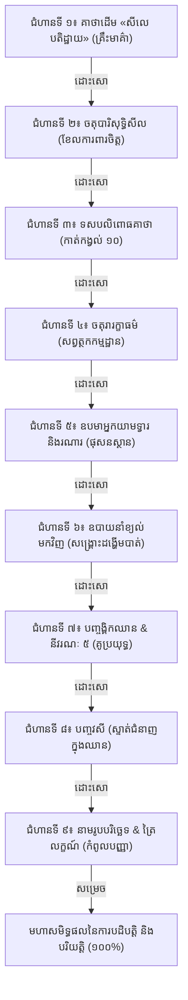

# របាយការណ៍ស្រាវជ្រាវបិដកយោង និងជណ្តើរ ៩ ថ្នាក់នៃវិសុទ្ធិមគ្គ
**កាលបរិច្ឆេទ**៖ ២៥ តុលា ២០២៦  
**អ្នករៀបចំ**៖ អ្នកជំនាញស្រាវជ្រាវបិដកយោង (Citation Specialist) & អ្នកជំនាញព្រះបរិយត្តិ និងវិសុទ្ធិមគ្គ (Visuddhimagga & Pariyatti Specialist)

---

## ១. ការស្រាវជ្រាវ និងការកសាងប្រព័ន្ធ Deep-Linking ទៅកាន់បន្ទាត់ និងកថាខណ្ឌជាក់លាក់

ដើម្បីធានាថា រាល់ពេលដែលអ្នកប្រើប្រាស់ចុចលើតំណភ្ជាប់បិដកយោង (Citation Badge) គេហទំព័រនឹង **លោតចំកថាខណ្ឌ និងបន្ទាត់នៃគម្ពីរពិតប្រាកដ ដោយមានការគូសរំលេចពណ៌លឿង (Highlight)** យើងបានសិក្សាស៊ីជម្រៅលើ Source Code នៃម៉ាស៊ីនអាន `read.html` និង `js/read.js` នៃគម្រោង [tripitaka82.com](https://www.tripitaka82.com/)៖

### ក. រចនាសម្ព័ន្ធ URL ដែលម៉ាស៊ីនអាន (Reader Engine) គាំទ្រ
1. **`book=v1` ដល់ `book=v8`**៖
   - `v1` = វិសុទ្ធិមគ្គ សីលនិទ្ទេស (ក្បាល ៨៣ ក្នុងប្រព័ន្ធទិន្នន័យ)
   - `v2` = វិសុទ្ធិមគ្គ សមាធិនិទ្ទេស ភាគ ១ (ក្បាល ៨៤)
   - `v3` = វិសុទ្ធិមគ្គ សមាធិនិទ្ទេស ភាគ ២ (ក្បាល ៨៥)
   - `v4` = វិសុទ្ធិមគ្គ សមាធិនិទ្ទេស ភាគ ៣ (ក្បាល ៨៦)
   - `v5` = វិសុទ្ធិមគ្គ សមាធិនិទ្ទេស ភាគ ៤ (ក្បាល ៨៧)
   - `v6` = វិសុទ្ធិមគ្គ បញ្ញានិទ្ទេស ភាគ ១ (ក្បាល ៨៨)
   - `v7` = វិសុទ្ធិមគ្គ បញ្ញានិទ្ទេស ភាគ ២ (ក្បាល ៨៩)
   - `v8` = វិសុទ្ធិមគ្គ បញ្ញានិទ្ទេស ភាគ ៣ (ក្បាល ៩០)
2. **`id=XXXXXX`**៖ លេខកូដផ្នែកជាក់លាក់ (Section ID) ធ្វើឱ្យ Browser ទាញយកតែ JSON នៃផ្នែកនោះភ្លាមៗ ដោយមិនបាច់រង់ចាំផ្ទុកមាតិកាធំទាំងអស់។
3. **`page=YY`**៖ កំណត់ទំព័របោះពុម្ពដើម — ម៉ាស៊ីនអាននឹងរំកិល Scroll ទៅកាន់ `id="pg-YY"` ដោយស្វ័យប្រវត្តិ។
4. **`find=KEYWORD`**៖ បញ្ជាឱ្យមុខងារ `autoFind()` ដំណើរការភ្លាមៗ បន្ទាប់ពីរៀបចំអត្ថបទរួច (delay 350ms) ដោយ **គូសរំលេចពណ៌លឿង (Yellow Highlight) លើពាក្យ ឬវាក្យខណ្ឌនោះ និងផ្តោតកែវភ្នែកអ្នកអានទៅចំទីតាំងនោះភ្លាម**។

### ខ. ឧទាហរណ៍ជាក់ស្តែងនៃ Deep Links ក្នុងគម្រោង
* **គាថាដើម «សីលេ បតិដ្ឋាយ»**៖  
  `https://www.tripitaka82.com/read.html?book=v1&id=100251&page=2&find=សីលេ+បតិដ្ឋាយ`
* **ទសបលិពោធ ១០**៖  
  `https://www.tripitaka82.com/read.html?book=v2&id=100298&page=39&find=បលិពោធ+១០`
* **ឧបមាអ្នករក្សាទ្វារ (ទោវារិកោ)**៖  
  `https://www.tripitaka82.com/read.html?book=v4&id=100428&page=80&find=មនុស្សរក្សាទ្វារ`
* **ឧបមារណារ (កកចោ)**៖  
  `https://www.tripitaka82.com/read.html?book=v4&id=100428&page=81&find=ឧបមាដោយរណា`
* **ឧបាយនាំខ្យល់ត្រឡប់មកវិញ (Lost Breath Recovery)**៖  
  `https://www.tripitaka82.com/read.html?book=v4&id=100430&page=85&find=ឧបាយនាំខ្យល់`
* **ទិដ្ឋិវិសុទ្ធិ និងនាមរូប**៖  
  `https://www.tripitaka82.com/read.html?book=v7&id=100664&page=401&find=ទិដ្ឋិវិសុទ្ធិ`

---

## ២. ជណ្តើរ ៩ ថ្នាក់នៃវិសុទ្ធិមគ្គ (នវវិសុទ្ធិបទដ្ឋាន) — ខ្លឹមសារដែលត្រូវទន្ទេញចាំមាត់ជាមុន

ព្រះភទន្តាចារ្យពុទ្ធឃោសៈ បានបញ្ជាក់យ៉ាងច្បាស់ថា ការចម្រើនសមណធម៌ មិនអាចរំលងជំហានគ្រឹះនៃព្រះបរិយត្តិបានឡើយ។ បើមិនទាន់ចាំវាក្យគន្លឹះ និងយល់ឧបមាគ្រឹះទេ ចិត្តនឹងវង្វេងកាលណាជួបឧបសគ្គផ្លូវចិត្ត។

យើងបានរៀបចំជណ្តើរទាំង ៩ ថ្នាក់នេះជាប្រព័ន្ធចាក់សោ (Gated Step-Stone) ដោយ **តម្រូវឱ្យអ្នកបដិបត្តិទន្ទេញចាំ និងផ្ទៀងផ្ទាត់ជំហានមុនជាមុនសិន ទើបអាចដោះសោ (Unlock) ឆ្លងទៅជំហានបន្ទាប់បាន**៖

---

### តារាងសង្ខេបនៃខ្លឹមសារទន្ទេញទាំង ៩ ជំហាន

| ជំហាន | ដំណាក់កាល | គាថា/វាក្យគន្លឹះបាលី | ហេតុផលដែលត្រូវទន្ទេញចាំជាមុន | បិដកយោង (Deep Link) |
| :---: | :--- | :--- | :--- | :--- |
| **១** | សីល (Sīla) | `សីលេ បតិដ្ឋាយ នរោ សបញ្ញោ ចិត្តំ បញ្ញញ្ច ភាវយំ...` | ជាឫសគល់នៃគម្ពីរវិសុទ្ធិមគ្គទាំងមូល បើមិនស្គាល់ទេ នឹងវង្វេងទិសដៅ | វិសុទ្ធិមគ្គ សីលនិទ្ទេស ទំព័រ ២ (`find=សីលេ+បតិដ្ឋាយ`) |
| **២** | សីល (Sīla) | `បាតិមោក្ខសំវរោ, ឥន្ទ្រិយសំវរោ, អាជីវបារិសុទ្ធិ, បច្ចយសន្និស្សិតំ` | ជាខែលការពារអវិប្បដិសារ (មិនក្តៅក្រហាយស្តាយក្រោយ) ជួយឱ្យចិត្តស្ងប់ | វិសុទ្ធិមគ្គ សីលនិទ្ទេស ទំព័រ ១៥១ (`find=បាតិមោក្ខសំវរសីល`) |
| **៣** | សមាធិ | `អាវាសោ ច កុលំ លាភោ គណោ កម្មញ្ច បញ្ចមំ...` | ពិនិត្យកាត់កង្វល់ ១០ មុននឹងបិទភ្នែក មិនឱ្យចិត្តរសាប់រសល់ | វិសុទ្ធិមគ្គ សមាធិនិទ្ទេស ភាគ ១ ទំព័រ ៣៩ (`find=បលិពោធ+១០`) |
| **៤** | សមាធិ | `ពុទ្ធានុស្សតិ មេត្តា ច អសុភំ មរណស្សតិ...` | បោសសម្អាតទីលានចិត្ត និងចាក់ថ្នាំបង្ការកំហឹង តម្រេក ភ័យខ្លាច ៥ នាទីរាល់ថ្ងៃ | វិសុទ្ធិមគ្គ សមាធិនិទ្ទេស ភាគ ១ ទំព័រ ៦២ (`find=សព្វត្ថកម្មដ្ឋាន`) |
| **៥** | សមាធិ | `ទោវារិកោវិយ... កកចោវិយ សតិឧបដ្ឋបនំ` | ដឹងតែត្រង់ចំណុចប៉ះ មិនរវល់ដេញតាមដង្ហើមចូលពោះ ឬតាមដង្ហើមចេញក្រៅ | វិសុទ្ធិមគ្គ សមាធិនិទ្ទេស ភាគ ៣ ទំព័រ ៨០ (`find=មនុស្សរក្សាទ្វារ`) |
| **៦** | សមាធិ | `អនស្សាសកស្ស... ភាវនា នត្ថិ... យត្ថ ផុសតិ តត្ថេវ` | ការពារការភ័យស្លន់ស្លោពេលដង្ហើមស្រាលស្មើនឹងចិត្ត ដឹងវិធីស្ងប់រង់ចាំនិមិត្ត | វិសុទ្ធិមគ្គ សមាធិនិទ្ទេស ភាគ ៣ ទំព័រ ៨៥ (`find=ឧបាយនាំខ្យល់`) |
| **៧** | សមាធិ | `វិតក្កោ វិចារោ បីតិ សុខំ ចិត្តស្សេកគ្គតា...` | ស្គាល់គូប្រយុទ្ធរវាងអង្គឈាន និងនីវរណៈ ៥ ដើម្បីដឹងថ្នាំព្យាបាលរោគចិត្ត | វិសុទ្ធិមគ្គ សមាធិនិទ្ទេស ភាគ ១ ទំព័រ ២៥៤ (`find=បឋមជ្ឈាន`) |
| **៨** | សមាធិ | `អាវជ្ជន, សមាបជ្ជន, អធិដ្ឋាន, វុដ្ឋាន, បច្ចវេក្ខណា` | មិនឱ្យប្រញាប់ឡើងឈានលើទាំងចិត្តមិនទាន់ស្ទាត់ (ការពារការធ្លាក់ទាំងពីរឈាន) | វិសុទ្ធិមគ្គ សមាធិនិទ្ទេស ភាគ ១ ទំព័រ ៣២៨ (`find=វសី+៥`) |
| **៩** | បញ្ញា (Paññā) | `សព្វេ សង្ខារា អនិច្ចា... នាមរូបវវដ្ឋានំ ទិដ្ឋិវិសុទ្ធិ` | កំពូលនៃមាគ៌ា៖ ញែកនាម និងរូប ចាក់ធ្លុះត្រៃលក្ខណ៍ កាត់ផ្តាច់ឫសកិលេស | វិសុទ្ធិមគ្គ បញ្ញានិទ្ទេស ភាគ ២ ទំព័រ ៤០១ (`find=ទិដ្ឋិវិសុទ្ធិ`) |

---

## ៣. យន្តការបច្ចេកវិទ្យានៃប្រព័ន្ធចាក់សោ-ដោះសោ (Interactive Gated Progression)

1. **ការរក្សាទុកទិន្នន័យ (LocalStorage Persistence)**៖
   - កម្រិតនៃជំហានដែលបានដោះសោត្រូវបានកត់ត្រាក្នុង `localStorage.getItem('vism_stepping_unlocked')` (តម្លៃដើម = 1)។ ពេលអ្នកប្រើប្រាស់បិទ browser ឬចូលម្តងទៀត វឌ្ឍនភាពនៅតែដដែល។
2. **ការផ្ទៀងផ្ទាត់ (Verification Checkpoint)**៖
   - ជំហានបច្ចុប្បន្នមានប្រអប់ធីកបញ្ជាក់៖ `[✓] ខ្ញុំបានទន្ទេញចាំមាត់ និងពិចារណាយល់សេចក្តីធម៌នៃជំហាននេះច្បាស់លាស់ហើយ`។ ប្រសិនបើមិនទាន់ធីកទេ ប្រព័ន្ធនឹងមិនអនុញ្ញាតឱ្យចុចដោះសោឡើយ។
3. **សូរសំឡេងជួងសមាធិ (Acoustic Bell Feedback)**៖
   - ពេលចុច «ដោះសោឆ្លងទៅជំហានបន្ទាប់» ម៉ាស៊ីនសំឡេង Web Audio API នឹងបន្លឺជួងកណ្តឹង (`audioEngine.playBowl(320, 4.5)`) បង្កើតនូវសេចក្តីជ្រះថ្លា និងអារម្មណ៍ស្ងប់។
4. **ចលនារំកិល និងរំលេចពន្លឺ (Smooth Scroll & Aura Glow)**៖
   - ទំព័រនឹង scroll ដោយស្វ័យប្រវត្តិកាត់កែវភ្នែកអ្នកអានទៅកាន់ជំហានថ្មីដែលទើបនឹងដោះសោ អមដោយចលនា Aura Flash ពណ៌ទឹកមាស។
5. **ផ្ទាំងមហាសមិទ្ធផល (Grand Mastery Celebration Banner)**៖
   - ពេលឆ្លងផុតទាំង ៩ ជំហាន ផ្ទាំងអបអរសាទរធំនឹងបង្ហាញឡើង រួមជាមួយជម្រើស «ចាប់ផ្តើមរំលឹកឡើងវិញពីជំហានទី ១» គ្រប់ពេលវេលា។
