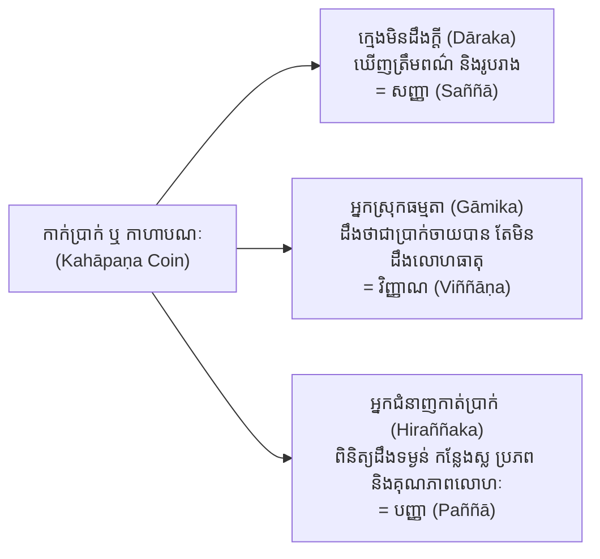
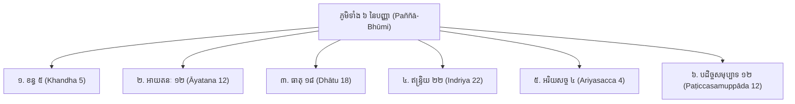
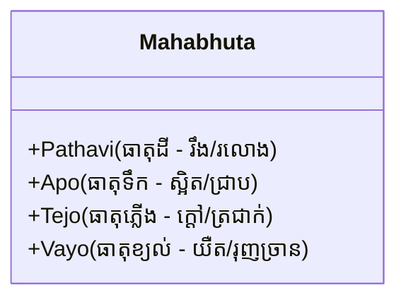
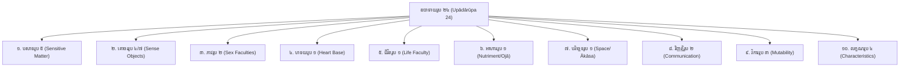
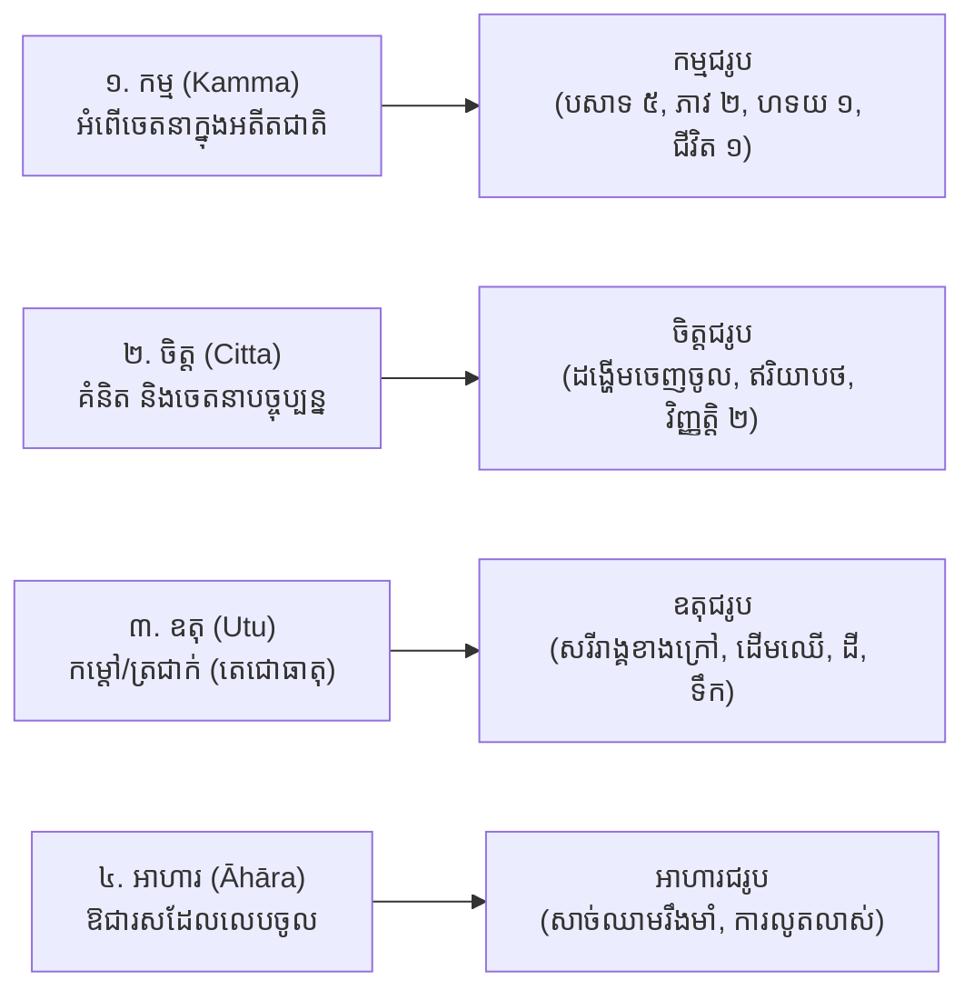
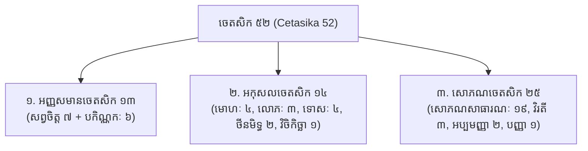
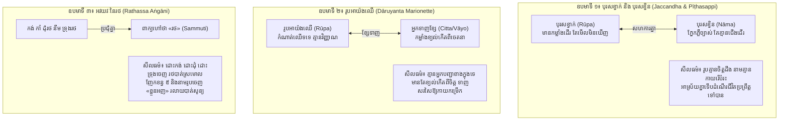
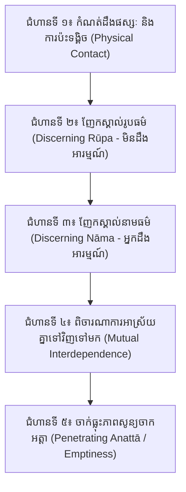

# ការសិក្សាស្រាវជ្រាវស៊ីជម្រៅ៖ វិសុទ្ធិមគ្គ បញ្ញានិទ្ទេស (នាម និង រូប)
## Deep Scholarly Study on Buddhaghosa's Visuddhimagga Paññā Niddesa (Books 88–91 / Volumes v6–v8)
### ការស្វែងយល់លម្អិតអំពី នាម និង រូប (Nāma & Rūpa), ទិដ្ឋិវិសុទ្ធិ, ឧបមាទាំង ៣, និងវិធីចម្រើនវិបស្សនាកម្មដ្ឋានក្នុងជីវិតប្រចាំថ្ងៃ
**ប្រភពគម្ពីរយោងដើម**៖ គម្រោងព្រះត្រៃបិដក និងអដ្ឋកថា ៨២ ក្បាលជាភាសាខ្មែរ ([tripitaka82.com](https://www.tripitaka82.com/))

---

## I. មូលគ្រឹះនៃបញ្ញានិទ្ទេស (Foundations of Paññā Niddesa)

នៅក្នុងគម្ពីរវិសុទ្ធិមគ្គ បញ្ញានិទ្ទេស គឺជាកំពូលនៃត្រៃសិក្ខា (សីល សមាធិ បញ្ញា) ដែលព្រះភទន្តាចារ្យពុទ្ធឃោសៈ បានតាក់តែងឡើងដើម្បីបកស្រាយគាថាបុរាណ៖
> *«សីលេ បតិដ្ឋាយ នរោ សបញ្ញោ ចិត្តំ បញ្ញញ្ច ភាវយំ...»*  
> (បុគ្គលមានប្រាជ្ញា កាលតម្កល់ខ្លួននៅក្នុងសីលហើយ ចម្រើនចិត្ត [សមាធិ] ផង ចម្រើនបញ្ញាផង...)

### ១. និយមន័យ និងលក្ខណាទិចតុក្កៈនៃបញ្ញា (The 4-Fold Definition of Paññā)
យោងតាម **វិសុទ្ធិមគ្គ បញ្ញានិទ្ទេស ភាគ ១ ទំព័រ ២–១៤ (Book 88 / v6)** បញ្ញាមានលក្ខណៈវិនិច្ឆ័យ ៤ យ៉ាង (Lakkhaṇādi-catukka) ដូចខាងក្រោម៖

| លក្ខណៈទាំង ៤ | បាលី (Pāḷi) | សេចក្តីពន្យល់ជាភាសាខ្មែរ (Khmer Explanation) |
| :--- | :--- | :--- |
| **១. លក្ខណៈ (Characteristic)** | *Dhammasabhāvapaṭivedha-lakkhaṇā* | មានការចាក់ធ្លុះនូវសភាវធម៌ពិតនៃធម៌ទាំងឡាយ (អនិច្ចំ ទុក្ខំ អនត្តា) ជាលក្ខណៈ |
| **២. រស/កិច្ច (Function)** | *Visayobhāsana-rasā* ឬ *Moha-andhakāraviddhaṃsana-rasā* | មានការបំភ្លឺអារម្មណ៍ឱ្យភ្លឺច្បាស់ ឬកម្ចាត់បង់នូវងងឹតគឺមោហៈ (អវិជ្ជា) ជាកិច្ច |
| **៣. បច្ចុប្បដ្ឋាន (Manifestation)** | *Asammoha-paccupaṭṭhānā* | មានការមិនវង្វេងមិនភាន់ច្រឡំក្នុងអារម្មណ៍ ជាផលលេចឡើងក្នុងចិត្ត |
| **៤. បទដ្ឋាន (Proximate Cause)** | *Samādhi-padaṭṭhānā* | មានសមាធិ (ចិត្តស្ងប់នឹងនរជាឯកគ្គតា) ជាហេតុជិតស្និទ្ធបំផុតឱ្យកើតឡើង |

> [!NOTE]
> ព្រះអដ្ឋកថាចារ្យបានបញ្ជាក់យ៉ាងដាច់អហង្ការថា៖ *«សមាហិតោ យថាភូតំ បជានាតិ»* — បុគ្គលដែលមានចិត្តតម្កល់មាំក្នុងសមាធិ ទើបអាចដឹងច្បាស់នូវសភាវធម៌តាមពិតបាន។ ដូច្នេះ បើគ្មានមូលដ្ឋានសីល និងសមាធិទេ វិបស្សនាបញ្ញាពិតប្រាកដមិនអាចកើតឡើងបានឡើយ។

---

### ២. ភាពខុសគ្នារវាង សញ្ញា (Saññā), វិញ្ញាណ (Viññāṇa), និង បញ្ញា (Paññā)
នៅក្នុង **វិសុទ្ធិមគ្គ ខន្ធនិទ្ទេស (ភាគ ១ ទំព័រ ៦–៨)** ព្រះពុទ្ធឃោសាចារ្យបានលើកយក **ឧបមាកាក់ប្រាក់ (កាហាបណៈ - The Coin Simile)** មកបំភ្លឺភាពខុសគ្នានៃការដឹង ៣ កម្រិត៖

1. **សញ្ញា (Perception)** ដូចជា **ក្មេងមិនដឹងក្តី**៖ គ្រាន់តែចំណាំស្គាល់រូបរាង ពណ៌ ខៀវ ក្រហម មូល ជ្រុង តែមិនដឹងថាកាក់នោះមានតម្លៃចាយវាយបានឬអត់ឡើយ។
2. **វិញ្ញាណ (Consciousness)** ដូចជា **អ្នកស្រុកធម្មតា**៖ ដឹងថាជារូប ដឹងថាសំឡេង ដឹងថាកាក់ប្រាក់អាចយកទៅទិញទំនិញបាន តែមិនអាចវិភាគដឹងថាកាក់នោះធ្វើពីលោហធាតុអ្វី ស្លនៅទីណា ក្លែងក្លាយឬសុទ្ធឡើយ។
3. **បញ្ញា (Wisdom)** ដូចជា **អ្នកជំនាញកាត់ប្រាក់ (Hiraññaka)**៖ ក្រឡេកមើលភ្លាម ដឹងទាំងរូបរាង ដឹងទាំងតម្លៃចាយវាយ ព្រមទាំងដឹងច្បាស់ថាកាក់នោះធ្វើពីមាសសុទ្ធ ប្រាក់ ឬស្ពាន់ ស្លនៅភូមិណា ផលិតនៅឆ្នាំណា។ បញ្ញាចាក់ធ្លុះនូវ **ត្រៃលក្ខណ៍ (អនិច្ចំ ទុក្ខំ អនត្តា)** ញែកធម៌ជាបរមត្ថ និងសម្រេចអរិយមគ្គ។

---

### ៣. ភូមិទាំង ៦ របស់បញ្ញា (The 6 Grounds / Soil of Wisdom: Paññā-Bhūmi)
មុននឹងអាចបដិបត្តិចម្រើនវិបស្សនាបាន អ្នកបដិបត្តិត្រូវយល់ច្បាស់នូវ «ដី ឬភូមិ» ដែលជាទីតាំងលូតលាស់នៃបញ្ញា ចំនួន ៦ ប្រការ (យោង **វិសុទ្ធិមគ្គ បញ្ញានិទ្ទេស ភាគ ១ & ភាគ ២**)៖

1. **ខន្ធ ៥ (The 5 Aggregates)**៖ រូបក្ខន្ធ, វេទនាក្ខន្ធ, សញ្ញាក្ខន្ធ, សង្ខារក្ខន្ធ, វិញ្ញាណក្ខន្ធ។
2. **អាយតនៈ ១២ (The 12 Sense Bases)**៖
   - *អាយតនៈខាងក្នុង ៦*៖ ចក្ខ្វាយតនៈ, សោតាយតនៈ, ឃានាយតនៈ, ជីវ្ហាយតនៈ, កាយាយតនៈ, មនាយតនៈ។
   - *អាយតនៈខាងក្រៅ ៦*៖ រូបាយតនៈ, សទ្ទាយតនៈ, គន្ធាយតនៈ, រសាយតនៈ, ផោដ្ឋព្វាយតនៈ, ធម្មាយតនៈ។
3. **ធាតុ ១៨ (The 18 Elements)**៖
   - ទ្វារ ៦ (ចក្ខុធាតុ ដល់ កាយធាតុ និងមនោធាតុ)
   - អារម្មណ៍ ៦ (រូបធាតុ ដល់ ផោដ្ឋព្វធាតុ និងធម្មធាតុ)
   - វិញ្ញាណ ៦ (ចក្ខុវិញ្ញាណធាតុ ដល់ កាយវិញ្ញាណធាតុ និងមនោវិញ្ញាណធាតុ)។
4. **ឥន្ទ្រិយ ២២ (The 22 Faculties)**៖ ឥន្ទ្រិយជាធំក្នុងការគ្រប់គ្រង (ទ្វារ ៦, ភាវរូប ២, ជីវិតិន្ទ្រិយ ១, វេទនា ៥, សទ្ធា-វិរិយៈ-សតិ-សមាធិ-បញ្ញា ៥, និងលោកុត្តរិន្ទ្រិយ ៣)។
5. **អរិយសច្ច ៤ (The 4 Noble Truths)**៖ ទុក្ខសច្ច (ខន្ធ ៥), សមុទយសច្ច (តណ្ហា), និរោធសច្ច (ព្រះនិព្វាន), មគ្គសច្ច (អរិយអដ្ឋង្គិកមគ្គ)។
6. **បដិច្ចសមុប្បាទ ១២ (The 12 Links of Dependent Origination)**៖ អវិជ្ជា $\rightarrow$ សង្ខារ $\rightarrow$ វិញ្ញាណ $\rightarrow$ នាមរូប $\rightarrow$ សឡាយតនៈ $\rightarrow$ ផស្សៈ $\rightarrow$ វេទនា $\rightarrow$ តណ្ហា $\rightarrow$ ឧបាទាន $\rightarrow$ ភព $\rightarrow$ ជាតិ $\rightarrow$ ជរាមរណៈ។

---

## II. ការសិក្សាស៊ីជម្រៅលើរូបធម៌ (Deep Dive into Rūpa 28)

យោងតាមគម្ពីរ **វិសុទ្ធិមគ្គ ខន្ធនិទ្ទេស ភាគ ១ ទំព័រ ១៤–៤០ (Book 88 / v6)** ពាក្យថា «រូប» មានអត្ថន័យថា៖
> *«រុប្បតីតិ ខោ ភិក្ខវេ តស្មា រូបន្តិ វុច្ចតិ»* — ម្នាលភិក្ខុទាំងឡាយ ធម្មជាតិណាដែលតែងតែបែកធ្លាយ ប្រែប្រួល ទ្រុឌទ្រោមទៅដោយសារត្រជាក់ ក្តៅ ឃ្លាន ស្រេក របួសសត្វល្អិតទិចខាំ ធម្មជាតិនោះហៅថា **រូប**។

រូបទាំងអស់ក្នុងបរមត្ថវិជ្ជាមាន **២៨ ប្រភេទ** ចែកចេញជា ២ ពួកធំៗគឺ៖
- **មហាភូតរូប ៤** (Great Essentials)
- **ឧបាទាយរូប ២៤** (Derived Matter)

---

### ១. មហាភូតរូប ៤ (The 4 Great Essentials)
មហាភូតរូប ៤ គឺជាមេធាតុគ្រឹះដែលទ្រទ្រង់រូបទាំងអស់ក្នុងលោកធាតុ មិនអាចញែកចេញពីគ្នាបានឡើយ (អវិនoptions)៖

#### ក. បឋវីធាតុ (Pathavī-dhātu - ធាតុដី)
- **លក្ខណៈ (Lakkhaṇa)**៖ *Kakkhalatta-lakkhaṇā* — មានសេចក្តីរឹង រដុប ឬទន់ជាលក្ខណៈ។
- **រស/កិច្ច (Rasa)**៖ *Patiṭṭhāna-rasā* — មានការតាំងនៅ ជាទីពឹងពាក់នៃរូបដទៃជាកិច្ច។
- **បច្ចុប្បដ្ឋាន (Paccupaṭṭhāna)**៖ *Sampaṭicchana-paccupaṭṭhānā* — មានការទទួលទ្រទ្រង់នូវសហជាតរូប ជាផលលេចឡើង។
- **បទដ្ឋាន (Padaṭṭhāna)**៖ *Sesadhātuttaya-padaṭṭhānā* — មានធាតុ ៣ ទៀត (ទឹក ភ្លើង ខ្យល់) ជាហេតុជិត។

#### ខ. អាបោធាតុ (Āpo-dhātu - ធាតុទឹក)
- **លក្ខណៈ (Lakkhaṇa)**៖ *Paggharaṇa-lakkhaṇā* (ហូរ/ជ្រាបចេញ) ឬ *Bandhana-lakkhaṇā* (ការស្អិត/ការចងក្រងរូបធាតុចូលគ្នា) ជាលក្ខណៈ។
- **រស/កិច្ច (Rasa)**៖ *Byāpana-rasā* — មានការផ្សព្វផ្សាយ ពង្រីក និងជ្រាបសព្វនៃរូបជាកិច្ច។
- **បច្ចុប្បដ្ឋាន (Paccupaṭṭhāna)**៖ *Saṅgaha-paccupaṭṭhānā* — មានការប្រមូលផ្តុំ ក្រសោបរូបមិនឱ្យខ្ចាត់ខ្ចាយ ជាផលលេចឡើង។
- **បទដ្ឋាន (Padaṭṭhāna)**៖ *Sesadhātuttaya-padaṭṭhānā* — មានធាតុ ៣ ទៀតជាហេតុជិត។

#### គ. តេជោធាតុ (Tejo-dhātu - ធាតុភ្លើង)
- **លក្ខណៈ (Lakkhaṇa)**៖ *Uṇhatta-lakkhaṇā* — មានកម្តៅ ឬភាពត្រជាក់ (សីតតេជោ & ឧណ្ហតេជោ) ជាលក្ខណៈ។
- **រស/កិច្ច (Rasa)**៖ *Paripācana-rasā* — មានការធ្វើរូបឱ្យទុំជោរ ចាស់ទុំ រំលាយអាហារ ឬដុតកម្ដៅជាកិច្ច។
- **បច្ចុប្បដ្ឋាន (Paccupaṭṭhāna)**៖ *Maddavānuppadāna-paccupaṭṭhānā* — មានការផ្តល់នូវភាពទន់ និងភាពកក់ក្តៅជានិច្ច ជាផលលេចឡើង។
- **បទដ្ឋាន (Padaṭṭhāna)**៖ *Sesadhātuttaya-padaṭṭhānā* — មានធាតុ ៣ ទៀតជាហេតុជិត។

#### ឃ. វាយោធាតុ (Vāyo-dhātu - ធាតុខ្យល់)
- **លក្ខណៈ (Lakkhaṇa)**៖ *Vitthambhana-lakkhaṇā* — មានការទ្រទ្រង់ ការតឹង ភាពយឺត និងការរុញច្រានជាលក្ខណៈ។
- **រស/កិច្ច (Rasa)**៖ *Samudīraṇa-rasā* — មានការធ្វើចលនា ញាប់ញ័រ រំកិលទៅមុខថយក្រោយជាកិច្ច។
- **បច្ចុប្បដ្ឋាន (Paccupaṭṭhāna)**៖ *Abhinīhāra-paccupaṭṭhānā* — មានការនាំរូបកាយឱ្យឈានទៅមុខ ឬផ្លាស់ប្តូរឥរិយាបថ ជាផលលេចឡើង។
- **បទដ្ឋាន (Padaṭṭhāna)**៖ *Sesadhātuttaya-padaṭṭhānā* — មានធាតុ ៣ ទៀតជាហេតុជិត។

---

### ២. ឧបាទាយរូប ២៤ (The 24 Derived Material Phenomena)
ឧបាទាយរូប គឺជារូបដែលកើតឡើងដោយអាស្រ័យលើមហាភូតរូប ៤ ដូចជាដើមឈើ និងស្មៅដែលដុះលើផែនដី៖

#### តារាងលម្អិតនៃរូបទាំង ២៨ ប្រភេទ៖

| លេខ | ក្រុមរូប | ឈ្មោះបាលី | ឈ្មោះខ្មែរ | សេចក្តីពិពណ៌នា និងការពិចារណាក្នុងវិបស្សនា |
| :---: | :--- | :--- | :--- | :--- |
| **១** | មហាភូត | **Pathavī-dhātu** | ធាតុដី | សភាពរឹង ទន់ រដុប (សក់ រោម ក្រចក ធ្មេញ ឆ្អឹង សាច់) |
| **២** | មហាភូត | **Āpo-dhātu** | ធាតុទឹក | សភាពស្អិត ជ្រាប ហូរ ផ្សារភ្ជាប់រូបកាយ (ឈាម ទឹកប្រមាត់ ទឹកសំបោរ) |
| **៣** | មហាភូត | **Tejo-dhātu** | ធាតុភ្លើង | សភាពក្តៅ ត្រជាក់ ការរំលាយអាហារ កម្តៅក្នុងខ្លួន |
| **៤** | មហាភូត | **Vāyo-dhātu** | ធាតុខ្យល់ | សភាពតឹង រុញច្រាន ដង្ហើមចេញចូល ខ្យល់ក្នុងពោះវៀន ចលនាបត់បែន |
| **៥** | បសាទរូប | **Cakkhu-pasāda** | ចក្ខុបសាទ | ភាពជ្រះថ្លានៃភ្នែកសម្រាប់ទទួលរូបារម្មណ៍ (ពណ៌) |
| **៦** | បសាទរូប | **Sota-pasāda** | សោតបសាទ | ភាពជ្រះថ្លានៃត្រចៀកសម្រាប់ទទួលសទ្ទារម្មណ៍ (សំឡេង) |
| **៧** | បសាទរូប | **Ghāna-pasāda** | ឃានបសាទ | ភាពជ្រះថ្លានៃច្រមុះសម្រាប់ទទួលគន្ធារម្មណ៍ (ក្លិន) |
| **៨** | បសាទរូប | **Jivhā-pasāda** | ជីវ្ហាបសាទ | ភាពជ្រះថ្លានៃអណ្តាតសម្រាប់ទទួលរសារម្មណ៍ (រសជាតិ) |
| **៩** | បសាទរូប | **Kāya-pasāda** | កាយបសាទ | ភាពជ្រះថ្លានៃស្បែកកាយទូទាំងខ្លួនសម្រាប់ទទួលផោដ្ឋព្វារម្មណ៍ (ប៉ះពាល់) |
| **១០** | គោចររូប | **Rūpārammaṇa / Vaṇṇa** | រូបារម្មណ៍/ពណ៌ | ពន្លឺ ពណ៌ខៀវ លឿង ក្រហម ស ភ្លឺ ងងឹត ដែលភ្នែកមើលឃើញ |
| **១១** | គោចររូប | **Saddārammaṇa** | សទ្ទារម្មណ៍ | សូរ សំឡេងមនុស្ស សត្វ ខ្យល់ ឡាន ភ្លេង ដែលត្រចៀកឮ |
| **១២** | គោចររូប | **Gandhārammaṇa** | គន្ធារម្មណ៍ | ក្លិនក្រអូប ក្លិនស្អុយ ក្លិនឆួល ដែលច្រមុះហិតដឹង |
| **១៣** | គោចររូប | **Rasārammaṇa** | រសារម្មណ៍ | រសផ្អែម ជូរ ប្រៃ ចត់ ល្វីង ហឹរ ដែលអណ្តាតភ្លក់ដឹង |
| *--* | *(គោចររូប)* | *(Phoṭṭhabba)* | *(ផោដ្ឋព្វារម្មណ៍)* | *(មិនមែនជារូបដាច់ដោយឡែកទេ គឺបានដល់ មហាភូត ៣៖ ដី ភ្លើង ខ្យល់ ប៉ះលើកាយ)* |
| **១៤** | ភាវរូប | **Itthibhāva** | ឥត្ថីភាវរូប | ភាពជាស្រ្តី លក្ខណៈ ទម្រង់ អាកប្បកិរិយាភេទស្រ្តី |
| **១៥** | ភាវរូប | **Purisabhāva** | បុរិសភាវរូប | ភាពជាបុរស លក្ខណៈ ទម្រង់ អាកប្បកិរិយាភេទប្រុស |
| **១៦** | ហទយរូប | **Hadayavatthu** | ហទយវត្ថុ | រូបជាទីតាំងអាស្រ័យនៃមនោធាតុ និងមនោវិញ្ញាណធាតុ (បេះដូង) |
| **១៧** | ជីវិតរូប | **Jīvitindriya-rūpa** | ជីវិតរូប | ធម្មជាតិរក្សាការពាររូបដែលកើតពីកម្មឱ្យរស់នៅបន្តបន្ទាប់ |
| **១៨** | អាហាររូប | **Kavaliṅkārāhāra / Ojā** | ឱជារូប | ឱជារសក្នុងចំណីអាហារដែលចិញ្ចឹមរាងកាយឱ្យចម្រើន |
| **១៩** | បរិច្ឆេទរូប | **Ākāsa-dhātu** | អាកាសធាតុ | ចន្លោះទទេរវាងរូបកលាបនីមួយៗ មិនឱ្យច្រឡូកច្រឡំគ្នា |
| **២០** | វិញ្ញត្តិរូប | **Kāya-viññatti** | កាយវិញ្ញត្តិ | កាយវិការបម្រះខ្លួន គ្រវីក្បាល ដើរ ដែលបង្ហាញបំណងចិត្តឱ្យអ្នកដទៃដឹង |
| **២១** | វិញ្ញត្តិរូប | **Vacī-viññatti** | វចីវិញ្ញត្តិ | វចីវិការ ការបញ្ចេញសំឡេងនិយាយស្តី ដែលបង្ហាញបំណងចិត្ត |
| **២២** | វិការរូប | **Rūpassa Lahutā** | រូបស្ស លဟုតា | ភាពស្រាលនៃរូប មិនធ្ងន់អាប់អួរ ពេលកាយមានសុខភាពល្អ |
| **២៣** | វិការរូប | **Rūpassa Mudutā** | រូបស្ស មុទុតា | ភាពទន់ភ្លន់ មិនរឹងរូសក្រិននៃសាច់ដុំ និងសរសៃ |
| **២៤** | វិការរូប | **Rūpassa Kammaññatā** | រូបស្ស កម្មញ្ញតា | ភាពគួរដល់ការងារ ភាពរហ័សរហួននៃសរីរាង្គកាយ |
| **២៥** | លក្ខណរូប | **Upacaya** | ឧបច័យរូប | ការកើតឡើង និងដុះដាលពេញលេញនៃឥន្ទ្រិយក្នុងគភ៌ |
| **២៦** | លក្ខណរូប | **Santati** | សន្តតិរូប | ការតភ្ជាប់កើតបន្តគ្នាមិនដាច់នៃរូបកាយ |
| **២៧** | លក្ខណរូប | **Jaratā** | ជរតារូប | ភាពទ្រុឌទ្រោម ចាស់ជរា សក់ស្កូវ ធ្មេញបាក់ ស្បែកជ្រីវជ្រួញ |
| **២៨** | លក្ខណរូប | **Aniccatā** | អនិច្ចតារូប | ការបែកធ្លាយ រលត់សាបសូន្យ ការស្លាប់នៃរូបធម៌ |

> [!TIP]
> **និប្ផន្នរូប ១៨ vs អនិប្ផន្នរូប ១០ (Nipphanna vs Anipphanna)**៖
> - **និប្ផន្នរូប ១៨** (មហាភូត ៤, បសាទ ៥, គោចរ ៤, ភាវ ២, ហទយ ១, ជីវិត ១, ឱជា ១) ជា «រូបពិតប្រាកដ» ដែលកើតពីបច្ច័យ ៤ ដោយផ្ទាល់ មានសភាវលក្ខណៈផ្ទាល់ខ្លួន អាចយកមកកំណត់ពិចារណាជាអារម្មណ៍នៃវិបស្សនាបានពេញលេញ។
> - **អនិប្ផន្នរូប ១០** (បរិច្ឆេទ ១, វិញ្ញត្តិ ២, វិការ ៣, លក្ខណៈ ៤) គ្រាន់តែជា «អាការៈ អាការប្លែក ឬព្រំដែន» នៃនិប្ផន្នរូបប៉ុណ្ណោះ មិនមែនជារូបអង្គធម៌ដាច់ដោយឡែកឡើយ។

---

### ៣. សមុដ្ឋាន ៤ នៃរូបធម៌ (The 4 Origins of Matter)
រូបកាយរបស់មនុស្ស និងសត្វកើតឡើង និងទ្រទ្រង់ដោយប្រភពហេតុ ៤ យ៉ាង (**វិសុទ្ធិមគ្គ ភាគ ១ ទំព័រ ៣៥–៤០**)៖

1. **កម្មសមុដ្ឋានរូប (Matter born of Kamma)**៖ កើតអំពីកុសលកម្ម ឬអកុសលកម្មក្នុងអតីតភព។ ចក្ខុបសាទ សោតបសាទ ឃានបសាទ ជីវ្ហាបសាទ កាយបសាទ ឥត្ថីភាវរូប បុរិសភាវរូប ហទយវត្ថុ និងជីវិតិន្ទ្រិយរូប ជាកម្មជរូបសុទ្ធសាធ (គ្មានអ្នកណាអាចកែច្នៃភ្នែក ឬបេះដូងពិតដោយគ្មានកម្មបានឡើយ)។
2. **ចិត្តសមុដ្ឋានរូប (Matter born of Citta)**៖ កើតអំពីចិត្ត និងចេតសិកបច្ចុប្បន្ន។ ពេលចិត្តចង់ដើរ ឈរ អង្គុយ ដេក ញញឹម យំ និយាយ ឬដកដង្ហើម ចិត្តបង្កើតនូវខ្យល់ (វាយោធាតុ) រុញច្រានរូបកាយឱ្យធ្វើចលនា។
3. **ឧតុសមុដ្ឋានរូប (Matter born of Utu)**៖ កើតអំពីតេជោធាតុ (កម្តៅ ឬត្រជាក់)។ រាងកាយមនុស្សត្រូវការកម្តៅសមល្មម បើត្រជាក់ពេក ឬក្តៅពេក រូបកាយនឹងទ្រុឌទ្រោម។ ពិភពធម្មជាតិ ភ្នំ ដើមឈើ សុទ្ធតែកើតពីឧតុ។
4. **អាហារសមុដ្ឋានរូប (Matter born of Āhāra)**៖ កើតអំពីឱជា (ជីវជាតិ) នៃអាហារដែលបរិភោគចូលទៅ។ កាលណាឱជាជ្រាបចូលក្នុងចរន្តឈាម វានឹងបង្កើតរូបកលាបថ្មីៗរាប់លាន ជួយជួសជុលកោសិកាចាស់ និងទ្រទ្រង់អាយុជីវិត។

---

## III. ការសិក្សាស៊ីជម្រៅលើនាមធម៌ (Deep Dive into Nāma)

យោងតាម **វិសុទ្ធិមគ្គ ខន្ធនិទ្ទេស ភាគ ១ ទំព័រ ៤១–១១៥ (Book 88 / v6)** ពាក្យថា «នាម» បានមកពីឫសសព្ទ៖
> *«អារម្មណាភិមុខំ នមតីតិ នាមំ»* — ធម្មជាតិណាដែលតែងតែបង្អោនខ្លួន ឬលំអោនទៅកាន់អារម្មណ៍ ធម្មជាតិនោះហៅថា **នាម**។

នាមធម៌ រួមមាន **អរូបក្ខន្ធ ៤**៖
1. **វេទនាក្ខន្ធ (Vedanā-khandha)**៖ សភាវៈសោយរសអារម្មណ៍ (សុខ ទុក្ខ ឧបេក្ខា / សោមនស្ស ទោមនស្ស)។
2. **សញ្ញាក្ខន្ធ (Saññā-khandha)**៖ សភាវៈចំណាំអារម្មណ៍ ចាំឈ្មោះ ចាំពណ៌ ចាំសញ្ញាសម្គាល់។
3. **សង្ខារក្ខន្ធ (Saṅkhāra-khandha)**៖ សភាវៈតាក់តែងចិត្ត តាក់តែងអំពើល្អ-អាក្រក់ មាន **ចេតនា (Volition)** ជាប្រធាន រួមជាមួយចេតសិក ៥០ ទៀត។
4. **វិញ្ញាណក្ខន្ធ (Viññāṇa-khandha)**៖ សភាវៈដឹងច្បាស់នូវអារម្មណ៍ (ចិត្ត)។

---

### ១. ចិត្ត ៨៩ ឬ ១២១ (The 89/121 Types of Consciousness)
ចិត្ត គឺជាធម្មជាតិដែលជាធំក្នុងការដឹងអារម្មណ៍ (*Cintetīti cittaṃ* / *Vijānātīti viññāṇaṃ*)។
នៅក្នុងដំណើរជីវិត ចិត្តបំពេញនូវ **កិច្ច ១៤ យ៉ាង (Citta-kicca 14)** ដូចជា៖
1. *បដិសន្ធិកិច្ច (Paṭisandhi)*៖ តភ្ជាប់កំណើតថ្មី
2. *ភវង្គកិច្ច (Bhavaṅga)*៖ រក្សាខ្សែជីវិតមិនឱ្យដាច់ ពេលមិនទាន់ទទួលអារម្មណ៍ថ្មី
3. *អាវជ្ជនកិច្ច (Āvajjana)*៖ ពិចារណាអារម្មណ៍តាមទ្វារ ៥ ឬទ្វារមនោ
4. *ទស្សនកិច្ច (Dassana)*៖ ការឃើញរូប (ចក្ខុវិញ្ញាណ)
5. *សវនកិច្ច (Savana)*៖ ការឮសំឡេង (សោតវិញ្ញាណ)
6. *ឃាយនកិច្ច (Ghāyana)*៖ ការហិតក្លិន (ឃានវិញ្ញាណ)
7. *សាយនកិច្ច (Sāyana)*៖ ការភ្លក់រស (ជីវ្ហាវិញ្ញាណ)
8. *ផុសនកិច្ច (Phusana)*៖ ការប៉ះពាល់ត្រជាក់ក្តៅទន់រឹង (កាយវិញ្ញាណ)
9. *សម្បដិច្ឆនកិច្ច (Sampaṭicchana)*៖ ទទួលយកអារម្មណ៍ពីវិញ្ញាណទ្វារ ៥
10. *សន្តីរណកិច្ច (Santīraṇa)*៖ ស៊ើបសួរពិចារណាអារម្មណ៍
11. *វោដ្ឋព្វនកិច្ច (Votthapana)*៖ កាត់សេចក្តីកំណត់អារម្មណ៍
12. *ជវនកិច្ច (Javana)*៖ ការរត់សោយអារម្មណ៍យ៉ាងលឿន ៧ ខណៈ (ជាដំណាក់កាលដែលបង្កើតកម្មល្អ ឬអាក្រក់!)
13. *តទារម្មណកិច្ច (Tadārammaṇa)*៖ ការកត់ត្រាចំណាំអារម្មណ៍បន្ត ២ ខណៈ
14. *ចុតិកិច្ច (Cuti)*៖ ការឃ្លាតចាកចោលភពចាស់ (ការស្លាប់)។

---

### ២. ចេតសិក ៥២ (The 52 Mental Factors)
ចេតសិក គឺជាធម៌ដែលកើតរួមជាមួយចិត្ត រលត់រួមជាមួយចិត្ត មានអារម្មណ៍ដូចចិត្ត និងមានទីតាំងអាស្រ័យដូចចិត្ត (*Ekuppāda-ekanirodha-ekārammaṇa-ekavatthuka*)។ ចេតសិក ៥២ បែងចែកជា ៤ ពួកធំៗ៖

#### ក. អញ្ញសមានចេតសិក ១៣ (Universals & Particulars)
- **សព្វចិត្តសាធារណចេតសិក ៧** (កើតជាមួយចិត្តគ្រប់ដួងទាំងអស់ មិនដែលខាន)៖
  1. *ផស្សៈ (Phassa)* = ការប៉ះខ្ទប់អារម្មណ៍
  2. *វេទនា (Vedanā)* = ការសោយរសអារម្មណ៍
  3. *សញ្ញា (Saññā)* = ការកត់សម្គាល់អារម្មណ៍
  4. *ចេតនា (Cetanā)* = ការដឹកនាំ បង្គាប់បញ្ជា ចាត់ចែងចិត្ត (តួកម្ម!)
  5. *ឯកគ្គតា (Ekaggatā)* = ការតម្កល់ចិត្តនឹងលើអារម្មណ៍តែមួយ
  6. *ជីវិតិន្ទ្រិយ (Jīvitindriya)* = ការរក្សាជីវិតនាមធម៌
  7. *មនសិការ (Manasikāra)* = ការធ្វើអារម្មណ៍ទុកក្នុងចិត្ត ការផ្ចង់ចិត្តឆ្ពោះទៅអារម្មណ៍។
- **បកិណ្ណកចេតសិក ៦** (កើតជាមួយចិត្តខ្លះ មិនកើតជាមួយចិត្តខ្លះ)៖
  8. *វិតក្កៈ (Vitakka)* = ការលើកចិត្តឡើងកាន់អារម្មណ៍
  9. *វិចារៈ (Vicāra)* = ការអង្អែល ឬជ្រួតជ្រាបលើអារម្មណ៍
  10. *អធិមោក្ខ (Adhimokkha)* = ការសម្រេចចិត្តលើអារម្មណ៍
  11. *វិរិយៈ (Vīriya)* = ការប្រឹងប្រែង ឧស្សាហ៍
  12. *បីតិ (Pīti)* = សេចក្តីឆ្អែតកាយឆ្អែតចិត្ត
  13. *ឆន្ទៈ (Chanda)* = សេចក្តីប្រាថ្នានឹងធ្វើ។

#### ខ. អកុសលចេតសិក ១៤ (Unwholesome Factors)
- *មោហចតុកៈ ៤*៖ មោហៈ (ល្ងង់វង្វេង), អហិរិកៈ (មិនខ្មាសបាប), អនោត្តប្បៈ (មិនខ្លាចបាប), ឧទ្ធច្ចៈ (រាយមាយ)។
- *លោភត្រិកៈ ៣*៖ លោភៈ (ជាប់ជំពាក់), ទិដ្ឋិ (យល់ខុស), មានះ (ប្រកាន់ឫកពា ប្រៀបធៀប)។
- *ទោសចតុកៈ ៤*៖ ទោសៈ (ខឹងមួម៉ៅ), ឥស្សា (ច្រណែន), មច្ឆរិយៈ (កំណាញ់), កុក្កុច្ចៈ (ក្តៅក្រហាយស្តាយក្រោយ)។
- *ថីនទ្វិកៈ ២*៖ ថីនៈ (ចិត្តរួញរា), មិទ្ធៈ (ចិត្តងងុយដេក)។
- *វិចិកិច្ឆា ១*៖ វិចិកិច្ឆា (សង្ស័យព្រះពុទ្ធ ព្រះធម៌ ព្រះសង្ឃ បដិបត្តិ)។

#### គ. សោភណចេតសិក ២៥ (Beautiful Factors)
- *សោភណសាធារណៈ ១៩* (កើតជាមួយកុសលចិត្តគ្រប់ដួង)៖
  សទ្ធា (ជំនឿជ្រះថ្លា), សតិ (ការរលឹកដឹង), ហិរិ (សេចក្តីខ្មាសបាប), ឱត្តប្ប (សេចក្តីខ្លាចបាប), អលោភៈ (មិនលោភលន់), អទោសៈ (មេត្តា មិនខឹង), តត្រមជ្ឈត្តតា (ឧបេក្ខា ចិត្តកណ្តាល), កាយបស្សទ្ធិ & ចិត្តបស្សទ្ធិ (ស្ងប់កាយស្ងប់ចិត្ត), កាយលဟုតា & ចិត្តលဟုតា (ស្រាលកាយស្រាលចិត្ត), កាយមុទុតា & ចិត្តមុទុតា (ទន់ភ្លន់កាយចិត្ត), កាយកម្មញ្ញតា & ចិត្តកម្មញ្ញតា (គួរដល់ការងារ), កាយបាគុញ្ញតា & ចិត្តបាគុញ្ញតា (ស្ទាត់ជំនាញ), កាយុជុកតា & ចិត្តុជុកតា (ត្រង់កាយត្រង់ចិត្ត)។
- *វិរតី ៣*៖ សម្មាវាចា (វៀរវាចាខុស), សម្មាកម្មន្ត (វៀរកាយខុស), សម្មាអាជីវៈ (វៀរចិញ្ចឹមជីវិតខុស)។
- *អប្បមញ្ញា ២*៖ ករុណា (អាណិតសត្វមានទុក្ខ), មុទិតា (ត្រេកអរពេលឃើញគេមានសុខ)។
- *បញ្ញិន្ទ្រិយ ១*៖ បញ្ញា ឬ អមោហៈ (ដឹងច្បាស់នូវសច្ចធម៌)។

---

## IV. នាមរូបបរិច្ឆេទញាណ និង ទិដ្ឋិវិសុទ្ធិ (Nāmarūpapariccheda-ñāṇa & Diṭṭhi-visuddhi)

យោងតាម **វិសុទ្ធិមគ្គ ទិដ្ឋិវិសុទ្ធិនិទ្ទេស ភាគ ២ ទំព័រ ៤០១–៤៣០ (Book 89 / v7)**៖
> *«នាមរូបានំ យាថាវទស្សនំ ទិដ្ឋិវិសុទ្ធិ នាម»*  
> ការឃើញច្បាស់នូវនាម និងរូប តាមសភាវៈពិត ហៅថា **ទិដ្ឋិវិសុទ្ធិ (Purification of View)**។

កាលណាអ្នកបដិបត្តិបានធ្វើចិត្តឱ្យស្ងប់ក្នុងឧបចារសមាធិ ឬអប្បនាសមាធិ (ឈាន ១–៤) ហើយចេញមក យោគាវចរពិចារណារូបកាយ និងចិត្តដឹង។ ពេលនោះ យោគាវចរនឹងដឹងច្បាស់ថា៖
> ក្នុងលោកនេះ **ពុំមានសត្វ បុគ្គល តួខ្លួន យើង គេ ព្រលឹង ឬអាត្មាណាមួយឡើយ**។ មានតែ «រូបធម៌» (សភាពមិនដឹងអារម្មណ៍) និង «នាមធម៌» (សភាពដឹងអារម្មណ៍) ដែលកើតឡើងដោយអាស្រ័យគ្នាទៅវិញទៅមក រលត់ទៅវិញជាដរាប។

---

### ឧបមាដ៏ល្បីល្បាញទាំង ៣ ក្នុងគម្ពីរវិសុទ្ធិមគ្គ (The 3 Famous Master Similes)

ដើម្បីកម្ចាត់បង់នូវ «សក្កាយទិដ្ឋិ» (ការប្រកាន់ថាជារូបយើង ឬព្រលឹងយើង) ព្រះភទន្តាចារ្យពុទ្ធឃោសៈ បានលើកយក **ឧបមាអមតៈ ៣** មកបង្ហាញក្នុងទិដ្ឋិវិសុទ្ធិនិទ្ទេស៖

---

#### ១. ឧបមាបុរសខ្វាក់ និង បុរសខ្វិន (The Blind Man and the Cripple - Jaccandha & Pīṭhasappi)
- **សាច់រឿងក្នុងគម្ពីរ**៖
  បុរសម្នាក់ពីកំណើតមកខ្វាក់ភ្នែកមើលមិនឃើញអ្វីទាំងអស់ (*Jaccandha*) ប៉ុន្តែដៃជើងរបស់គាត់រឹងមាំ មានកម្លាំងដើរផ្លូវឆ្ងាយបាន។ រីឯបុរសម្នាក់ទៀត មានជើងស្វិតខ្វិនដើរមិនរួច (*Pīṭhasappi*) ប៉ុន្តែភ្នែករបស់គាត់ភ្លឺថ្លា មើលឃើញផ្លូវកាត់ ផ្លូវបត់ ថ្លុក ជ្រោះយ៉ាងច្បាស់។  
  បុរសទាំងពីរនាក់ចង់ធ្វើដំណើរទៅកាន់ទីក្រុងឆ្ងាយមួយ។ បើបុរសខ្វាក់ដើរតែម្នាក់ឯង មុខជានឹងធ្លាក់ជ្រោះ ឬបុកដើមឈើស្លាប់។ បើបុរសខ្វិនវារតែម្នាក់ឯង មុខជានឹងហត់ស្លាប់ពាក់កណ្តាលផ្លូវ។  
  អ្នកទាំងពីរបានព្រមព្រៀងគ្នា៖ **បុរសខ្វិនបានឡើងជិះលើស្មារបស់បុរសខ្វាក់**។ បុរសខ្វិនប្រើភ្នែកមើលផ្លូវ ហើយប្រាប់ថា «បត់ឆ្វេង បត់ស្តាំ ដើរត្រង់ ជៀសថ្លុក»។ បុរសខ្វាក់ប្រើកម្លាំងជើងដើរតាមបញ្ជានោះ។ ដោយសារការសហការគ្នានេះ អ្នកទាំងពីរក៏បានទៅដល់គោលដៅដោយសុវត្ថិភាព។
- **ការប្រៀបធៀបក្នុងវិបស្សនា**៖
  - **រូបធម៌ ប្រៀបដូចជា បុរសខ្វាក់**៖ រូបកាយមានកម្លាំងដើរ ឈរ អង្គុយ ដេក បរិភោគ និយាយស្តីបាន ប៉ុន្តែរូបកាយគ្មានវិញ្ញាណដឹងខុសត្រូវ គ្មានចេតនា មិនដឹងអារម្មណ៍ឡើយ (Blind Matter)។
  - **នាមធម៌ ប្រៀបដូចជា បុរសខ្វិន**៖ ចិត្ត និងចេតសិក មានភ្នែកភ្លឺច្បាស់ ដឹងអារម្មណ៍ ចង់ដើរ ចង់និយាយ ប៉ុន្តែខ្លួនឯងគ្មានដៃជើងសាច់ឈាម មិនអាចបោះជំហាន ឬបញ្ចេញសំឡេងដោយគ្មានរូបកាយបានឡើយ (Cripple Mind)។
  - **ដំណើរជីវិត**៖ កាលណាចិត្តចង់ដើរ ចិត្តបង្កើតនូវវាយោធាតុរុញជើងឱ្យឈានទៅ។ រូប និងនាមអាស្រ័យគ្នាទៅវិញទៅមក (*Aññamaññanissitā*) គ្មានទេវតា ព្រះព្រហ្ម ឬព្រលឹងអាត្មាណាមកបង្កើតឡើយ។

---

#### ២. ឧបមារូបអាយ៉ងឈើ (The Wooden Puppet / Marionette - Dāruyanta)
- **សាច់រឿងក្នុងគម្ពីរ**៖
  រូបអាយ៉ងឈើមួយ ត្រូវបានជាងឆ្លាក់ធ្វើពីកំណាត់ឈើស្ងួត តភ្ជាប់ដោយសន្លាក់ ដែកគោល និងខ្សែចំណង។ រូបអាយ៉ងនោះគ្មានជីវិត គ្មានដង្ហើម មិនចេះឈឺ មិនចេះស្រែក ហើយមិនអាចងើបឈរដោយខ្លួនឯងបានឡើយ។  
  ប៉ុន្តែនៅពេលដែលអ្នកលេងអាយ៉ងទាញខ្សែពីលើ ដៃអាយ៉ងក៏លើកឡើង ជើងអាយ៉ងក៏បោះជំហាន ក្បាលអាយ៉ងក៏ងក់ចុះឡើង រាំតាមចង្វាក់ភ្លេង។ មនុស្សល្ងង់ដែលឈរមើលពីចម្ងាយ តែងគិតច្រឡំថា «អាយ៉ងនោះមានជីវិត មានមនុស្សនៅក្នុងនោះ!» ប៉ុន្តែអ្នកមានប្រាជ្ញាចូលទៅមើលជិត ទើបដឹងថា វាគ្រាន់តែជាកំណាត់ឈើដែលកម្រើកដោយសារខ្សែទាញប៉ុណ្ណោះ។
- **ការប្រៀបធៀបក្នុងវិបស្សនា**៖
  - សរីរាង្គកាយ ឆ្អឹង សាច់ សរសៃ ប្រៀបដូចជា **កំណាត់ឈើនៃរូបអាយ៉ង** ដែលទទេស្អាត គ្មានព្រលឹង គ្មានម្ចាស់។
  - ចិត្ត និងចេតនា ប្រៀបដូចជា **អ្នកបញ្ជាខ្សែអាយ៉ង**។
  - ខ្យល់កើតអំពីចិត្ត (*Cittasamuṭṭhāna-vāyodhātu*) ប្រៀបដូចជា **ខ្សែចំណងដែលទាញសន្លាក់ឆ្អឹង**។
  - ពេលចិត្តគិតចង់លើកដៃ ខ្យល់ចិត្តសមុដ្ឋានក៏រត់ទៅទាញសរសៃពួរ ដៃក៏លើកឡើង។ គ្មាន «ខ្ញុំ» លើកដៃទេ គឺមានតែ «ចលនានៃខ្យល់ និងសរសៃឈាមដែលរុញដោយកម្លាំងចិត្ត» ប៉ុណ្ណោះ។

---

#### ៣. ឧបមាអវយវៈនៃរថ (The Assembly of Chariot Parts - Rathassa Aṅgāni)
- **សាច់រឿងក្នុងគម្ពីរ (ព្រះនាងវជិរាថេរីគាថា)**៖
  នៅក្នុងគម្ពីរសំយុត្តនិកាយ និងវិសុទ្ធិមគ្គ ព្រះនាងវជិរាភិក្ខុនី បានឆ្លើយតបនឹងមារដែលមានគំនិតយល់ច្រឡំថា៖
  > *«យថា ហិ អង្គសម្ភារា ហោតិ សទ្ទោ រថោ ឥតិ*  
  > *ឯវំ ខន្ធេសុ សន្តេសុ ហោតិ សត្តោតិ សម្មុតិ។»*  
  > (ដូចពាក្យថា «រថ» តែងមានឡើងព្រោះការប្រជុំគ្នានៃគ្រឿងអវយវៈរថទាំងឡាយយ៉ាងណា មិញ កាលបើខន្ធទាំងឡាយនៅមាន សន្មតិថា «សត្វ បុគ្គល» ក៏តែងមានឡើងយ៉ាងនោះឯង។)
- **ការប្រៀបធៀបក្នុងវិបស្សនា**៖
  - ប្រសិនបើយើងដោះកង់ចេញ ដោះដុំចេញ ដោះទ្រុងចេញ ដោះនឹមចេញ ដោះខ្សែបរចេញ តើពាក្យថា «រថ» នៅត្រង់ណា? គ្មានរថឡើយ! ពាក្យថារថ គ្រាន់តែជាឈ្មោះសន្មតិសម្រាប់ហៅបណ្តុំគ្រឿងបន្លាស់ដែលផ្គុំចូលគ្នាប៉ុណ្ណោះ។
  - ដូចគ្នានេះដែរ កាលណាយើងញែកដក រូបក្ខន្ធ (ដី ទឹក ភ្លើង ខ្យល់), វេទនាក្ខន្ធ (ការសោយអារម្មណ៍), សញ្ញាក្ខន្ធ (ការចាំ), សង្ខារក្ខន្ធ (ចេតនា តាក់តែង), និងវិញ្ញាណក្ខន្ធ (ការដឹង) ចេញពីគ្នា តើ «ខ្លួនខ្ញុំ» នៅឯណា?  
  - គ្មាន «ខ្ញុំ» គ្មាន «មនុស្ស» គ្មាន «សត្វ» ឡើយ មានតែបាតុភូតធម្មជាតិដែលកើតរលត់ៗតាមហេតុបច្ច័យសុទ្ធសាធ! នេះគឺជាការសម្រេច **ទិដ្ឋិវិសុទ្ធិ** ដែលកម្ទេចឫសគល់នៃសក្កាយទិដ្ឋិ ២០ ប្រការបានទាំងស្រុង។

---

## V. វិធីចម្រើនវិបស្សនាកម្មដ្ឋានក្នុងជីវិតប្រចាំថ្ងៃ (Daily Life Practical Contemplation)

ដើម្បីឱ្យការសិក្សាព្រះបរិយត្តិមិននៅត្រឹមតែទ្រឹស្តី ព្រះភទន្តាចារ្យពុទ្ធឃោសៈ បានណែនាំវិធីកំណត់ដឹងនាមរូបក្នុងជីវិតជាក់ស្តែង (Direct Phenomenological Discerning) តាមជំហានទាំង ៥ ដូចតទៅ៖

### ជំហានទាំង ៥ ក្នុងការបដិបត្តិ (The 5-Step Practical Meditation Process)

#### ជំហានទី ១៖ កំណត់ដឹងផស្សៈ និងការប៉ះទង្គិច (Awareness of Touch & Contact)
- **វិធីអនុវត្ត**៖ ពេលកំពុងអង្គុយលើកៅអី ឬលើកម្រាល ចូរផ្ចង់ស្មារតីទៅកាន់ចំណុចប៉ះទង្គិចរវាងរាងកាយ និងកម្រាល (ត្រគាក កែងជើង ជង្គង់ ឬដៃដែលប៉ះគ្នា)។
- **ការសង្កេត**៖ ដឹងនូវសភាពរឹង សភាពទន់ ឬសភាពក្តៅត្រជាក់ដែលកំពុងប្រាកដនៅត្រង់ចំណុចនោះ។

#### ជំហានទី ២៖ ញែកដឹងសភាពនោះថាជារូបធម៌ (Discerning Matter / Rūpa)
- **វិធីអនុវត្ត**៖ សង្កេតមើលឱ្យច្បាស់ថា សភាពរឹង ឬទន់នោះ គឺជា **បឋវីធាតុ** (ធាតុដី); សភាពក្តៅ ឬត្រជាក់ គឺជា **តេជោធាតុ** (ធាតុភ្លើង); សភាពតឹង ឬសង្កត់ គឺជា **វាយោធាតុ** (ធាតុខ្យល់)។
- **ការសង្កេត**៖ ធាតុរឹង ក្តៅ ត្រជាក់ទាំងនេះ **មិនចេះគិត មិនដឹងខ្លួន មិនដឹងថាខ្លួនឯងជារបស់អ្នកណាឡើយ**។ វាដូចជាដុំថ្ម ឬកំណាត់ឈើដែលគេដាក់លើដី — នេះហៅថា **«រូបធម៌»**។

#### ជំហានទី ៣៖ ញែកដឹងសភាពដឹងថាជានាមធម៌ (Discerning Mind / Nāma)
- **វិធីអនុវត្ត**៖ បង្វែរការយកចិត្តទុកដាក់មករក «សភាវៈដែលកំពុងដឹង» នូវភាពរឹង ឬក្តៅនោះវិញ។
- **ការសង្កេត**៖ តើអ្នកណាដឹង? គឺចិត្ត (វិញ្ញាណ) ជាអ្នកដឹង; វេទនា ជាអ្នកសោយអារម្មណ៍ស្រួល ឬមិនស្រួល; សញ្ញា ជាអ្នកចាំសម្គាល់ថារឹង; មនសិការ ជាអ្នកផ្ចង់ចិត្ត។ ក្រុមធម្មជាតិដែលដឹងអារម្មណ៍នេះ គ្មានរូបរាង គ្មានពណ៌ តែមានសមត្ថភាពដឹងច្បាស់ — នេះហៅថា **«នាមធម៌»**។

#### ជំហានទី ៤៖ ពិចារណាការអាស្រ័យគ្នាទៅវិញទៅមក (Discerning Interdependence)
- **វិធីអនុវត្ត**៖ ពិចារណាដោយបញ្ញាថា បើគ្មានកាយដែលប៉ះនឹងកម្រាលទេ (គ្មានរូប) តើចិត្តដឹងការប៉ះអាចកើតឡើងបានទេ? មិនអាចកើតបានឡើយ។ បើគ្មានចិត្តដឹងទេ (គ្មាននាម) តើរូបកាយនេះខុសពីសាកសពទេ? មិនខុសឡើយ។
- **ការសង្កេត**៖ នាម និងរូប អាស្រ័យគ្នាទៅវិញទៅមកដូច **បុរសខ្វាក់ និងបុរសខ្វិន** ឬដូច **កណ្តាប់ស្មៅដើមត្រែងពីរដើមដែលផ្អែកគ្នាឈរ** (Ven. Sāriputta's Naḷakalāpī Simile in SN 12.67) — បើដកមួយចេញ មួយទៀតនឹងដួលរលំភ្លាម។

#### ជំហានទី ៥៖ ចាក់ធ្លុះភាពសូន្យចាកអត្តា (Seeing Anattā & Liberation)
- **វិធីអនុវត្ត**៖ សួរដេញដោលក្នុងចិត្តថា៖ «តើមាន "ខ្ញុំ" ឬ "ខ្លួនខ្ញុំ" អង្គុយនៅទីនេះទេ?»
- **ការសង្កេត**៖ ឃើញច្បាស់ដោយបញ្ញាថា៖ «មានតែរូបធម៌ដែលរឹង និងនាមធម៌ដែលដឹង។ រូបក៏មិនមែនជាខ្ញុំ នាមក៏មិនមែនជាខ្ញុំ។ ទាំងពីរនេះកើតឡើងព្រោះហេតុបច្ច័យ ហើយរលត់ទៅវិញជាខណៈៗ ឥតមានព្រលឹង ឬអាត្មាណានៅទីនោះឡើយ!» ចិត្តនឹងលែងជាប់ជំពាក់ រំសាយការប្រកាន់ខ្លួន ហើយចូលកាន់សេចក្តីស្ងប់ដ៏បរិសុទ្ធ។

---

### ការអនុវត្តតាមទ្វារឥរិយាបថទាំង ៤ ក្នុងជីវិត (Everyday Mindfulness Anchors)

| ឥរិយាបថ / សកម្មភាព | រូបធម៌ (Rūpa - សភាពមិនដឹង) | នាមធម៌ (Nāma - សភាពដឹង) | ការពិចារណាវិបស្សនាជាក់ស្តែង |
| :--- | :--- | :--- | :--- |
| **១. ការដកដង្ហើម (Ānāpāna)** | ខ្យល់ប៉ះចុងច្រមុះ (វាយោធាតុ & ផោដ្ឋព្វរូប) | សតិ និងចិត្តដែលដឹងដង្ហើមចូល-ចេញ (វិញ្ញាណក្ខន្ធ) | «ដង្ហើមជារូប ចិត្តដឹងជានាម កើតហើយរលត់ គ្មានខ្ញុំដកដង្ហើមទេ» |
| **២. ការស្តាប់សំឡេង (Hearing)** | សំឡេងឡាន សំឡេងមនុស្ស (សទ្ទរូប) + ប្រហោងត្រចៀក (សោតបសាទ) | សោតវិញ្ញាណ និងសញ្ញាដែលដឹង និងស្គាល់សំឡេង | «សំឡេងប៉ះត្រចៀកទើបកើតការឮ គ្មានបុរសណាម្នាក់នៅក្នុងត្រចៀកឡើយ» |
| **៣. ការឈានជើងដើរ (Walking)** | កាយវិការបោះជើង ការប៉ះដី (វាយោធាតុ & បឋវីធាតុ) | ចេតនានាំឱ្យបោះជំហាន និងចិត្តដឹងការឈានជើង | «ដូចរូបអាយ៉ងឈើ ចិត្តគិតចង់ដើរ ខ្យល់ក៏រុញជើងឱ្យបោះទៅមុខ» |
| **៤. ការបរិភោគអាហារ (Eating)** | បាយ ទឹក រសជាតិផ្អែម ប្រៃ (រូបារម្មណ៍ រសារម្មណ៍ ឱជា) | ចិត្តចង់ញ៉ាំ ជីវ្ហាវិញ្ញាណភ្លក់រស វេទនាសោយរសឆ្ងាញ់ | «អាហារជាធាតុបំប៉នរូប ចិត្តដឹងរសជានាម មិនមែនយើងញ៉ាំដើម្បីស្រវឹងទេ» |
| **៥. ពេលកើតកំហឹង ឬមួម៉ៅ (Stress/Anger)** | បេះដូងលោតញាប់ កម្តៅភាយលើមុខ (តេជោធាតុ) | ទោសចេតសិក និងទោមនស្សវេទនា (អកុសលនាមធម៌) | «កំហឹងជាទោសចេតសិកកើតពីអារម្មណ៍មិនគាប់ចិត្ត វាមិនមែនជាអញឡើយ» |

---

## VI. តារាងបិដកយោង និងតំណភ្ជាប់ Deep-Links ទៅកាន់ Tripitaka82.com

ដើម្បីឱ្យការសិក្សាស្រាវជ្រាវនេះមានតម្លៃជាវិជ្ជាជីវៈ និងអាចផ្ទៀងផ្ទាត់បាន ១០០% ខាងក្រោមនេះជាតារាងបិដកយោងជាក់លាក់នៃគម្ពីរវិសុទ្ធិមគ្គ បញ្ញានិទ្ទេស (ភាគ ៦, ភាគ ៧, ភាគ ៨) លើគេហទំព័រ [tripitaka82.com](https://www.tripitaka82.com/)៖

| ជំពូក / បរិច្ឆេទ | ខ្លឹមសារធម៌សំខាន់ | ភាគ និងក្បាល | ទំព័រដើម | គន្លឹះស្វែងរក (Find Keyword) | តំណភ្ជាប់បិដកយោងពិត (Deep Link) |
| :--- | :--- | :---: | :---: | :--- | :--- |
| **បញ្ញានិទ្ទេស (អារម្ភកថា)** | និយមន័យបញ្ញា, លក្ខណាទិចតុក្កៈ, ឧបមាកាក់ប្រាក់ ៣ កម្រិត | ភាគ ៦ (ក្បាល ៨៨) | ទំព័រ ១–១៤ | `បញ្ញានិទ្ទេស` | [v6 ទំព័រ ១](https://www.tripitaka82.com/read.html?book=v6&page=1) |
| **ខន្ធនិទ្ទេស (រូបក្ខន្ធ)** | រូប ២៨, មហាភូត ៤, ឧបាទាយរូប ២៤ | ភាគ ៦ (ក្បាល ៨៨) | ទំព័រ ១៥–៣៤ | `រូបក្ខន្ធ` | [v6 ទំព័រ ១៥](https://www.tripitaka82.com/read.html?book=v6&page=15&find=រូបក្ខន្ធ) |
| **ខន្ធនិទ្ទេស (សមុដ្ឋាន ៤)** | កម្ម, ចិត្ត, ឧតុ, អាហារ បង្កើតរូប | ភាគ ៦ (ក្បាល ៨៨) | ទំព័រ ៣៥–៤០ | `សមុដ្ឋាន` | [v6 ទំព័រ ៣៥](https://www.tripitaka82.com/read.html?book=v6&page=35&find=សមុដ្ឋាន) |
| **ខន្ធនិទ្ទេស (នាមក្ខន្ធ)** | វេទនា, សញ្ញា, សង្ខារ, ចេតសិក ៥២, ចិត្ត ៨៩/១២១ | ភាគ ៦ (ក្បាល ៨៨) | ទំព័រ ៤១–១១៥ | `ចេតសិក` | [v6 ទំព័រ ៤១](https://www.tripitaka82.com/read.html?book=v6&page=41&find=ចេតសិក) |
| **អាយតនៈ & ធាតុនិទ្ទេស** | អាយតនៈ ១២, ធាតុ ១៨ (ភូមិរបស់បញ្ញា) | ភាគ ៦ (ក្បាល ៨៨) | ទំព័រ ១១៦–១៨០ | `អាយតន` | [v6 ទំព័រ ១១៦](https://www.tripitaka82.com/read.html?book=v6&page=116&find=អាយតន) |
| **បដិច្ចសមុប្បាទនិទ្ទេស** | អង្គ ១២ នៃបដិច្ចសមុប្បាទ និងបច្ច័យ ២៤ | ភាគ ៧ (ក្បាល ៨៩) | ទំព័រ ១–៤០០ | `បដិច្ចសមុប្បាទ` | [v7 ទំព័រ ១](https://www.tripitaka82.com/read.html?book=v7&page=1&find=បដិច្ចសមុប្បាទ) |
| **ទិដ្ឋិវិសុទ្ធិនិទ្ទេស** | នាមរូបវវដ្ឋានំ, ការញែកនាម និងរូប | ភាគ ៧ (ក្បាល ៨៩) | ទំព័រ ៤០១ | `ទិដ្ឋិវិសុទ្ធិ` | [v7 ទំព័រ ៤០១](https://www.tripitaka82.com/read.html?book=v7&id=100664&page=401&find=ទិដ្ឋិវិសុទ្ធិ) |
| **ទិដ្ឋិវិសុទ្ធិ (ឧបមា ១)** | ឧបមាបុរសខ្វាក់ និងបុរសខ្វិន | ភាគ ៧ (ក្បាល ៨៩) | ទំព័រ ៤១៨ | `បុរសខ្វាក់` | [v7 ទំព័រ ៤១៨](https://www.tripitaka82.com/read.html?book=v7&id=100664&page=418&find=បុរសខ្វាក់) |
| **ទិដ្ឋិវិសុទ្ធិ (ឧបមា ២)** | ឧបមារូបអាយ៉ងឈើ | ភាគ ៧ (ក្បាល ៨៩) | ទំព័រ ៤២០ | `រូបអាយ៉ង` | [v7 ទំព័រ ៤២០](https://www.tripitaka82.com/read.html?book=v7&id=100664&page=420&find=រូបអាយ៉ង) |
| **ទិដ្ឋិវិសុទ្ធិ (ឧបមា ៣)** | ឧបមាអវយវៈនៃរថ (វជិរាថេរីគាថា) | ភាគ ៧ (ក្បាល ៨៩) | ទំព័រ ៤២៣ | `អវយវៈនៃរថ` | [v7 ទំព័រ ៤២៣](https://www.tripitaka82.com/read.html?book=v7&id=100664&page=423&find=អវយវៈនៃរថ) |
| **កង្ខាវិតរណវិសុទ្ធិ** | ការឆ្លងផុតសេចក្តីសង្ស័យ ដោយដឹងហេតុបច្ច័យនៃនាមរូប | ភាគ ៧ (ក្បាល ៨៩) | ទំព័រ ៤៣៥ | `កង្ខាវិតរណវិសុទ្ធិ` | [v7 ទំព័រ ៤៣៥](https://www.tripitaka82.com/read.html?book=v7&page=435&find=កង្ខាវិតរណវិសុទ្ធិ) |
| **មគ្គាមគ្គញាណទស្សន** | ឧទយព្វយញាណ និងវិបស្សនូបក្កិលេស ១០ | ភាគ ៨ (ក្បាល ៩០) | ទំព័រ ១–៦៤ | `មគ្គាមគ្គ` | [v8 ទំព័រ ១](https://www.tripitaka82.com/read.html?book=v8&page=1&find=មគ្គាមគ្គ) |
| **បដិបទាញ្ញាណទស្សន** | វិបស្សនាញាណ ៩ (ឧទយព្វយ ដល់ អនុលោម) | ភាគ ៨ (ក្បាល ៩០) | ទំព័រ ៦៥–១៥៩ | `បដិបទាញ្ញាណ` | [v8 ទំព័រ ៦៥](https://www.tripitaka82.com/read.html?book=v8&page=65&find=បដិបទាញ្ញាណ) |
| **ញាណទស្សនវិសុទ្ធិ** | គោត្រភូញាណ និងអរិយមគ្គ-ផលទាំង ៤ | ភាគ ៨ (ក្បាល ៩០) | ទំព័រ ១៦០–២២០ | `ញាណទស្សន` | [v8 ទំព័រ ១៦០](https://www.tripitaka82.com/read.html?book=v8&page=160&find=ញាណទស្សន) |
| **បញ្ញាភាវនានិសង្ស** | ផលានិសង្សនៃបញ្ញា, ផលសមាបត្តិ, និរោធសមាបត្តិ | ភាគ ៨ (ក្បាល ៩០) | ទំព័រ ២២១–២៨០ | `អានិសង្ស` | [v8 ទំព័រ ២២១](https://www.tripitaka82.com/read.html?book=v8&page=221&find=អានិសង្ស) |

---

## VII. សន្និដ្ឋាន និងទស្សនវិស័យនៃការបដិបត្តិ (Scholarly Conclusion)

ការសិក្សាស្រាវជ្រាវលើ **វិសុទ្ធិមគ្គ បញ្ញានិទ្ទេស** បង្ហាញឱ្យឃើញនូវភាពអស្ចារ្យឥតខ្ចោះនៃប្រព័ន្ធវិជ្ជាពុទ្ធសាសនាថេរវាទ៖
1. **បញ្ញាមិនអាចកើតឡើងលើភាពទទេបានឡើយ**៖ បើគ្មានសីលវិសុទ្ធិ (ការបរិសុទ្ធកាយវាចា) និងចិត្តវិសុទ្ធិ (សមាធិស្ងប់នឹងនរ) ទេ នោះចិត្តនឹងបន្តរសាប់រសល់ មិនអាចចូលទៅញែកនាម និងរូបបានឡើយ។
2. **ទិដ្ឋិវិសុទ្ធិ គឺជាច្រកទ្វារដំបូងនៃវិបស្សនា**៖ តាមរយៈការយល់ច្បាស់នូវរូប ២៨ និងនាម ៤ ខន្ធ រួមជាមួយឧបមាទាំង ៣ (បុរសខ្វាក់-ខ្វិន, រូបអាយ៉ងឈើ, អវយវៈនៃរថ) អ្នកបដិបត្តិអាចទម្លុះទម្លាយការយល់ច្រឡំថាមាន «ខ្លួនអញ» «ព្រលឹងអមតៈ» ឬ «តួអង្គបង្កើតលោក»។
3. **អនុវត្តក្នុងគ្រប់ដង្ហើម និងគ្រប់ជំហាន**៖ វិបស្សនាមិនមែនជាការអង្គុយបិទភ្នែកស្រមើស្រមៃឡើយ តែជាការដឹងទាន់នូវរាល់ផស្សៈ ការប៉ះទង្គិច ការដកដង្ហើម ការឈានជើង និងការដឹងច្បាស់ថា «នេះជារូប មិនដឹងអារម្មណ៍; នេះជានាម ដឹងអារម្មណ៍; ទាំងពីរជាធម៌មិនទៀង ជាទុក្ខ និងជាអនត្តា»។

*កត់ត្រា និងរៀបរៀងសម្រាំងដោយសេចក្តីគោរពបំផុតចំពោះព្រះត្រៃបិដក និងព្រះភទន្តាចារ្យពុទ្ធឃោសៈ។*
