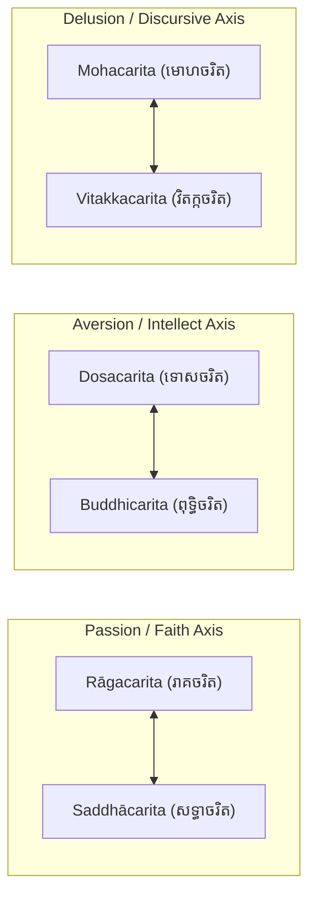
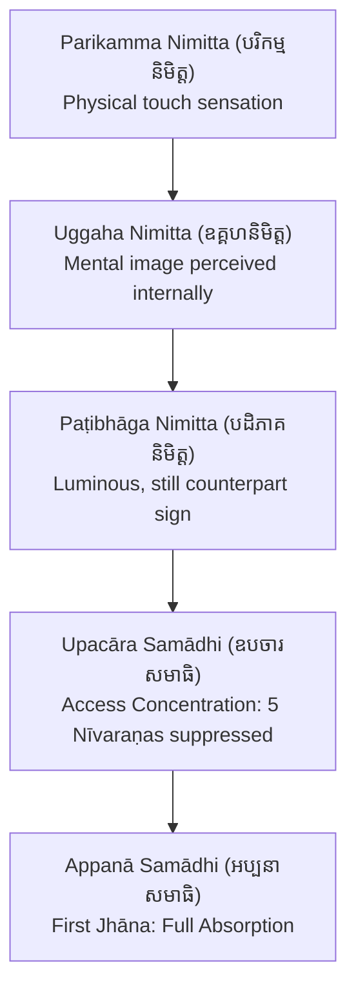

# Deep Study: Visuddhimagga Samādhi Niddesa (វិសុទ្ធិមគ្គ សមាធិនិទ្ទេស)
## Analysis from the Khmer Tipiṭaka & Aṭṭhakathā Project ([វិសុទ្ធិមគ្គ សមាធិនិទ្ទេស ភាគ ១ ដល់ ភាគ ៤](https://www.tripitaka82.com/)) & Blueprint for "Samādhi Daily Guide"

---

## Executive Overview

In the Theravāda tradition, the **Visuddhimagga** (*The Path of Purification*, វិសុទ្ធិមគ្គ) composed by **Bhadantācariya Buddhaghosa** (ព្រះពុទ្ធឃោសាចារ្យ) in the 5th century CE stands as the undisputed encyclopedic authority on Buddhist meditation. Within the 110-volume Khmer Tipiṭaka & Commentary digitization project (**Tripitaka-and-Athakatha**), the **Samādhi Niddesa** (សមាធិនិទ្ទេស — Description of Concentration) comprises four massive volumes:
- **[វិសុទ្ធិមគ្គ សមាធិនិទ្ទេស ភាគ ១](https://www.tripitaka82.com/read.html?book=v2)**: *Samādhi Niddesa I* (សមាធិនិទ្ទេស ១, pp. 1–430) — Samādhi definition, 10 Palibodha, Kalyāṇamitta, 6 Carita, 40 Kammaṭṭhāna taxonomy, Pathavī Kasiṇa, 3 Nimitta, 2 Samādhi, 7 Sappāya, 10 Appanā-kosalla, 1st–4th Jhāna, 5 Vasī, and Remaining 9 Kasiṇas.
- **[វិសុទ្ធិមគ្គ សមាធិនិទ្ទេស ភាគ ២](https://www.tripitaka82.com/read.html?book=v3)**: *Samādhi Niddesa II* (សមាធិនិទ្ទេស ២, pp. 1–437) — 10 Asubha, 6 Anussati (Buddha, Dhamma, Saṅgha, Sīla, Cāga, Devatā), Maraṇassati, and Kāyagatāsati (32 Kotthāsa).
- **[វិសុទ្ធិមគ្គ សមាធិនិទ្ទេស ភាគ ៣](https://www.tripitaka82.com/read.html?book=v4)**: *Samādhi Niddesa III* (សមាធិនិទ្ទេស ៣, pp. 1–407) — Ānāpānasati (16 bases, 8 stages: Gaṇanā to Paṭipassaddhi), Upasamānussati, 4 Brahmavihāra (Mettā, Karuṇā, Muditā, Upekkhā), and 4 Arūpajjhāna.
- **[វិសុទ្ធិមគ្គ សមាធិនិទ្ទេស ភាគ ៤](https://www.tripitaka82.com/read.html?book=v5)**: *Samādhi Niddesa IV* (សមាធិនិទ្ទេស ៤, pp. 1–484) — Āhārepaṭikūlasaññā, Catudhātuvavatthāna, Benefits of Samādhi, and the 5 Mundane Direct Knowledges (Lokiya Abhiññā 5).

This study bridges the exact **Khmer text**, **Pāḷi root formulations**, and **English scholarly translations** (by Bhikkhu Ñāṇamoli) into an actionable, progressive curriculum for a daily meditation guide web application.

```mermaid
flowchart TD
    A["Stage 1: Ādikammika (Beginner)<br/>អ្នកចាប់ផ្តើមដំបូង"] --> B["Stage 2: Yogāvacara (Intermediate)<br/>យោគាវចរមធ្យម"]
    B --> C["Stage 3: Jhānalābhī (Advanced)<br/>ឈានលាភី"]
    C --> D["Stage 4: Vasīpatta (Mastery/Expert)<br/>បរមយោគី / អ្នកស្ទាត់ជំនាញ"]

    subgraph "Stage 1 Foundations"
        A1["Purify Sīla & Cut 10 Palibodha (កាត់បលិពោធ ១០)"]
        A2["Diagnose Carita 6 (វិនិច្ឆ័យចរិត ៦)"]
        A3["Caturārakkha / Sabbatthaka (សព្វត្ថកកម្មដ្ឋាន)"]
        A4["Ānāpānasati: Gaṇanā Counting (វិធីរាប់ ៥-១០)"]
        A1 --> A2 --> A3 --> A4
    end

    subgraph "Stage 2 Deepening"
        B1["Anubandhanā & Phusanā (តាមដាន & ផុសនាត្រង់ចុងច្រមុះ)"]
        B2["Overcome 5 Nīvaraṇa (កម្ចាត់នីវរណៈ ៥)"]
        B3["Recognize Parikamma & Uggaha Nimitta"]
        B4["Apply 10 Appanā-kosalla & Attain Upacāra"]
        B1 --> B2 --> B3 --> B4
    end

    subgraph "Stage 3 Absorption"
        C1["Paṭibhāga Nimitta Stabilization"]
        C2["First Jhāna: 5 Factors (វិតក្ក វិចារ បីតិ សុខ ឯកគ្គតា)"]
        C3["Master 5 Vasī (វសី ៥: រំពឹង ចូល តាំងនៅ ចេញ ពិចារណា)"]
        C4["Ascend 2nd, 3rd, 4th Jhāna (លះអង្គគ្រោតគ្រាត)"]
        C1 --> C2 --> C3 --> C4
    end

    subgraph "Stage 4 Transcendence"
        D1["4 Arūpajjhāna (អរូបជ្ឈាន ៤)"]
        D2["Catudhātuvavatthāna & Āhārepaṭikūla"]
        D3["Bridge to Vipassanā (បញ្ញានិទ្ទេស: ខន្ធ អាយតនៈ ធាតុ)"]
        D1 --> D2 --> D3
    end

    A --> Stage 1 Foundations
    Stage 1 Foundations --> B
    B --> Stage 2 Deepening
    Stage 2 Deepening --> C
    C --> Stage 3 Absorption
    Stage 3 Absorption --> D
    D --> Stage 4 Transcendence
```

---

## Part I: Doctrinal Foundations (មូលដ្ឋានធម៌នៃសមាធិ)

### 1. Definition & Quadruple Analysis (លក្ខណាទិចតុកៈ)
In [វិសុទ្ធិមគ្គ សមាធិនិទ្ទេស ភាគ ១](https://www.tripitaka82.com/read.html?book=v2), Section 1 (*សមាធិដោយសរុប*, p. 3):
- **Canonical Definition**:
  > *Kusalacittekaggatā samādhi* (កុសលចិត្តេកគ្គតា សមាធិ) — Concentration is the one-pointedness of wholesome consciousness.
- **Etymological derivation**: *Sam-ā-dhā* — to put together well and evenly (*Samādhāna* / ការតាំងនៅដោយល្អ និងស្មើលើអារម្មណ៍តែមួយ).
- **The 4-fold Analytical Matrix (លក្ខណាទិចតុកៈ)**:
  1. **Lakkhaṇa (លក្ខណៈ - Characteristic)**: *Avisāra-lakkhaṇo* / *Avipphāra-lakkhaṇo* (ការមិនរាយមាយ មិនរសាត់អណ្តែត — non-distraction, non-wavering).
  2. **Rasa (រស - Function/Taste)**: *Vikhambhana-raso* (ការកម្ចាត់បង់នូវនីវរណៈ — subduing the hindrances) or *Sampinḍana-raso* (uniting conascent mental formations on one single object).
  3. **Paccupaṭṭhāna (បច្ចុប្បដ្ឋាន - Manifestation)**: *Samatha-paccupaṭṭhāno* or *Akampana-paccupaṭṭhāno* (ភាពស្ងប់រម្ងាប់ មិនកម្រើក — unshakeable peace and stillness).
  4. **Padaṭṭhāna (បទដ្ឋាន - Proximate Cause)**: *Sukha-padaṭṭhāno* (សេចក្តីសុខ — bodily and mental bliss), grounded in the Buddha's utterance: *"Sukhino cittaṃ samādhiyati"* (*ចិត្តរបស់អ្នកមានសេចក្តីសុខ រមែងតាំងនៅមាំ* — the mind of the happy one becomes concentrated).

---

## Part II: Preparatory Cleansing (បុព្វកិច្ច និងការកាត់បលិពោធ)

### 1. The 10 Palibodha (បលិពោធ ១០ — The 10 Impediments)
In [វិសុទ្ធិមគ្គ សមាធិនិទ្ទេស ភាគ ១](https://www.tripitaka82.com/read.html?book=v2), Section 12 (*បលិពោធ ១០*, pp. 39–54), Buddhaghosa emphasizes that meditation cannot bear fruit if the mind remains entangled in the 10 attachments. The daily guide must help practitioners sever these mentally and practically:

| # | Pāḷi Term | Khmer | Meaning in Modern Life | Visuddhimagga Remedy |
|---|-----------|-------|------------------------|----------------------|
| 1 | **Āvāsa** | អាវាស | Dwelling / Home / Room | Declutter living space, clean meditation corner, avoid dwelling projects. |
| 2 | **Kula** | ត្រកូល | Social circles / Supporters | Set boundaries with family & social commitments during practice hours. |
| 3 | **Lābha** | លាភ | Material gain / Income pursuits | Contentment with basic necessities (*Santuṭṭhī*); pause financial anxiety. |
| 4 | **Gaṇa** | គណៈ | Team / Group / Social media | Disconnect from group chats, meetings, and digital feeds. |
| 5 | **Kamma** | ការងារ | Tasks / Building / Projects | Complete urgent tasks beforehand; leave unstarted tasks aside. |
| 6 | **Addhāna** | អទ្ធាន | Travel / Trips | Avoid planning or undertaking journeys before meditation retreat. |
| 7 | **Ñāti** | ញាតិ | Relatives / Domestic duties | Ensure relatives are cared for, then entrust them to wholesome kamma. |
| 8 | **Ābādha** | អាពាធ | Illness / Physical ailments | Treat illness with proper medicine and simple healthy posture. |
| 9 | **Gantha** | គន្ថ | Scholarly study / Book reading | Suspend theoretical research, overthinking, and debates during practice. |
| 10 | **Iddhi** | ឫទ្ធិ | Psychic powers / Ego attachment | Guard against spiritual vanity and desire for mystical phenomena. |

---

## Part III: Diagnosis of the 6 Temperaments (ចរិយា និង ចរិត ៦)

In [វិសុទ្ធិមគ្គ សមាធិនិទ្ទេស ភាគ ១](https://www.tripitaka82.com/read.html?book=v2), Section 16 (*ចរិយា និង ចរិត ៦*, pp. 75–93), the Visuddhimagga lays out a master psychology based on 6 core temperaments. Every practitioner must be diagnosed to receive their matching **Pārihāriya-kammaṭṭhāna** (បារិហារិយកម្មដ្ឋាន).



### Behavioral Diagnostic Markers from the Khmer Text ([វិសុទ្ធិមគ្គ សមាធិនិទ្ទេស ភាគ ១](https://www.tripitaka82.com/read.html?book=v2))

1. **Walking & Posture (ឥរិយាបថ)**:
   - *Rāga*: Steps gracefully, deliberately, toes lifting evenly without dragging; footstep impression shows a clear arch hollow in the center.
   - *Dosa*: Walks abruptly, forcefully, heels digging deep, dragging toes, stamping feet.
   - *Moha*: Drags feet awkwardly, stumbling, uneven rhythm, footsteps flat and smudged.
   - *Saddhā, Buddhi, Vitakka*: Mirror Rāga, Dosa, and Moha respectively, but purified or refined by awareness.

2. **Work Habits (ការងារ)**:
   - *Rāga*: Artistic, neat, balanced, beautiful, but slow.
   - *Dosa*: Tense, rigid, explosive, irritable when objects are out of place.
   - *Moha*: Disorganized, clumsy, unfinished tasks, sloppy.
   - *Vitakka*: Constantly starting new things, scattered, jumping between projects.

3. **Food Habits (អាហារ)**:
   - *Rāga*: Craves sweet, refined, colorful, beautifully plated food; eats slowly savoring every bite.
   - *Dosa*: Craves pungent, spicy, sour, hot food; eats hurriedly without chewing properly.
   - *Moha*: No discerning taste; eats whatever is served carelessly, dropping food.

4. **Environment & Sleeping (ទីកន្លែង & ការដេក)**:
   - *Rāga*: Needs an austere, unadorned, simple dwelling to prevent vanity; awakens gently.
   - *Dosa*: Needs a spacious, breezy, cool, fragrant, serene dwelling to avoid irritation.
   - *Moha & Vitakka*: Needs an open, well-lit, non-cluttered space with clear sky or horizon to disperse mental fog.

---

## Part IV: The 40 Kammaṭṭhāna Allocation System (កម្មដ្ឋាន ៤០)

In [វិសុទ្ធិមគ្គ សមាធិនិទ្ទេស ភាគ ១](https://www.tripitaka82.com/read.html?book=v2), Section 19 (*កម្មដ្ឋាន ៤០ ដោយអាការ ១០*, pp. 115–132), the 40 meditation subjects are classified by their attainment capacity and temperament suitability:

```
+-------------------------------------------------------------------------------+
|                       THE 40 KAMMAṬṬHĀNA (កម្មដ្ឋាន ៤០)                        |
+------------------------------------+------------------------------------------+
| Subject Group                      | Attainment Potential                     |
+------------------------------------+------------------------------------------+
| 10 Kasiṇa (បឋវី, អាបោ, តេជោ, វាយោ,   | All can attain 4th/5th Rūpajjhāna        |
|  នីល, បីត, លោហិត, ឱទាត, អាលោក, អាកាស) | (បឋមជ្ឈាន ដល់ ចតុត្ថជ្ឈាន)               |
+------------------------------------+------------------------------------------+
| 10 Asubha (អសុភ ១០ — ឧទ្ធុមាតក, etc)| Can attain ONLY 1st Jhāna (បឋមជ្ឈាន)     |
+------------------------------------+------------------------------------------+
| 10 Anussati:                       |                                          |
|  - 6 Recollections (Buddha..Devatā)| Upacāra Samādhi ONLY (ត្រឹមឧបចារសមាធិ)   |
|  - Maraṇassati                     | Upacāra Samādhi ONLY                     |
|  - Upasamānussati                  | Upacāra Samādhi ONLY                     |
|  - Kāyagatāsati (32 Parts of Body) | 1st Jhāna ONLY (បឋមជ្ឈាន)                |
|  - Ānāpānasati (Mindfulness/Breath)| All 4 Rūpajjhānas (បឋម ដល់ ចតុត្ថជ្ឈាន)  |
+------------------------------------+------------------------------------------+
| 4 Brahmavihāra:                    |                                          |
|  - Mettā, Karuṇā, Muditā           | 1st to 3rd Jhāna (បឋម, ទុតិយ, តតិយជ្ឈាន) |
|  - Upekkhā                         | 4th Jhāna ONLY (ចតុត្ថជ្ឈាន)              |
+------------------------------------+------------------------------------------+
| 4 Arūpa (អាកាសា, វិញ្ញាណា, etc.)    | 4 Arūpajjhānas (អរូបជ្ឈាន ៤)             |
+------------------------------------+------------------------------------------+
| 1 Āhārepaṭikūlasaññā               | Upacāra Samādhi ONLY                     |
+------------------------------------+------------------------------------------+
| 1 Catudhātuvavatthāna              | Upacāra Samādhi ONLY                     |
+------------------------------------+------------------------------------------+
```

### Exact Temperament Matching (កម្មដ្ឋានសមគួរដល់ចរិត)

| Temperament | Suitable Kammaṭṭhāna | Why it Works |
|-------------|----------------------|--------------|
| **Rāgacarita** (Greed/Lust) | **10 Asubha** + **Kāyagatāsati (32 Parts)** | Cuts physical infatuation and sensory obsession by exposing bodily reality. |
| **Dosacarita** (Aversion/Anger) | **4 Brahmavihāra** (esp. Mettā) + **4 Color Kasiṇas** (Blue, Yellow, Red, White) | Soothes agitated mind with gentle coolness and harmonious pure colors. |
| **Mohacarita** (Delusion/Dullness) | **Ānāpānasati** (with counting) + Dhamma inquiry | Tightens focus, prevents mind wandering into fog and sleepiness. |
| **Vitakkacarita** (Overthinking) | **Ānāpānasati** (Mindfulness of Breathing) | Breath is the anchor that cuts the proliferation of endless conceptual thoughts. |
| **Saddhācarita** (Faith/Devotion) | **6 Anussati** (Buddhānussati, Dhammānussati, Saṅghānussati, etc.) | Channels pure faith into stable, joyful absorption without superstition. |
| **Buddhicarita** (Intellect/Wisdom) | **Maraṇassati**, **Upasamānussati**, **Catudhātuvavatthāna**, **Āhārepaṭikūla** | Engages analytical investigation without getting bogged down in imagery. |

---

## Part V: Daily Universal Practice (សព្វត្ថកកម្មដ្ឋាន / Caturārakkha)

In [វិសុទ្ធិមគ្គ សមាធិនិទ្ទេស ភាគ ១](https://www.tripitaka82.com/read.html?book=v2), Section 14 (*កម្មដ្ឋាន ២ យ៉ាង*, pp. 62–69), Buddhaghosa makes a crucial distinction:
1. **Sabbatthaka-kammaṭṭhāna (សព្វត្ថកកម្មដ្ឋាន)** — Universal, all-protective meditations that **every meditator MUST practice daily**, regardless of individual temperament.
2. **Pārihāriya-kammaṭṭhāna (បារិហារិយកម្មដ្ឋាន)** — The specific vehicle chosen to reach high Jhāna (e.g. Ānāpānasati or Pathavī Kasiṇa).

The Visuddhimagga identifies **Caturārakkha** (ចតុរារក្ខ — The 4 Guardian Meditations):
1. **Buddhānussati (ពុទ្ធានុស្សតិ)**: Inspires faith, drives out fear, purifies the heart with the Buddha’s virtues (*Arahaṃ, Sammāsambuddho...*).
2. **Mettā Bhāvanā (មេត្តាភាវនា)**: Removes ill-will and friction with coworkers, family, and sentient beings.
3. **Asubha Saññā (អសុភសញ្ញា)**: Subdues lustful attraction and sensory cravings.
4. **Maraṇassati (មរណស្សតិ)**: Slashes procrastination, awakens urgency (*Saṃvega*), reminding us that life is fleeting.

> **Daily Guide Golden Rule**: Start every daily sitting with 5 minutes of Caturārakkha (Buddhānussati & Mettā) before turning to the primary object (Ānāpānasati).

---

## Part VI: Master Guide to Ānāpānasati (អានាបានស្សតិ — [វិសុទ្ធិមគ្គ សមាធិនិទ្ទេស ភាគ ៣](https://www.tripitaka82.com/read.html?book=v4))

Ānāpānasati is the crown jewel of Buddhist meditation, practiced by all the Buddhas. [វិសុទ្ធិមគ្គ សមាធិនិទ្ទេស ភាគ ៣](https://www.tripitaka82.com/read.html?book=v4) (pp. 4–140) provides the exact 8-step methodology for practicing breath meditation:

```mermaid
sequenceDiagram
    participant M as Meditator
    participant N as Nose-Tip Touch Point (ផុសនស្ថាន)
    participant S as Sign (និមិត្ត)
    participant J as Absorption (ឈាន)

    M->>N: Step 1: Gaṇanā (គណនា) — Count 1 to 5..10 (Slow then Fast)
    M->>N: Step 2: Anubandhanā (អនុពន្ធនា) — Continuous uninterrupted awareness
    M->>N: Step 3: Phusanā (ផុសនា) — Fasten strictly at touch point; DO NOT follow into chest/belly
    Note over N: Breath turns subtle (សុខុម)
    N-->>S: Step 4: Ṭhapanā (ឋបនា) — Arising of Nimitta
    Note over S: Parikamma -> Uggaha -> Paṭibhāga Nimitta
    S->>J: Apply 10 Appanā-kosalla -> Enter 1st Jhāna (បឋមជ្ឈាន)
    J->>M: Cultivate 5 Masteries (វសី ៥) & Progress to 2nd, 3rd, 4th Jhāna
```

### 1. The 8 Stages of Ānāpānasati

1. **Gaṇanā (គណនា - Counting)**:
   - **Slow Counting (ដូចមនុស្សវាល់អង្ករ - Like a grain measurer)**: Inhale, exhale, count "1". Inhale, exhale, count "2"... up to minimum 5, maximum 10.
     - *Why not below 5?* Mind becomes cramped and agitated (*Sambādha*).
     - *Why not above 10?* Mind begins tracking numbers instead of watching breath (*Gaṇanānuvattī*).
   - **Fast Counting (ដូចគោបាល - Like a cowherd at the gate)**: Once breath flows evenly, switch to counting right at the touch point: In-1, Out-1; In-2, Out-2... rapidly pinning attention without letting thoughts slip in.
2. **Anubandhanā (អនុពន្ធនា - Following)**:
   - Keeping the mind continuously on the breath without breaks.
   - **CRITICAL WARNING FROM VISUDDHIMAGGA**: Do NOT follow the breath all the way inside to the throat, chest (*Hadaya*), or navel (*Nābhi*), nor follow it outside into the air. If you follow it inside, the body will feel heavy, bloated, and shaky. If you follow it outside, the mind scatters! Follow the breath **only as it passes the touch point**.
3. **Phusanā (ផុសនា - Contact)**:
   - Anchoring exclusively at the physical contact point:
     - The **tip of the nose** (*Nāsikagga*) for a person with a long nose.
     - The **upper lip** (*Uttaroṭṭha*) for a person with a short nose.
   - Like a carpenter sawing a log (*Rukkhachedeko viya*): The carpenter looks only at the teeth of the saw cutting the wood at one spot, not at the saw moving back and forth!
4. **Ṭhapanā (ឋបនា - Fixing/Absorption)**:
   - When the breath becomes ultra-subtle and the **Paṭibhāga Nimitta** (counterpart sign) appears, fix the mind firmly on that sign until entering **Upacāra** and **Appanā Samādhi**.
5. **Sallakkhaṇā (សលក្ខណា - Discerning Characteristics)**:
   - Investigating the three universal marks (*Anicca, Dukkha, Anattā*) of the breath and mental states.
6. **Vivaṭṭanā (វិវដ្តនា - Turning Away)**:
   - Disenchantment with worldly formations and defilements.
7. **Pārisuddhi (បារិសុទ្ធិ - Purification)**:
   - Cleansing of the mind through the Transcendent Paths (*Ariya-magga*).
8. **Paṭipassaddhi (បដិបស្សទ្ធិ - Tranquilization/Fruition)**:
   - The deep, unwavering peace of Fruition (*Phala-samāpatti*).

---

## Part VII: The 3 Nimittas and the Threshold to Jhāna

In [វិសុទ្ធិមគ្គ សមាធិនិទ្ទេស ភាគ ១](https://www.tripitaka82.com/read.html?book=v2), Section 31 (*ឧគ្គហនិមិត្ត និងបដិភាគនិមិត្ត*, pp. 191–193) & [វិសុទ្ធិមគ្គ សមាធិនិទ្ទេស ភាគ ៣](https://www.tripitaka82.com/read.html?book=v4) (pp. 89–95):

1. **Parikamma Nimitta (បរិកម្មនិមិត្ត - Preparatory Sign)**:
   - The raw physical sensation of breath touching the nostril/lip (warm, cool, soft, rough).
2. **Uggaha Nimitta (ឧគ្គហនិមិត្ត - Acquired Mental Image)**:
   - The internal mental replica of the sensation, perceived with closed eyes. It may feel unstable, moving, or fuzzy.
3. **Paṭibhāga Nimitta (បដិភាគនិមិត្ត - Counterpart Sign)**:
   - A completely pure, conceptual mental projection born of concentration. It is free from physical color or tactile form.
   - *How it appears differently to practitioners* ([វិសុទ្ធិមគ្គ សមាធិនិទ្ទេស ភាគ ៣](https://www.tripitaka82.com/read.html?book=v4), p. 89):
     - Like a tuft of cotton (*Kappāsa-picu*) or silk.
     - Like a radiant star (*Tārakā-rūpa*).
     - Like a cluster of pearls or a clear crystal mirror (*Ādāsa-maṇḍala*).
     - Like a gentle smoke plume or full moon rising behind clouds.



---

## Part VIII: The 10 Appanā-Kosalla (អប្បនាកោសល្យ ១០)

In [វិសុទ្ធិមគ្គ សមាធិនិទ្ទេស ភាគ ១](https://www.tripitaka82.com/read.html?book=v2), Section 36 (*អប្បនាកោសល្យ ១០ យ៉ាង*, pp. 202–224), Buddhaghosa reveals the 10 tactical skills required to elevate concentration from Access (*Upacāra*) to Absorption (*Appanā*):

1. **Vatthu-visada-kiriyatā (ធ្វើវត្ថុឲ្យស្អាត)**: Cleanliness of personal body (trimmed hair/nails, clean skin) and clean environment (swept floor, clean robe/clothing).
2. **Indriya-samatta-paṭipādanatā (ការសម្របឥន្ទ្រិយឲ្យស្មើគ្នា)**:
   - Balance **Saddhā** (Faith) with **Paññā** (Wisdom): Too much faith leads to blind devotion; too much intellectual inquiry leads to restlessness (*Uddhacca*).
   - Balance **Samādhi** (Concentration) with **Vīriya** (Energy): Too much energy leads to agitation; too much concentration leads to sluggishness (*Kosajja*).
   - **Sati** (Mindfulness) oversees and moderates all four faculties.
3. **Nimitta-kusalatā (ភាពឈ្លាសវៃក្នុងនិមិត្ត)**: Knowing how to protect, nurture, and sustain the meditation sign without grasping or forcing.
4. **Samaye cittassa paggaṇhana (ការលើកតម្កើងចិត្តកាលរួញរា)**: Gladdening and energizing the mind with Dhamma investigation (*Dhammavicaya*), energy (*Vīriya*), and joy (*Pīti*) when sluggish.
5. **Samaye cittassa niggaṇhana (ការសង្កត់ចិត្តកាលជ្រួលច្របល់)**: Calming the mind with tranquility (*Passaddhi*), concentration (*Samādhi*), and equanimity (*Upekkhā*) when restless.
6. **Samaye sampahaṃsana (ការធ្វើចិត្តឲ្យរីករាយ)**: Uplifting the mind by reflecting on the 8 grounds of spiritual urgency (*Saṃvega-vatthu 8*: birth, aging, sickness, death, 4 realms of misery).
7. **Samaye ajjhupekkhana (ការតាំងនៅជាកណ្តាល)**: Maintaining non-interfering equanimity when the practice is balanced and flowing effortlessly.
8. **Asamāhita-puggala-parivajjana (ការចៀសវាងបុគ្គលគ្មានសមាធិ)**: Avoiding hyperactive, gossiping, and scattered individuals.
9. **Samāhita-puggala-sevana (ការគប់រកបុគ្គលមានសមាធិ)**: Associating with serene, focused, disciplined practitioners.
10. **Tadadhimuttatā (ការបង្អោនចិត្តទៅរកឈាន)**: Continually inclining, slanting, and directing the heart toward Samādhi throughout daily life.

---

## Part IX: The 5 Jhāna Factors and the 5 Masteries (វសី ៥)

### 1. Abandoning the 5 Hindrances (នីវរណៈ ៥)
In [វិសុទ្ធិមគ្គ សមាធិនិទ្ទេស ភាគ ១](https://www.tripitaka82.com/read.html?book=v2), Section 38 (*បឋមជ្ឈាន*, pp. 254–282), the First Jhāna is attained when the 5 mental hindrances are replaced factor-by-factor with the 5 Jhāna factors:

| Hindrance Overcome (នីវរណៈ) | Jhāna Factor Born (អង្គឈាន) | Psychological Effect |
|-----------------------------|----------------------------|----------------------|
| **Kāmacchanda** (Sensory Desire) | **Ekaggatā** (ឯកគ្គតា — One-pointedness) | Unifies mind on wholesome object, burning away craving. |
| **Vyāpāda** (Ill-Will / Anger) | **Pīti** (បីតិ — Rapture / Exhilaration) | Infuses heart with wholesome delight, melting away hostility. |
| **Thīna-middha** (Sloth & Torpor) | **Vitakka** (វិតក្ក — Applied Thought) | Strikes the mind directly onto the object, destroying drowsiness. |
| **Uddhacca-kukkucca** (Restlessness & Worry)| **Sukha** (សុខ — Happiness / Bliss) | Settles mental turbulence into deep, serene contentment. |
| **Vicikicchā** (Skeptical Doubt) | **Vicāra** (វិចារ — Sustained Thought) | Keeps mind gently rubbing and anchored on the object, ending doubts. |

### 2. The 5 Vasī (វសី ៥ — The 5 Masteries of Jhāna)
In [វិសុទ្ធិមគ្គ សមាធិនិទ្ទេស ភាគ ១](https://www.tripitaka82.com/read.html?book=v2), Section 46 (*វសី ៥*, pp. 328–334), an advanced practitioner must master 5 specific controls before attempting to ascend to the Second Jhāna:
1. **Āvajjana-vasī (ការរំពឹង)**: Ability to advert to any Jhāna factor at will in an instant.
2. **Samāpajjana-vasī (ការចូល)**: Ability to enter Jhāna immediately, anytime, without struggle.
3. **Adhiṭṭhāna-vasī (ការតាំងនៅ)**: Ability to remain absorbed for the exact duration resolved beforehand (e.g. exactly 30 minutes, 1 hour, 3 hours).
4. **Vuṭṭhāna-vasī (ការចេញ)**: Ability to emerge cleanly and punctually at the resolved moment.
5. **Paccavekkhaṇa-vasī (ការពិចារណា)**: Ability to review the Jhāna factors immediately upon emerging.

---

## Part X: Architecture for the "Samādhi Daily Guide" Website

Based on the study of [វិសុទ្ធិមគ្គ សមាធិនិទ្ទេស ភាគ ១ ដល់ ភាគ ៤](https://www.tripitaka82.com/), here is the full blueprint for building the **Samādhi Daily Guide** website.

### 1. Core Principles
- **Methodological Purity**: 100% grounded in Visuddhimagga methods. No modern hybrid or syncretic theories.
- **Progressive Unfolding**: Beginners are not overwhelmed with high Jhāna theory; experts are given the full technical rigor of the 5 Vasī and Arūpajjhāna.
- **Authentic Pāḷi & Khmer Citations**: Every exercise links directly to the corresponding Book, Section, and Page in the `Tripitaka-and-Athakatha` project.
- **Trilingual Support**: Khmer (primary), English, and original Pāḷi terminology.

### 2. Practitioner Curriculum Architecture

```
LEVEL 1: ĀDIKAMMIKA (អ្នកចាប់ផ្តើមដំបូង — 0 to 30 Days)
├── 1. Daily Palibodha Severing (កាត់បលិពោធ ១០ មុនពេលអង្គុយ)
├── 2. Carita Quiz (ការវិនិច្ឆ័យចរិតទាំង ៦ ដោយសង្កេតឥរិយាបថ និងទម្លាប់)
├── 3. Daily 5-Minute Caturārakkha (ពុទ្ធានុស្សតិ និង មេត្តាភាវនា)
└── 4. Ānāpānasati: Gaṇanā Counting Tool (គណនាវិធី ៥ ដល់ ១០ រាប់យឺត និងរាប់លឿន)

LEVEL 2: YOGĀVACARA (យោគាវចរមធ្យម — 1 to 6 Months)
├── 1. Transition to Anubandhanā & Phusanā (លះវិធីរាប់ តម្កល់សតិនៅត្រង់កន្លែងប៉ះ)
├── 2. 5 Nīvaraṇa Diagnostic & Antidote Engine (វិនិច្ឆ័យនីវរណៈ និងឱសថកម្ចាត់)
├── 3. Nimitta Journal (ការកត់សម្គាល់បរិកម្ម ឧគ្គហ និងបដិភាគនិមិត្ត)
└── 4. 10 Appanā-kosalla Checklist (ការអនុវត្តឧបាយឈ្លាសវៃ ១០ ប្រការ)

LEVEL 3: JHĀNALĀBHĪ (ឈានលាភី — 6 to 18 Months)
├── 1. Attaining First Jhāna (ការសម្រេចបឋមជ្ឈាន ដោយអង្គ ៥)
├── 2. Training the 5 Vasī (ការហ្វឹកហាត់វសី ៥: រំពឹង ចូល តាំងនៅ ចេញ ពិចារណា)
├── 3. Ascending to 2nd, 3rd, and 4th Jhānas (ការលះអង្គឈានគ្រោតគ្រាតតាមលំដាប់)
└── 4. Alternative Primary Tracks (10 Kasiṇa, 10 Asubha, 4 Brahmavihāra)

LEVEL 4: VASĪPATTA & VIPASSANĀ PREP (បរមយោគី / អ្នកស្ទាត់ជំនាញ)
├── 1. 4 Arūpajjhāna (អាកាសា វិញ្ញាណា អាកិញ្ចញ្ញា នេវសញ្ញា)
├── 2. Somatic Purification (ចតុធាតុវវដ្ឋាន និង អាហារេបដិកូលសញ្ញា)
└── 3. Transition to Insight (សមាធិជាបាទនៃវិបស្សនា ឈានទៅកាន់បញ្ញានិទ្ទេស)
```

### 3. Key Interactive Web Tools
1. **Interactive Ānāpānasati Breathing & Counting Assistant (ឧបករណ៍ជំនួយគណនាវិធី)**:
   - Visual/audio breathing rhythm matching the Visuddhimagga counting guidelines (5 to 10 counts).
   - Switching between "Slow Counting" (*Rice Measurer*) and "Fast Counting" (*Cowherd*).
   - Touch-point visualization: Guides meditator to maintain focus strictly at the upper lip or nostril tip.
2. **Carita Diagnostic Engine (ប្រព័ន្ធវិនិច្ឆ័យចរិត ៦)**:
   - 12-question quiz based on the diagnostic markers in [វិសុទ្ធិមគ្គ សមាធិនិទ្ទេស ភាគ ១](https://www.tripitaka82.com/read.html?book=v2) (walking style, food preferences, work habits, sleeping patterns).
   - Outputs primary and secondary temperament, recommended primary meditation subject (*Pārihāriya*), and customized lifestyle adjustments (*Sappāya*).
3. **Session Meditation Timer & Bell**:
   - Gentle traditional bronze temple bell / singing bowl chime.
   - Presets for 15m, 30m, 45m, 60m with optional 5-minute pre-meditation Caturārakkha intro.
4. **Visuddhimagga Reference Drawer**:
   - In-app text viewer reading directly from the `Tripitaka-and-Athakatha` project data for [វិសុទ្ធិមគ្គ សមាធិនិទ្ទេស ភាគ ១ ដល់ ភាគ ៤](https://www.tripitaka82.com/), displaying Khmer, Pāḷi, and English translation snippets.
5. **Daily Practice Tracker & Nimitta Log**:
   - Local storage / offline-first tracker for daily streak, session length, temperament shifts, and nimitta stability ratings.
